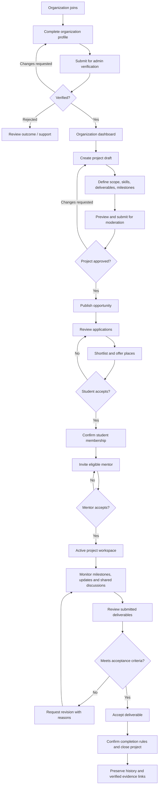

# ExperienceBridge — Organization Portal
## Product Journey, Architecture, Premium UI/UX & Agent Implementation Specification

**Status:** Proposed implementation specification — review against repository contracts before coding  
**Owner:** Marinus / Organization Portal & backend coordination  
**Working branch:** `dev/marinus` (local)  
**Target feature boundary:** `apps/web/features/organization/**`  
**Last updated:** 2026-10-29

> **Mission:** Help verified organizations turn real problems into structured opportunities, recruit willing students, collaborate with mentors, review deliverables, and close projects with credible evidence. The portal should feel like a premium, carefully crafted B2B SaaS product: quick, clear, responsive, accessible and genuinely interactive.

---

## 1. Mandatory scope and teammate ownership

Your AI coding agent **owns only Organization Portal frontend work**. Team responsibilities:

| Area | Responsibility | Agent access |
|---|---|---|
| `apps/web/features/organization/**` | Organization Portal | **Read/write** |
| `apps/web/app/(portals)/organization/**` | Next.js organization route entry points | **Read-only until explicit approval for a narrow route patch** |
| `apps/web/features/student/**` and Student routes | Stella | Read-only |
| `apps/web/features/mentor/**` and Mentor routes | Jathnie | Read-only |
| `apps/web/features/admin/**` and Admin routes | Annet | Read-only |
| `apps/api/**`, `packages/api-client/**` | Shared backend / API integration | Read-only during frontend tasks; separate assignment/approval for backend work |
| `apps/web/proxy.ts`, Clerk, root layouts, global CSS, shared app UI, Vercel config | Shared security and infrastructure | Read-only; propose a precise change and ask approval |
| `docs/**`, `AGENTS.md` | Shared governance/contracts | Read-only unless a separate approved documentation task |

- Do not alter, relocate, reformat or overwrite teammate code to make the organization UI fit.
- Do not create demo routes or duplicate other portals. Build the **actual Organization Portal** components.
- Follow repository `AGENTS.md` and the approved `docs/` PRD, architecture, API, UI/UX and roadmap. **Do not assume this file overrides existing approved contracts.** Report any conflict before schema/API/security work.
- Preserve existing organization components and exports where possible.
- Only work locally on `dev/marinus`. No autonomous branch creation, commits, pushes, merges, deployments or production changes.
- Protect unrelated uncommitted files. Every checkpoint ends with tests, review, and the user's explicit approval to continue.

## 2. Success criteria

A real, authorized organization should ultimately be able to:

1. Create an organization profile and request verification.
2. See a clear, actionable organization dashboard.
3. Create, save, preview, edit and submit a well-scoped project for review.
4. Publish approved opportunities for eligible students to discover.
5. Review applications and offer places to students; students must accept offers.
6. Invite eligible mentors; mentors must accept invitations.
7. See an active project workspace with team, milestones, progress and evidence.
8. Communicate in authorized project discussions.
9. Request revisions or accept deliverables against documented acceptance criteria.
10. Close the project while preserving records needed for student contribution evidence.

**Crucial separation:** An organization accepts **business deliverables**; a mentor evaluates **individual student skills and contributions**. An organization cannot fabricate or overwrite mentor assessments or Experience Passport verification.

## 3. End-to-end organization journey



### Journey-stage contract

| Stage | Actor action | System behavior | Essential UX state |
|---|---|---|---|
| Join | Sign up / create org context | Creates org record tied to eligible account | Guided setup; saved progress |
| Verify | Submit business details | Admin queues review, returns decision | Pending, approved, changes requested, rejected |
| Create | Draft project | Autosave or explicit Save Draft; validate | Draft badge and save confirmation |
| Review | Submit project | Admin moderation workflow | Locked/controlled editable fields and review history |
| Publish | Open opportunity | Students discover project | Public summary, dates, eligibility |
| Recruit | Review applicants | Authorized organization reviewers see limited applicant details | Search, filter, shortlist, offer, decline |
| Confirm | Student accepts offer | Membership created only on acceptance | Awaiting response, accepted, declined, expired |
| Mentor | Invite mentor | Eligible mentor receives invitation | Pending, accepted, declined, expired |
| Execute | Track and discuss work | Shared project read-model and milestones | Attention queue; timeline; notifications |
| Review | Assess deliverables | Versioned submission and review history | Under review, revisions requested, accepted |
| Close | Finalize project | Immutable closure/audit data | Closure confirmation and project archive |

**Exceptions:** Support withdrawn applications, canceled projects, suspended organizations, reassignment, overdue milestones and disputed outcomes with explicit reasons and permissions. Do not put exceptions on the happy-path UI unless needed.

## 4. Product information architecture

**Primary sidebar:** Dashboard · My Projects · Create Project · Applications · Reviews · Messages · Settings.  
**Contextual within project:** Overview · Team · Milestones · Updates · Deliverables · Discussion.  
**Top bar:** Organization switcher (if authorized), contextual search, notifications, help, account menu.

### Target routes (proposal; inspect current routes first)

| Screen | Proposed URL | Goal |
|---|---|---|
| ORG-01 Dashboard | `/organization/dashboard` | Attention and activity overview |
| ORG-02 Projects | `/organization/projects` | All projects and status filters |
| ORG-03 Create Project | `/organization/projects/new` | Guided project wizard |
| ORG-04 Project Detail | `/organization/projects/[projectId]` | Project requirements and activity |
| ORG-05 Applications | `/organization/applications` | Candidate review and decisions |
| ORG-06 Workspace | `/organization/projects/[projectId]/workspace` | Team collaboration and progress |
| ORG-07 Reviews | `/organization/reviews` | Deliverable acceptance decisions |
| ORG-08 Messages | `/organization/messages` | Project-scoped discussions |
| ORG-09 Settings | `/organization/settings` | Organization details, team and preferences |

**Routing ownership rule:** The agent may build navigable components and route-ready exports under `features/organization/`. Registering new Next.js routes under `app/(portals)/organization/**` requires a separate **specific** approval, even if the agent claims it is necessary.

## 5. Screen-by-screen premium design specification

### ORG-01 — Dashboard: command center
- Welcome header: org name, verified status, friendly context, prominent **Create Project** CTA.
- Four KPI tiles: Active Projects, New Applications, Pending Deliverable Reviews, Upcoming Deadlines.
- **Needs Your Attention** prioritized queue: unreviewed applicants, unanswered invitations, revisions needing approval, overdue milestones.
- Active-project cards with organization-approved title, status, milestone completion, team avatars, nearest deadline and **Open Workspace**.
- Recent activity timeline with direct links to relevant records.
- Every metric navigates to its filtered underlying list; no decorative nonfunctional cards.

### ORG-02 — My Projects
- Responsive grid/list view toggle; searchable/filterable projects: Draft, In Review, Published, Recruiting, Active, Completed, Closed.
- Each project card: title, concise problem, skills tags, deadline, applicant count, members, mentor indicator, status, next action.
- Draft cards support **Continue Editing**; active cards support **Open Workspace**; finished cards support **View History**.
- Helpful first-time empty state leading to Create Project.

### ORG-03 — Create Project: five-step wizard
1. **Problem:** project title, organization challenge, intended users, measurable outcome.
2. **Skills and Capacity:** skills, difficulty, student seats, hours per week, student eligibility.
3. **Deliverables:** tangible output, evidence requirements, measurable acceptance criteria, exclusions.
4. **Timeline:** expected start, duration, milestones, deadlines, desired mentor support.
5. **Review:** human-readable preview, completeness warnings, save draft, submit for moderation.

UI: elegant horizontal step indicator, persistent form draft, inline validation, previous/next controls, confirmation before abandoning unsaved data, keyboard-accessible controls, mobile stacked layout. Avoid giant forms, surprise resets, fake autosave and confusing errors.

### ORG-04 — Applications
- Pipeline tabs: New · Shortlisted · Offered · Accepted · Declined / Withdrawn.
- Applicant row/card: name, relevant skills, evidence excerpts, availability, application note, status, project applied for.
- Detail panel: application, qualifications, relevant work evidence, decision history; no extraneous personal data.
- Actions: Shortlist, Decline (with reason if needed), Offer Place; destructive decisions require confirmation.
- **Offer ≠ membership**: students join only upon accepting offer.

### ORG-05 — Project Detail and Workspace
- Sticky project title/status strip, contextual actions, key dates.
- Overview: problem, success criteria, deliverables, links, milestones.
- Team: accepted students, assigned mentor(s), invitations pending.
- Milestones: timeline/list with statuses and blockers.
- Updates: project-wide progress reports, evidence, recent changes.
- Deliverables: versioned student submissions and organization reviews.
- Discussion: authorized project-scoped messages and attachments (not private mentor–mentee messages).
- Enable team roles only as permitted by backend; organization cannot see private mentor feedback by default.

### ORG-06 — Mentor invitation within project
- Show available mentor expertise, availability/eligibility and prior work where permitted.
- Select candidate, review expected commitment, invite with optional context.
- Invitation state: Pending, Accepted, Declined, Expired. Provide alternatives after decline.
- Do not automatically grant access until accepted and approved assignment exists.

### ORG-07 — Deliverable Reviews
- Queue of submissions requiring organization action.
- Preview evidence, original acceptance criteria, submission versions, student notes and mentor observations explicitly designated as shareable.
- Two clear decisions: **Accept** or **Request Changes** with actionable reasons.
- Record reviewer, decision, timestamp, version and rationale; preserve the history.
- Do not equate organization acceptance with mentor skill verification.

### ORG-08 — Messages and Notifications
- Project-grouped conversation list, selected thread, read/unread state, message composer, reply timeline, optional attachments.
- Allow messages only within authorized project contexts.
- Notification links open their exact records; support unread filtering and sensible empty states.
- Start with asynchronous project discussions, not real-time chat complexity.

### ORG-09 — Organization Settings
- Organization profile and verification details, brand image/logo where supported, contact information, preferences.
- Organization team members and role management **only if approved backend contracts exist**; no self-granting privileged roles.
- Preserve unsaved changes prompts, field-level validation, and confirmation for irreversible actions.

## 6. Premium design system — non-negotiable

**Aesthetic:** exceptionally polished, credible enterprise SaaS; warm light neutral canvas (`#F6F7F9`), crisp white surfaces, deep navy/slate text, restrained deep teal accents. Fit the repository's existing design tokens first. Avoid gradients everywhere, neon/glassmorphism overload or noisy shadows.

| Element | Design expectation |
|---|---|
| Layout | Desktop 240–264px sidebar; generous whitespace; logical visual rhythm; compact but breathable content |
| Type | Geist or Inter if already available; refined weights; legible headings; 14–16px body; predictable hierarchy |
| Cards | 14–18px radius, hairline border, subtle shadow, consistent padding, polished hover elevation |
| Buttons | Solid primary, outlined secondary, quiet tertiary, reserved destructive; 40–44px target sizes where practical |
| Form fields | Clear labels, helper text, inline validation, strong accessible focus, polished select/date controls |
| Color | Design-system teal/navy/slate; semantic success/warning/error with text/icon, never color alone |
| Tables/lists | Dense but readable; responsive stacking; filters/sort/search; sticky headings where useful |
| Empty states | Custom icon/illustration, supportive explanation and a clear next action |
| Loading | Purposeful skeletons, button loading and progress states; no layout jumps |
| Feedback | Toasts for success; inline errors for validation; confirmation dialogs for consequential actions |
| Navigation | Active highlights; route-aware sidebar; mobile slide-out drawer; breadcrumbs on deep pages |
| Microinteractions | Short eased transitions, subtle pressed/hover states, contextual panels and animated progress |

### Animation and interaction quality bar
- Prefer `transform` and `opacity` for subtle animation; avoid heavy perpetual motion.
- Target approximately **120–220 ms** for standard microinteractions, and ~220–320 ms for drawer/overlay entry; adjust if existing conventions differ.
- Respect `prefers-reduced-motion`; do not animate crucial information out of reach.
- Buttons must respond to real actions. Filters actually filter; search actually searches; menus open; dialogs confirm/cancel; tabs switch; data updates after supported local action.
- Keyboard: Tab/Shift+Tab navigation; Escape closes dialogs/drawers; focus restored after modal close; visible focus styles.
- Accessible names, labels, contrast, logical headings, screen-reader announcements where appropriate.
- Responsive QA at mobile (~375px), tablet (~768px), laptop (~1280px) and larger desktop (~1440px). No horizontal overflow.
- Performance: avoid adding UI libraries or animation packages without approval; reuse native React/CSS and existing packages.

## 7. Component architecture and file structure

```text
apps/web/features/organization/
├── ORGANIZATION_PORTAL_SPEC.md
├── README.md
├── components/
│   ├── layout/            # Org sidebar, header, mobile drawer, page scaffolding
│   ├── ui/                # Org-scoped button, card, badge, dialog, tabs, form helpers
│   ├── projects/          # Project card, form wizard, timeline, status components
│   ├── applications/      # Applicant cards, status pipeline and review panels
│   ├── teams/             # Member lists, invitations, mentor cards
│   ├── reviews/           # Submission review and acceptance panels
│   └── messages/          # Project discussion primitives
├── screens/              # Dashboard, projects, applicants, workspace, settings
├── hooks/                # Org-scoped presentation hooks and local state
├── types/                # Frontend presentation types, distinct from API DTOs
├── data/                 # Clearly labeled synthetic fixtures for early UI work
├── lib/                  # Pure formatters, local selectors, validation helpers
└── tests/                # Feature unit, accessibility and interaction tests
```

- Components should be reused **within the organization feature**, and should not require modifying teammate packages.
- Keep data access behind a small feature-local adapter. Early tasks may use `syntheticOrganizationData` that is explicitly labeled and **never presented as verified activity**.
- Later real integration uses the shared generated API client, with an approved API contract task. Do not invent backend calls to make buttons appear functional.
- When routing is not yet authorized, provide feature-local navigable screen state and document exact route additions required; **do not secretly edit protected app route files**.

## 8. Shared backend domain architecture (design only during UI phase)

Use shared backend entities, not organization-only duplicate stores. Reconcile every proposed name against `docs/03-database-api.md`, SQLAlchemy models, Alembic history and generated DTOs before implementation.

| Logical domain | Proposed responsibilities |
|---|---|
| Organization + membership | Org verification, org-scoped roles, organization users |
| Projects + milestones | Scope, ownership, requirements, deadlines, deliverables |
| Applications + offers | Applicant decisions, consent and student assignment |
| Project membership | Confirmed student participation |
| Mentor invitations + assignments | Eligibility, acceptance, project access |
| Submissions + versions | Deliverables, evidence links, revisions |
| Organization reviews | Acceptance criteria, accept/revise decisions and audit |
| Project discussions | Authorized project-context messages |
| Notifications + audit | State-change events, provenance and traceability |
| Experience records | Links to actual contributions and independent assessments |

**Candidate API contract topics (not approved endpoints):** organization context/profile, projects/drafts/moderation, applications/offers, mentor invitations, project workspace/milestones, deliverable reviews, project discussions and closure. Match existing OpenAPI naming and versions before proposing routes.

### Permission boundaries
- Organization data is scoped by verified membership and organization ID; client-supplied org IDs never grant access.
- Only authorized organization members can create/edit/review project resources.
- Offer acceptance belongs to students; mentor invitation acceptance belongs to mentors; moderation belongs to admins.
- Audit each review/offer/invitation decision with actor, timestamp and context.
- Public frontend viewing during development **never** grants anonymous access to private organization data or mutation APIs. Continue enforcing authentication/authorization server-side.
- Never use fake/unauthenticated production sessions to drive real write APIs.

### Suggested state machines (confirm with approved architecture)

```text
Organization: Draft -> Pending Verification -> Verified | Changes Requested | Rejected
Project: Draft -> Pending Review -> Published/Recruiting -> Active -> Completed -> Closed
Application: Submitted -> Shortlisted -> Offered -> Accepted | Declined | Withdrawn
Mentor invitation: Pending -> Accepted | Declined | Expired
Submission review: Submitted -> Under Review -> Accepted | Changes Requested -> Resubmitted
```

## 9. Coding agent workflow: one checkpoint at a time

**Each task is independent, ends in a reviewable result, and must not spill into the next.**

| Task | Deliverable | Done when |
|---|---|---|
| **O00 — Audit** | Read-only inventory of existing organization feature, route files, design patterns, approved API contracts and Git status | Report only; no edits |
| **O01 — Foundation** | Premium organization sidebar, responsive header, theme-aligned components, shell and synthetic fixtures | Existing organization entry point still compiles; keyboard/mobile checks |
| **O02 — Dashboard** | Realistic KPI cards, priority queue, activity, project previews | Navigation and filters work with labeled synthetic data |
| **O03 — Projects** | Searchable/filterable project list, project detail presentation | All states/empty states and responsive cards work |
| **O04 — Create Project** | Five-step project wizard, field validation, draft state and preview | Input persists between steps; errors and exit confirmation work |
| **O05 — Applications** | Applicant pipeline, detail panel, shortlist/offer UI | UI state transitions and confirmations work without private APIs |
| **O06 — Team/Mentor Invites** | Assigned students, mentor invitation flow, invitation status | Offer vs accepted-membership distinction upheld |
| **O07 — Project Workspace** | Team, milestone timeline, updates, shared discussion and evidence surfaces | Accessible tabs, isolated project contexts and responsive layout |
| **O08 — Deliverables** | Review queue, version history, accept/request-revision forms | Decisions match acceptance rules; history represented |
| **O09 — Messages/Settings** | Project-scoped messages, notifications, organization profile/forms | Functional UI states, form validation, permission labels |
| **O10 — UX Polish** | Motion, skeletons, error/empty states, focus/contrast, mobile QA | Keyboard, reduced-motion and device QA pass |
| **O11 — Route Patch** | Proposal for minimal organization-only Next.js route registration | **Wait for explicit approval before edits outside feature folder** |
| **O12 — API Design** | Contract gap review with existing FastAPI/OpenAPI and other portal owners | No backend mutations; documented proposals and ownership agreement |
| **O13 — Backend Integration** | Separately approved backend APIs, migrations and real data adapter | Only after architecture/contract review and authorized scope |
| **O14 — Final Verification** | End-to-end tests, security checks, release readiness | Confirm real behavior; no invented passing claims |

### Every checkpoint report must contain
1. Task ID and one-paragraph outcome.
2. Exact files created/modified (confirm all in the approved scope).
3. Demonstrable working UI behavior and any limitations.
4. Tests actually run with pass/fail results.
5. Risks / decisions needing approval.
6. Suggested **conventional commit message** and precise manual staging/commit commands.
7. Stop and ask permission before the next checkpoint.

**Safe manual Git example** (adapt staging paths to task):

```bash
git status
git add apps/web/features/organization/
git diff --cached --check
git diff --cached --stat
git diff --cached
git commit -m "feat(organization): build portal UI foundation"
# git push origin dev/marinus  # only when the user explicitly decides to push
```

Never assume `git add .` is safe; it may stage unrelated team or secret files. Do not place tracked teammate folders in `.gitignore`.

## 10. Phase 1 build priorities and design acceptance

**First review milestone:** A gorgeous shell + dashboard + project list that looks coherent with ExperienceBridge branding.  
**Second:** A complete interactive create-project wizard and applications pipeline.  
**Third:** Project workspace, team invitations and deliverable reviews.  
**Fourth:** Communication, accessibility polish and authorized backend integration.

**The definition of premium is not just appearance:** fast navigation, no dead ends, accurate statuses, helpful forms, smooth but restrained animation, consistent controls, accessibility, responsive behavior and clear recovery from errors. No fake functional claims.

---

## 11. Agent startup instruction

Begin with **O00 — Read-only repository audit**. Inspect `AGENTS.md`, `docs/`, the current `dev/marinus` branch, existing `apps/web/features/organization/**`, organization route entry points and shared patterns. Report reuse opportunities, requirements conflicts and exact first task scope. **Do not edit files, start O01, or touch teammate areas without explicit instruction.**
