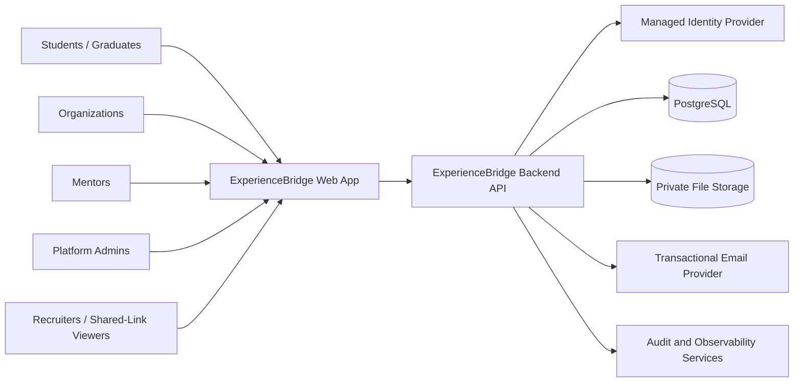
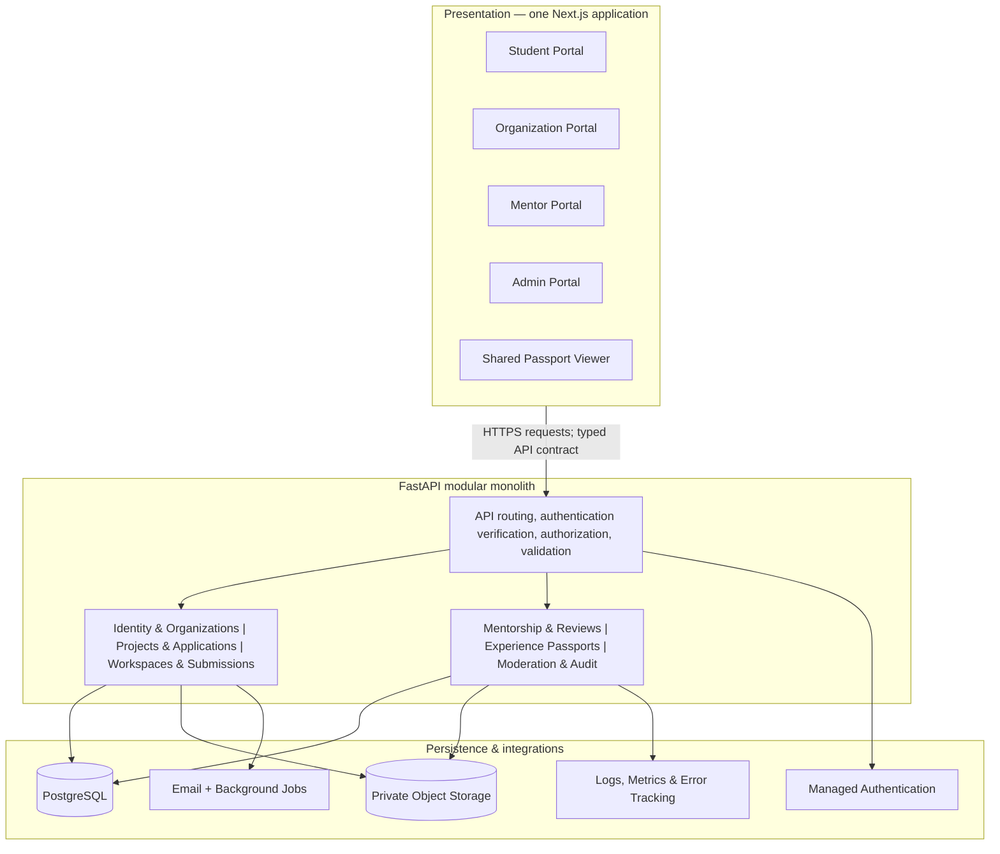
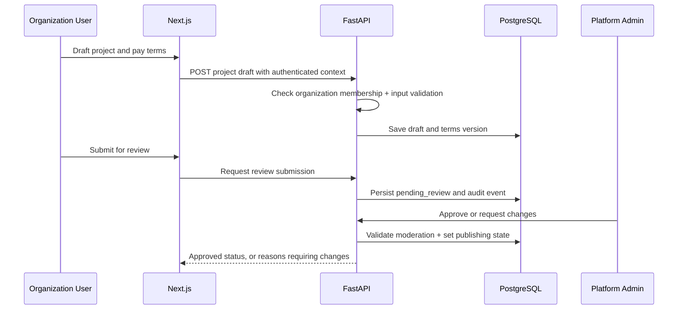
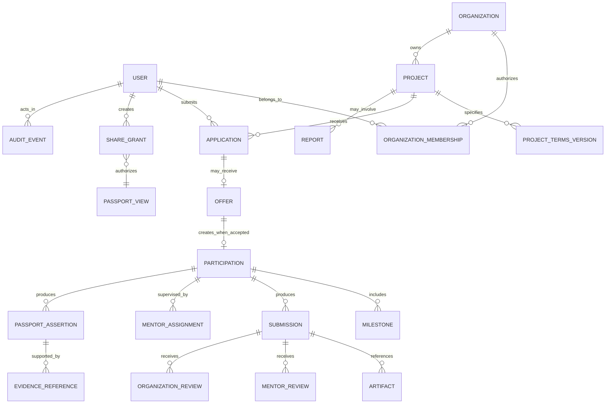
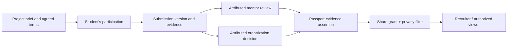
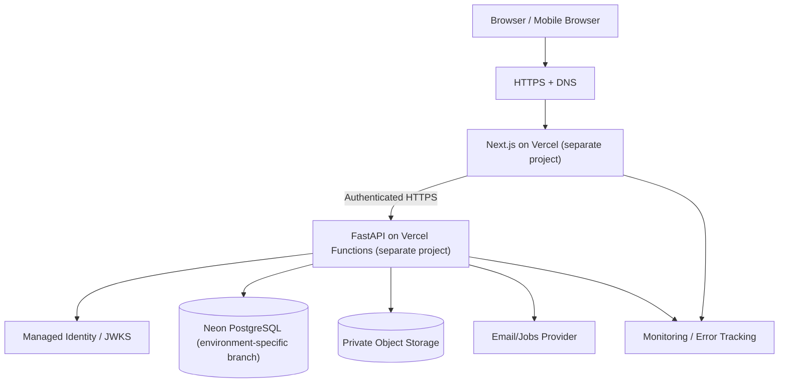
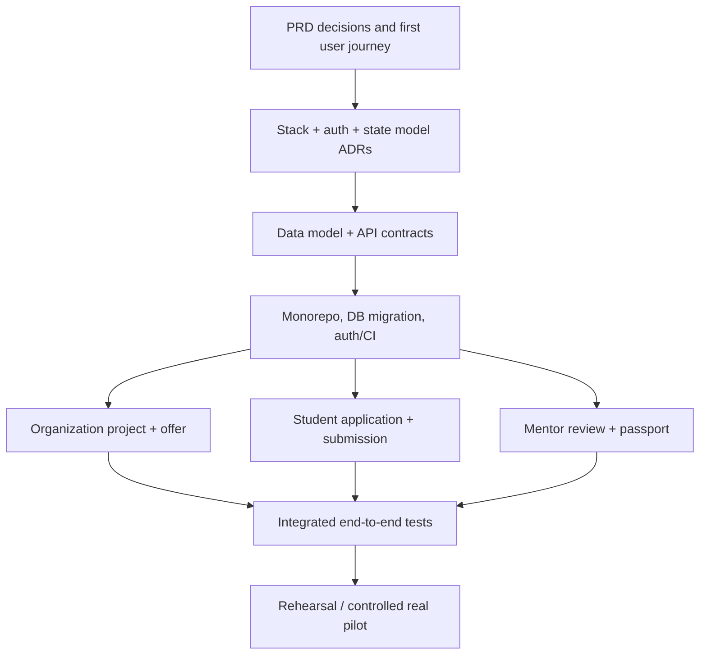

# ExperienceBridge — Software Architecture Document (SAD)

**Document ID:** EB-SAD-002  
**Version:** 0.2.0 — Coordinated architecture and release-policy update  
**Date:** 25 October 2026  
**Status:** **DRAFT — product contracts remain pending; deployment stack and Git workflow approved in ADR-001/009/011**  
**Owner:** JAMS Technical Lead (proposed)  
**Repository path:** `docs/02-system-architecture.md`  
**Depends on:** `docs/01-product-requirements.md` v0.2.0  
**Related:** `docs/03-database-api.md`, `docs/04-ui-ux.md`, `docs/05-development-roadmap.md`, `docs/06-engineering-standards.md`, `AGENTS.md`

> **Authority and decision convention**  
> **AGREED** = direction previously chosen by JAMS; **PROPOSED** = a design awaiting team approval; **VALIDATE** = assumption or issue needing external research, legal review, pilot evidence, or prototype measurement; **BLOCKED** = must be resolved before the dependent implementation or real-world operation.  
> The PRD is authoritative for *what the product must do*. This document defines *how we propose to implement it*. Executable OpenAPI schemas, database migrations and automated contract tests will become authoritative for approved implementation details only after reviewed alignment with the PRD. This document must not silently override the PRD.

> **Selected infrastructure baseline (25 Oct 2026; ADR-001/009/011):** Next.js and FastAPI are separately deployed to Vercel from the same monorepo; Neon PostgreSQL provides isolated staging and production database branches. Feature PR → protected `staging` → tested staging deploy → approved release PR → protected `main` → production deploy. This supersedes earlier *candidate provider* references in this draft. Identity, evidence storage, domain schema and compliance decisions are still pending.


> **Vercel operational boundary:** FastAPI runs as a Vercel Function, not a persistent server. Separate Vercel projects for Next.js and FastAPI; Git `staging` will deploy both projects to their staging/Preview environments against Neon staging; Git `main` will deploy the same two projects to their Production environments against Neon production. Backend `DATABASE_URL` never goes to Next.js. GitHub Actions deploys backend first, then frontend; database migrations require separate reviewed execution. Deployment runbooks will be prepared only after a separate authorization; remaining runtime/business decisions retain draft status.

---

> **Document-only update (25 October 2026).** This revision records the architecture and team workflow selected in the planning conversation. It does **not** mean a GitHub repository, Vercel project, Neon database, Codex integration, or CI/CD workflow has been configured or deployed. Do not treat proposed implementation details as approved product contracts. All six documents remain subject to review.

## Selected integration topology and release contract (25 October 2026)

The frontend and backend are **decoupled at their HTTP API boundary** and separately built/deployed, though maintained in one proposed monorepo. The backend remains a modular monolith. The frontend has no direct PostgreSQL credentials.

| Boundary | Staging | Production |
|---|---|---|
| Source ref | Protected `staging` branch after approved feature PR | Protected `main` after approved release PR |
| Web | Next.js Vercel project, staging/Preview deployment and stable test URL | Same frontend project, Production environment/live URL |
| API | FastAPI on a *separate* Vercel project, staging/Preview deployment and stable test API URL | FastAPI on that backend Vercel project, Production environment/API URL |
| Database | Isolated Neon staging branch with its own connection credentials | Isolated Neon production branch with restricted credentials |
| Secrets | Staging-scoped only | Production-scoped only; protected deployment access |
| Deployment | GitHub Actions on successful protected-branch merge; backend health checked before frontend smoke tests | GitHub Actions on approved `main` release; explicit environment/release gate |

**No duplicate deploy controllers:** Adopt *one* active deployment controller for each service/environment. The intended controller is GitHub Actions calling Vercel for approved commits; prevent Vercel Git auto-deployment from bypassing review or causing duplicate releases. The exact Vercel settings and deployment commands must be confirmed when infrastructure setup is separately authorized. Branch-specific Vercel Preview deployments may use aliases to give staging stable URLs. **No preview may access production secrets or Neon production.**

**CI and PR review boundary:** Feature push/PR → checks + Codex review request (advisory; supported integration and trigger must be verified) → independent human approval → merge into `staging` → automatic staging deploy + smoke tests → release PR into `main` → explicit final approval → production deploy + smoke tests. Never treat Codex comments or an AI review result as sufficient merge authorization. Do not trust PR-origin code with privileged production credentials.

**Vercel FastAPI constraints:** HTTP endpoints should be short-running and stateless; filesystem persistence is not a storage strategy; large deliverables require private object storage and controlled upload URLs; long-running jobs require a suitable external worker/queue after review. Manage SQLAlchemy connection pooling/concurrency for Neon's serverless connection behavior. Auth/cookie/CORS decisions remain open; choose them before shipping user authentication.

**Database deployment boundary:** Alembic migrations are generated and reviewed against approved contracts. Run staging migrations and integration tests on staging first; production requires an explicit migration review, backup/recovery readiness, and backward-compatible rollout. A `git merge` never migrates Neon automatically.

---

## 0. Executive decisions and current boundaries

**AGREED direction:** design a complete ExperienceBridge platform, collaborate with four developers using AI-assisted coding and mandatory human review, and implement a functioning end-to-end workflow before expanding modules. Both paid and unpaid models are supported **with explicit disclosures and safeguards**; the PRD recommends disallowing unpaid commercial production work.

**Selected architecture:** a **decoupled, separately deployed frontend and backend within a modular monorepo; backend remains a modular monolith** composed of one Next.js web application, one FastAPI backend application, one PostgreSQL database, private object storage, managed identity, and carefully bounded background processing. This is **not microservices**. Multiple portals are distinct user experiences within one web application, not five separate products.

**What is not proven:** organizations will supply enough projects; mentors will reliably participate; recruiters will value passports; the exact production rules for Ghanaian paid/unpaid participation; or that any one hosting/identity vendor is the final choice. Prototype screens and demo records are not real pilot outcomes.

**Major implementation gates:** `DEC-004/005/006/008/009/010/011/012` from the PRD; especially stack selection, project team participation, legal safeguards, IP/evidence rights, data protection and final state-machine rules. See §22. An owner cannot resolve one of these by having an AI agent guess.

### 0.1 Architectural goals

| Quality | Goal | How architecture supports it |
|---|---|---|
| Trust | Every claimed experience can be traced to real events and actors | Immutable-ish event history, versioned reviews, provenance references, explicit evidence labels |
| Safety and fairness | Enforce paid/unpaid disclosures and prevent unsafe projects | Admin moderation, bounded terms, report/hold flows, blocking states |
| Privacy | No accidental access to student evidence or confidential business work | Default-private objects, server-side authorization, expiring/revocable share grants |
| Development speed | Four AI-assisted developers can work without conflicting definitions | Domain ownership, OpenAPI-generated types, migration ownership, feature branches, CI |
| Maintainability | Clean boundaries for future changes | Modular monolith, documented contracts, no hidden cross-module table mutations |
| Operability | Team can debug and restore production | Structured logs, monitoring, backup/restore exercises, staging deployment |
| Responsible growth | Avoid unnecessary complexity while preserving a scale path | Managed hosting, background workers only when justified, measurable bottlenecks |

### 0.2 Out of scope for initial deployed slice

Real escrow or payment custody; general recruiter marketplace/search; AI-generated ratings masquerading as independent review; automated employer verification without documented checks; unrestricted file sharing; advanced recommendations; in-app video meetings; university-wide administration; multi-country tax/employment compliance. These require separate product and compliance decisions.

---

## 1. System context and actors

### 1.1 Actors

1. **Student / recent graduate** — own account, discovery, applications, accepted projects, evidence, passport and sharing controls.
2. **Organization owner** — organization profile, memberships, designated project managers/reviewers.
3. **Organization project manager** — drafts projects, manages applicants, milestones and project status within authorized organization scope.
4. **Organization reviewer** — accepts/rejects/request revisions of actual deliverables on assigned projects.
5. **Mentor** — accepts an assignment, observes work, comments and assesses competencies with a versioned rubric.
6. **Platform administrator** — moderates projects, handles reports, reviews restricted access with auditable authority.
7. **Recruiter / evidence viewer** — initially a permitted recipient of a public-safe or specifically shared passport view, **not** a privileged search user by default.

A **human account can hold multiple contextual roles**. Roles attached to a person do not grant access to every record in that role's category. Organization memberships, project assignments and individual evidence grants further restrict access.

### 1.2 Context diagram



**External provider boundaries:** the identity provider proves account authentication; it does not decide whether a user can review Project 123. The backend makes that resource-specific decision. The email service is not a source of truth. Storage access is never authorized solely by knowing a file URL.

---

## 2. Logical architecture

### 2.1 Layer diagram



### 2.2 Layer responsibilities

| Layer | Must do | Must not do |
|---|---|---|
| Next.js frontend | Render responsive UI; collect user input; show loading/errors; call authorized API; maintain navigation and UI state | Decide eligibility or permissions by itself; invent verification status; retain permanent private file URLs |
| API boundary | Validate auth tokens, input schemas, ownership/assignment and request limits; provide consistent errors | Trust role names from client input; bypass domain invariants |
| Domain modules | Apply business rules and lifecycle transitions; record approved actions and references | Depend on frontend components; write directly to unrelated module tables without explicit service interfaces |
| Database | Transactions, constraints, relationships, authoritative persistent facts | Store plaintext passwords; stand in for file storage; treat mutable display labels as evidence |
| Private object storage | Hold uploaded evidence with restricted access and controlled retrieval | Expose student or organization files through unbounded public bucket paths |
| Jobs / email | Deliver reminders, notifications and slower file-processing work | Become the sole record that a status changed; create duplicate domain effects on retry |
| Infrastructure | Secure and deploy services, backups, secrets, logs and alerts | Grant blanket production DB access to every developer or AI tool |

### 2.3 Why a modular monolith, not microservices? [PROPOSED]

- Four people can build, test, deploy and debug a smaller number of runtime components.
- A shared transaction is useful when accepting an offer and creating participation, or when approving work and generating a new passport assertion.
- Each domain still has an API/interface boundary, so a component *can* be separated later if actual usage or team structure justifies it.
- The architecture does **not** require Kubernetes, service meshes, event streaming or distributed transaction choreography for the pilot.

---

## 3. Technology decisions — proposal pending ADR approval

### 3.1 Selected stack (ADR-001 approved for foundation; application contracts still draft)

| Concern | Recommended candidate | Why | Trade-off / approval question |
|---|---|---|---|
| Web | Next.js + React + TypeScript | Shared frontend ecosystem, routing and good UI tooling | Extra complexity if its server functions duplicate FastAPI logic |
| UI | Tailwind CSS + shadcn/ui-style components | Reusable accessible components and consistent design | Requires design tokens and disciplined reuse |
| API | FastAPI + Python + Pydantic | Explicit typed Python business logic and OpenAPI generation | Two languages and deployments; stronger contract management needed |
| Persistence | PostgreSQL | Relational integrity and transactional workflows | Careful migrations and indexing required |
| ORM / migrations | SQLAlchemy 2.x + Alembic | Explicit persistence model and controlled change history | Migration conflicts require ownership/review |
| Authentication | Managed OIDC/OAuth provider (vendor TBD) | Avoid self-hosting credential infrastructure | Identity integration, token/session design and provider cost must be reviewed |
| Evidence | Private S3-compatible storage (vendor TBD) | Signed limited access, efficient file handling | Secure upload validation and malware response needed |
| Email | Transactional email service (vendor TBD) | Invite, review and status notifications | Delivery failures/retries and privacy |
| Hosting | Next.js on Vercel; FastAPI on a separate Vercel project; Neon PostgreSQL (isolated staging and production branches) | Straightforward managed operations | Cross-origin/session configuration and cost |
| CI | GitHub Actions | PR tests and deployment gates | Secrets, role permissions, paid minute quotas |
| Telemetry | Structured JSON logs + error tracking | Trace production failures | Must redact personal data and secrets |

**Decision:** JAMS selected the decoupled Next.js + FastAPI stack, documented in approved `docs/decisions/ADR-001-stack.md`. Next.js must not duplicate FastAPI domain or authorization logic. The identity vendor, session transport, domain schema, production auth model and external pilot policies remain unresolved and must not be inferred from this approval.

### 3.2 Authentication pattern [PROPOSED]

- Identity provider handles registration, authentication, password reset and stronger admin authentication.
- Next.js holds session material in secure `HttpOnly`, `Secure`, appropriately `SameSite` cookies or provider-supported equivalent; avoid localStorage as a long-term sensitive-token store.
- A server-side frontend/BFF layer may call FastAPI using user-scoped access tokens. FastAPI verifies signature, issuer, audience, expiry and the resolved subject using trusted provider configuration.
- FastAPI maps the identity `sub` to a local `users` record and checks active status **plus** resource-specific roles and assignments.
- Session transport, CSRF protections, refresh-token handling, CORS policy and OIDC redirect flows must be threat-modeled and tested after selecting the provider. Never accept a client-supplied `role=admin` as proof.

**No password or identity-provider secret is stored in the ExperienceBridge application database.** Local user profile data and membership information may be stored there.

---

## 4. Domain modules, responsibilities and boundaries

| Module | Owns | May call | Must not do |
|---|---|---|---|
| `identity` | Local user records, status, linked identity subjects | Provider adapter, audit | Implement homegrown password verification |
| `organizations` | Organization lifecycle, roles, membership, verification decision records | Identity, moderation | Certify project output quality merely from org verification |
| `projects` | Project briefs, compensation categories, terms versions, moderation publication decisions | Organizations, policy, audit | Publish invalid or unreviewed unpaid project |
| `applications` | Applications, offers, decisions, student acceptance of exact terms | Projects, identity, participation | Create an active participation from an unaccepted offer |
| `participations` | Student-to-project assignment, access scope, withdrawal and completion status | Applications, projects, mentorship | Mark work completed without completion conditions |
| `milestones` | Deliverable expectations, deadlines and approved changes | Participations, projects | Modify signed scope without change/consent record |
| `submissions` | Artifact metadata, attribution, revision history and upload state | Storage adapter, participation | Publish files to unauthorized users |
| `mentorship` | Mentor profile, eligibility, assignment acceptance, reviews and skill rubrics | Participations, submissions | Claim acceptance by an organization reviewer |
| `organization_reviews` | Authorized organization acceptance/revision/rejection | Submissions, org membership | Automatically certify all student skills |
| `passports` | Evidence claims, provenance links, share grants, revocations, public-safe projections | Reviews, participation, policy | Change source records or elevate claim verification status |
| `payments` | Contracted pay terms and **reported** external payment status | Terms, participation, disputes | Hold funds, promise payout or report independent payment confirmation without evidence |
| `moderation` | Reports, review queue, project holds, dispute decisions and restrictions | Other modules through approved commands | Delete audit events or rewrite third-party assessments silently |
| `notifications` | Message templates, dispatch status, delivery retries | Outbox events | Control authoritative business states |
| `audit` | Append-only audit event records, controlled investigations | All modules | Allow admin editing/deletion of important events via normal UI |

**Boundary rule:** an endpoint delegates to one owning domain service. Cross-domain changes use explicit service APIs and, when necessary, a single database transaction. Never let an AI agent directly modify other modules' models simply because it is quicker.

### 4.1 Organization/mentor separation

- Organization reviewer confirms whether agreed deliverables meet organization acceptance criteria.
- Mentor assesses observed competencies and provides guidance.
- Their records have separate authors, permissions, rubrics and timestamps, even if one human legitimately holds both roles.
- Organization identity verification is **a third independent dimension** and does not verify the student's skills or deliverable.

---

## 5. Primary end-to-end request and workflow sequences

### 5.1 New project posting



**Invariant:** a `draft` is not published merely because the organization selected a frontend dropdown. A real moderation decision is recorded by an authorized admin. For unpaid categories, the review checks are stricter (PRD `UP-*`).

### 5.2 Student participation, review and passport

```mermaid
sequenceDiagram
    participant S as Student
    participant A as Backend
    participant O as Organization
    participant M as Mentor
    participant D as PostgreSQL
    participant F as Private Storage
    S->>A: Submit application
    A->>D: Verify open project; persist application
    O->>A: Offer project participation
    A->>D: Save offer + exact terms version
    S->>A: Accept offer and terms
    A->>D: Create participation with scoped access
    S->>A: Request restricted evidence upload
    A-->>S: Short-lived upload authorization
    S->>F: Upload evidence privately
    S->>A: Finalize submission
    A->>D: Validate file + store evidence reference
    M->>A: Review evidence and observed competencies
    A->>D: Record separate mentor review
    O->>A: Accept deliverable or request revision
    A->>D: Record org decision; update participation
    A->>D: Create/version passport assertion with provenance
```

**Important:** upload finalization is conditional on file validation and approval. A submitted URL alone does not establish that a mentor has reviewed work. The passport remains a view over provenance-backed facts, not an independent certification authority.

### 5.3 Passport sharing and revocation

1. Student selects specific display fields and permitted evidence items.
2. Backend checks ownership, organization release permissions, confidentiality and active disputes/restrictions.
3. Backend creates an opaque, high-entropy share capability or authenticated access grant with scope and optional expiry; only a **hash** of share-secret is stored where applicable.
4. Viewer requests link; server checks grant status on **every access**, applies rate limits and serves an explicitly public-safe projection.
5. Private files are retrieved only after checking item-level permission and issuing a narrowly scoped, short-lived download authorization or proxy response.
6. Student revokes link; future server checks deny access. Previously downloaded or externally copied data cannot be retroactively recalled; this limitation must be communicated.
7. Caches for private content should use restrictive/no-store policies.

**Do not embed permanent private object-store URLs into a public passport page.** The backend does not infer permission from an unguessable URL alone without the intended grant checks.

---

## 6. Conceptual data architecture (schema finalized in Document 3)

### 6.1 Entity relationships



**Conceptual only:** final cardinalities and field types belong to `03-database-api.md`. For team projects, each project has multiple participations; each student's contributions, decisions and passport assertions remain individually attributable. `MILESTONE` may be project-defined and *assigned to* one or more participations; the exact schema depends on PRD `DEC-009`. The diagram is **not** license for an AI agent to invent a table without schema review.

### 6.2 Data ownership and rules

- All primary entities use stable server-generated IDs (UUIDs are a candidate); clients never choose another actor's user ID.
- All changes record `created_at`, `updated_at` as appropriate; consequential records carry actor ID and version/revision history.
- Use UTC for stored timestamps; show localized times in the UI. Duration/hours and money have explicit units.
- Monetary values use fixed-precision decimal or integer minor units with ISO currency codes; **never use binary floats** for compensation.
- The signed/accepted project terms reference an immutable `terms_version_id`. Changes require a new version and affected-party consent; do not overwrite a previously accepted contract snapshot.
- `organization_verified`, `mentor_reviewed`, `organization_accepted`, `payment_received` and `passport_shared` are **distinct facts**.
- Mentor review content is attributed to the mentor actor, rubric version and evidence observed; corrections append a superseding record/reason.
- Audits are append-only under normal application privileges. Stronger tamper resistance, dedicated audit stores and legal retention are later architectural decisions; **do not call records cryptographically immutable** without implementing guarantees.
- Soft deletion, anonymization and privacy-request handling require a retention policy that reconciles privacy rights, factual traceability and lawful obligations (PRD `DEC-006`).

### 6.3 Multi-tenancy boundary

This is a shared-database application with organization-scoped access, not one database per company.

Every organization-owned query must include both:
1. **Tenant boundary:** correct `organization_id` derived from requested resource and active membership.
2. **Resource/assignment boundary:** is this particular member authorized to perform this action on this project, submission or review?

A user selecting organization B in the frontend cannot grant themselves organization B membership. Any PostgreSQL row-level security, if adopted later, is defense in depth rather than a replacement for API-level authorization. Test cross-tenant access against every resource type.

---

## 7. Lifecycle and state machines [PROPOSED; require DEC-012 approval]

The PRD lists conceptual states. This section interprets them to avoid a single overloaded status field. Document 3 must formalize transitions.

### 7.1 Separate concepts rather than one mega-status

| Resource | Proposed dimensions | Why |
|---|---|---|
| Organization | Verification status; restriction status | A previously verified org may be restricted without erasing verification history |
| Project | Publication/moderation status; application-open flag; delivery state | Closed applications do not mean work is finished |
| Application | Review decision; offer and consent status | Offers expire independently of student application submission |
| Participation | Work status; final acceptance status; dispute/hold flag | Partial completion and disputes need truthful representation |
| Submission | Version number; validation status; mentor reviews; org decisions | A new revision must not erase earlier decisions |
| Compensation | Terms category; organization report; student acknowledgement; dispute | Platform does not independently settle or guarantee payments |
| Passport | Individual assertion provenance; sharing grants; correction/revocation | Avoid blanket `verified` label |

### 7.2 Example transition invariants

- `draft -> pending_review`: authorized org member; all required data present; classify compensation.
- `pending_review -> open`: authorized admin moderation approves current version; organization meets required verification policy; no prohibited work conditions.
- `open -> closed_to_applications`: capacity, closing date or authorized decision; existing valid offers remain governed by rules.
- `application submitted -> offer`: authorized org manager; capacity and applicant eligibility checked.
- `offer -> accepted participation`: authenticated student; exact current offer/terms accepted; offer not expired; single participation policy enforced transactionally.
- `submission -> organization_accepted`: org reviewer is assigned; submission is eligible; append decision to that submission version.
- `participation -> completed`: required deliverables accepted and configured review obligations satisfied. Completion **must not imply payment confirmed**.
- `claim -> organization_accepted`: requires explicit authorized acceptance event referencing the claim's supporting artifact/work, not just a student-uploaded link.
- `shared -> revoked`: any future use of that grant denied server-side; earlier external copies cannot be retracted.

Concurrency guards: database uniqueness constraints (e.g., active application rule), optimistic revision checks or transaction locks for offer/capacity race conditions, and idempotency keys where a client may retry the same mutation. Show state-specific errors to the caller (`409 conflict` for stale state is a possible policy).

### 7.3 Failure and remediation paths

| Event | Required behavior |
|---|---|
| Mentor unavailable | Hold review-dependent transitions; notify organizer/admin; reassign with consent and audit |
| Organization requests larger scope | Create new terms version; re-consent before changed work begins |
| Unpaid project unexpectedly delivers commercial production value | Pause and send to human review; resolve classification before continuation |
| Rejected work | Store reason and keep revision/history; don't manufacture successful passport status |
| Confidential upload shared accidentally | Revoke accessible grants, notify appropriate staff, incident triage, preserve controlled investigation record |
| Organization is restricted | Prevent new postings/offers; evaluate safe handling for active students and outstanding pay |
| Student withdraws | Record reason visibility appropriately; preserve legitimate compensation obligations and submitted facts |
| Mentor and org review conflict | Store both assertions; show separate statuses; escalate only where policy requires |
| Payment disputed | Show as disputed; no auto-claim that payment was made; escalate to human review |

---

## 8. Authorization model and threat boundaries

### 8.1 RBAC + relationships (not frontend role toggles)

Use **role-based access control plus relationship-based checks**. Each action evaluates:

```
authenticated actor
    + active account
    + scoped role (organization membership / assignment / student participation)
    + resource ownership and state
    + evidence sensitivity / sharing grant
    + any active restriction or conflict-of-interest policy
    -> permit OR deny, with auditable outcome where sensitive
```

Centralize permissions in a testable policy/service layer (`authorize(action, actor, resource)`) but require domain code to call it. A hidden button does not replace the server check.

### 8.2 Minimum permissions matrix

| Action | Student | Org Manager | Org Reviewer | Assigned Mentor | Admin | Share Viewer |
|---|---|---|---|---|---|---|
| Browse approved project | Eligible published content | Yes | Yes | Yes | Yes | Public only |
| Draft project | No | Own org | If also manager | No | Moderation only | No |
| Select student | No | Own assigned project | Only if separately authorized | No | Not by default | No |
| View private submission | Own participation | Authorized project only | Assigned project | Assigned participation only | Case-based authorized access | Only if separately granted |
| Grade observed competency | No | No | No | Assigned mentor only | Cannot forge mentor review | No |
| Accept organization deliverable | No | Only if reviewer role | Assigned project only | Only if separately assigned reviewer role | Cannot forge org review | No |
| Create/revoke passport share | Own passport | No | No | No | Exception process only | No |
| Moderate project | No | No | No | No | Authorized admin only | No |
| Edit historical audit event | No | No | No | No | No ordinary application role | No |

### 8.3 Threat model — minimum to design and test

1. **IDOR / BOLA:** student guesses another student's submission ID; must return denial rather than evidence.
2. **Tenant escape:** organization member changes `organization_id` in request; server checks actual membership and resource association.
3. **Privilege escalation:** client sends `role=admin` or `status=verified`; ignore/reject protected fields.
4. **Forged approvals:** student attempts mentor or organization review endpoint; independently check reviewer assignment.
5. **Upload abuse:** oversized files, HTML/script masquerading as evidence, malware, metadata leakage and credential-containing screenshots.
6. **Share-token leakage:** scraped or logged token, excessive access, revoked links; use strong tokens, hash storage, rate limits and secret redaction.
7. **PII leak through errors/logs/notifications:** redact confidential fields; don't email raw evidence to unintended people.
8. **Race/double-submit:** two students accept last slot or user double-clicks payment-status action; transactional rules and idempotency.
9. **Impersonation/social engineering:** claimed organization identity and mentor credentials; admin policy, human review and audit.
10. **AI-generated implementation mistakes:** unsafe raw SQL, permissive defaults, test bypasses; review, scanners, contract and negative authorization tests.

Apply secure headers, upload content restrictions, request size limits, timeouts, CORS and CSRF controls appropriate to final session architecture. Use managed secret storage and least-privilege service accounts. Administrative access should use MFA and should not be shared among developers.

---

## 9. File submission and evidence pipeline

**Private storage is a core dependency, not an afterthought.** Evidence files can contain personal data and unpublished organizational IP.

### 9.1 Proposed upload protocol

1. Student submits metadata: participation/milestone, filename, allowed type, stated size, intended evidence category.
2. API verifies student participation and submission state, allocates an `artifact_id` and a **private**, time-limited upload capability scoped to one object.
3. Browser uploads directly to private storage or via a size-limited API proxy.
4. Client notifies API upload completion; API checks object existence, metadata, content signatures/type allowlist, size/quota, malware status and ownership.
5. Until checks complete, keep artifact in `pending_validation` or quarantined state. Do not permit preview/download on a public share.
6. API marks artifact validated, links to a new submission version and writes audit record; unauthorized recipients cannot access it.
7. Deleting a submission from a UI must not implicitly destroy evidence involved in an active dispute; policy-driven retention and deletion apply.

### 9.2 Links and external artifacts

External URLs (e.g., GitHub, hosted demo) are **references**. Their content can change. Record URL, observation/verification time, scope of what reviewers actually inspected, and optionally a legally permissible snapshot/hash when available. Never claim an external link is permanent or independently verified merely because it was submitted.

### 9.3 Confidentiality and public projection

Store visibility independently for each evidence item: `private`, `assigned_project`, `shareable_with_consent`, or `public_safe` **proposed categories**. An organization may prohibit sharing code while allowing a sanitized project description. Students control their passport shares subject to legitimate confidentiality and IP restrictions. Redact personal contact details not intended for disclosure.

---

## 10. Compensation, project terms and IP boundary

**AGREED:** both paid and unpaid experiences should be supported with clear disclosure. **PROPOSED policy:** paid commercial work; unpaid only for specifically approved volunteer/educational scenarios, with prominent `Unpaid: GHS 0` disclosure and safeguards. **BLOCKED for real operations:** Ghana legal assessment of labor, recruiting, volunteering and taxation; final IP and contractual terms.

### 10.1 Terms must be versioned and accepted

Minimum agreed-terms snapshot fields: compensation category, currency, amount/rate/payment schedule or explicitly zero compensation, estimated hours, expenses/reimbursements, start/end, deliverables, acceptance criteria, confidentiality, IP/license, reviewer, mentor arrangement, dispute/cancellation rules, signatures/consent and document version.

- **Terms do not mutate after consent**; revisions create a new version and renewed consent where material.
- A student cannot begin active participation solely because an organization clicked “accept applicant.”
- No payment status grants a student skill-verification level.

### 10.2 No custody/payment guarantee in first release

An organization pays through a separately approved external arrangement. ExperienceBridge records terms, **organization-reported** payment, **student-confirmed receipt**, and dispute information separately. The platform does not hold funds or offer escrow in v1. Do not use a false `payment_success=true` flag to mean funds definitely moved.

### 10.3 IP and distribution of evidence

One cannot assume student owns the right to publish work after submitting it. A versioned project agreement must specify ownership/license and portfolio permissions. Recruiter views use only materials that have cleared both student permission and organizational confidentiality/IP review.

---

## 11. Experience Passport — provenance architecture

### 11.1 Central principle

**A passport is an evidence-backed projection over recorded activity, not an award generated by a student clicking Complete.** This is the platform's core trust mechanism; its quality is a hypothesis that must be tested with users and recruiters.

### 11.2 Assertion taxonomy [PROPOSED]

| Assertion type | Meaning | Minimum source |
|---|---|---|
| `self_reported` | Student claims a contribution or skill | Authenticated student statement |
| `platform_recorded` | Platform recorded a project action at a given time | Recorded application, participation, submission or workflow event |
| `mentor_reviewed` | Assigned mentor inspected cited evidence and made a documented assessment | Attributed mentor review + rubric version + evidence reference |
| `organization_accepted` | Authorized organization reviewer accepted a particular deliverable | Attributed org review tied to submission version |
| `organization_identity_checked` | Organization passed the platform's specific identity checks | Documented admin process with scope of checks |
| `disputed` / `corrected` / `revoked` | Assertion subsequently challenged, updated or invalidated | Attributed event and policy decision |

**Not allowed:** a generic green “Verified Experience” badge that implies broader checks than occurred; invented employer endorsements; fabricated recruiter responses; AI-generated mentor assessments submitted as human actions.

### 11.3 Provenance chain



Each assertion should store origin type, origin record ID, origin version, actor (where applicable), creation timestamp, current validity state and visibility policy. Project completion, mentor observation, organization acceptance, organization verification and receipt of payment are independent dimensions in UI and data.

### 11.4 Corrections and revocations

Preserve history of assessments and approval corrections instead of silently overwriting. Display disputed facts with appropriate qualifiers. Revocation of a *share grant* is different from invalidation of an *evidence claim*; they must use separate states and event types.

---

## 12. API architecture and contracts (Document 3 to specify endpoints)

### 12.1 API principles

- HTTPS only; URL versioning may begin with `/api/v1`.
- REST + JSON for core CRUD and workflow commands is sufficient; no GraphQL requirement.
- All mutation endpoints enforce actor authentication, resource permissions, state-transition guards and input validation.
- Use consistent field naming (propose `snake_case` API JSON for Python Pydantic **or** camelCase with explicit alias strategy; pick one before generating clients).
- Generate an OpenAPI schema from FastAPI and a TypeScript client/types as part of CI so frontend/backend cannot silently drift.
- Document standardized error envelope (`code`, `message`, `field_errors?`, `request_id`) and use appropriate HTTP codes without exposing private data.
- Pagination/filters for list endpoints, bounded request sizes and rate limits for sensitive routes.
- Use idempotency keys or database uniqueness constraints where duplicate mutations are harmful.
- Changes to published API require schema updates, contract tests and reviewer approval; avoid breaking consumers without coordination.

### 12.2 Illustrative resource groups — **not approved final endpoint list**

```text
/api/v1/me
/api/v1/organizations
/api/v1/organizations/{organization_id}/members
/api/v1/projects
/api/v1/projects/{project_id}/applications
/api/v1/applications/{application_id}/offer
/api/v1/offers/{offer_id}/accept
/api/v1/participations/{participation_id}/milestones
/api/v1/participations/{participation_id}/submissions
/api/v1/submissions/{submission_id}/mentor-reviews
/api/v1/submissions/{submission_id}/organization-reviews
/api/v1/passports/me
/api/v1/passport-shares
/api/v1/shared-passports/{share_token}
/api/v1/admin/project-reviews
/api/v1/reports
```

**No developer should treat this illustrative list as a freeze.** Document 3 will define exact paths, request/response types, query policies, ownership and error behavior. Domain state transitions should use named commands rather than a generic `PATCH status` that accepts arbitrary values.

### 12.3 Example contract with authorization

```yaml
# ILLUSTRATIVE — not final OpenAPI
command: accept_project_offer
actor: authenticated_student
preconditions:
  - actor.id == offer.student_id
  - offer.status == offered
  - offer.expires_at > now
  - offer.terms_version_id == consent.terms_version_id
  - project.capacity_not_exceeded
transactional_effects:
  - mark_offer_accepted
  - append_terms_consent
  - create_participation
  - append_audit_event
error_codes:
  - AUTH_REQUIRED
  - NOT_OWNER
  - OFFER_EXPIRED
  - TERMS_CHANGED
  - CAPACITY_EXCEEDED
  - INVALID_STATE
```

---

## 13. Notifications, events and background work

### 13.1 Events [PROPOSED]

`ProjectSubmittedForReview`, `ProjectPublished`, `ApplicationSubmitted`, `OfferIssued`, `TermsAccepted`, `SubmissionFinalized`, `MentorReviewRecorded`, `OrganizationDecisionRecorded`, `PassportShareRevoked`, `ProjectRestricted`, `ReportSubmitted`.

Events communicate already-committed actions; they are not a substitute for persisted source records.

### 13.2 Delivery design

- For transactional consistency, use a **database-backed outbox** pattern if reliable asynchronous delivery is needed: commit business change + outbox row in one transaction.
- A worker sends email/notification later and retries with backoff. Retries must be idempotent; no double-sending on unhandled crashes where provider supports deduplication or implement tolerable at-least-once behavior.
- In the first slice, nonessential reminders can be deferred. Do not block user application submission solely because email delivery fails.
- Never put private evidence or sensitive disputes directly into notification bodies; give users an authenticated link to the platform.

### 13.3 Background tasks vs dedicated queue

Start with simple controlled background processing or an outbox polling worker only for tasks that need it. Adopt a full queue/broker when measurement shows meaningful demand; do not add Redis/Celery solely because future scale is imagined.

---

## 14. Nonfunctional requirements and measurable release checks

The following **proposed initial engineering gates** refine PRD §9. They are not guarantees about untested performance.

| Dimension | Initial gate / test | Future target setting |
|---|---|---|
| Authorization | Automated negative tests for cross-user, cross-project, cross-org and unassigned-mentor access | Expand role/relationship matrix coverage |
| Data safety | No known critical/high-risk exploitable issues at release; private evidence tested end-to-end | Third-party review before broad onboarding |
| Reliability | Test a full project workflow across deploy/restart; backup and restore rehearsal before real-user production | Define recovery time/data loss objectives |
| Performance | Record server response times and page load on realistic Ghana mobile network conditions | Set p95 API/page budgets after a baseline |
| Accessibility | Keyboard and mobile use for key workflows; readable errors and compensation disclosure | Choose documented WCAG conformance target in UX spec |
| Operability | Request correlation ID in API logs and actionable error alerts | On-call responsibilities and incident response playbooks |
| Maintainability | CI lint/type/test/build + reviewed migrations + generated contract sync | Add property-based/concurrency tests |
| Privacy | Consent, disclosure limits, retention questions answered before real records | Formal privacy review and operational process |
| Cost | Inventory recurring vendor/service costs and free-tier limitations | Create monthly budget threshold alerts |

**Block release of real participant data** until there is a documented privacy basis, working permissions, private storage, appropriate terms, incident reporting and a verified backup/restore procedure. Pilot restrictions may require manual steps that must be honestly described.

---

## 15. Deployment architecture and environment separation



### 15.1 Environments [SELECTED TOPOLOGY — provisioning pending]

| Environment | Purpose | Data policy | Deployment |
|---|---|---|---|
| Local | Developer coding and tests | Synthetic fixtures only; no production credentials | Docker/local services as needed |
| CI/preview | Pull-request checks and visual review | Seeded demo-only records | Automatic and ephemeral where affordable |
| Staging | Team integration and rehearsal | Synthetic/sanitized records; limited pilot data only with approval | Protected pipeline |
| Production | Real authorized users after gates | Controlled personal/business data | Reviewed release, monitoring and backups |

Environment secrets must be separate. Preview builds must not inherit production admin keys, private buckets or unrestricted production database credentials. Deployments should be reversible using tested application rollback and migration compatibility; destructive database migrations require a planned, reviewed migration path.

### 15.2 Monorepo proposal

```text
experiencebridge/
├── apps/
│   ├── web/                     # Next.js application
│   └── api/                     # FastAPI application
│       ├── app/
│       │   ├── core/             # config, security integration, errors
│       │   ├── modules/          # identity, projects, ...
│       │   ├── db/               # session and migrations adapters
│       │   └── main.py
│       └── tests/
├── packages/
│   ├── ui/                      # reusable UI, if justified
│   └── contracts/               # generated OpenAPI TypeScript client
├── docs/
│   ├── 01-product-requirements.md
│   ├── 02-system-architecture.md
│   ├── 03-database-api.md
│   ├── 04-ui-ux.md
│   ├── 05-development-roadmap.md
│   ├── 06-engineering-standards.md
│   ├── decisions/
│   └── features/
├── infrastructure/             # container/deployment configuration
├── .github/workflows/           # CI gates
├── AGENTS.md
├── CONTRIBUTING.md
└── README.md
```

Do not allow multiple frontend and backend folders to each implement their own independent project status definitions. A generated contract package is the normal source of shared network types.

---

## 16. CI, code review and AI-assisted contribution controls

### 16.1 Pull request minimum pipeline [PROPOSED]

1. Check formatting, lint rules and TypeScript types.
2. Validate Python formatting/type guidance and import hygiene.
3. Run frontend unit/component tests and backend domain/API tests.
4. Start ephemeral PostgreSQL; apply migrations; run backend integration tests.
5. Generate OpenAPI types; fail build if generated contract changes have not been committed/reviewed.
6. Execute critical unauthorized-access and workflow-transition tests.
7. Scan dependencies and secrets; assess vulnerabilities based on severity and reachability.
8. Build both applications; deploy to preview/staging only after passing the appropriate gate.
9. Require a **different human reviewer** for sensitive or shared architecture changes before merge; no self-approval.

### 16.2 Agent rules to put in `AGENTS.md`

- Read PRD and relevant architecture, API, and UI sections plus the specific GitHub Issue before touching code.
- Do not invent states, permission policies, legal interpretations, database tables, compensation semantics or fake review events.
- Stay within the issue's paths/domain; propose a design change via ADR or issue comment first.
- Never disable authentication, authorization or tests to make a feature pass.
- Never insert mock organizations/mentor reviews into production as if real.
- Produce code, tests, migration impact, threat considerations, screenshots (if UI) and a concise human-readable summary.
- Ask for approval when touching shared schema, app-wide auth configuration, public passport disclosures or paid/unpaid safeguards.

The responsible developer must be able to explain any AI-written changes and must independently verify tests and observed behavior. AI output is a candidate implementation, not a trusted source of product requirements.

---

## 17. Four-developer integration and ownership plan

| Developer | Proposed primary ownership | Shared dependencies | Initial deliverables |
|---|---|---|---|
| **D1 — Technical Lead / Foundation** | CI, environments, auth integration, API scaffolding, shared policies, schema migration coordination, release reviews | Everyone depends on frozen contracts; D1 must not become sole implementer of every backend API | Monorepo, CI, auth checks, API/error conventions, baseline migrations, staging |
| **D2 — Student Journey** | Student pages and corresponding feature endpoints/tests via approved domain contracts | Project discovery shape from D3; terms/roles from D1; passport read view from D4 | Student onboarding, apply, accept terms, submit artifact, view status |
| **D3 — Organization Journey** | Organization pages and project/application/review workflow endpoints/tests | Org membership and auth from D1; submission version from D2; review semantics from D4 | Project draft/review/publish, applicant selection, final org acceptance |
| **D4 — Mentor / Passport / Basic Admin** | Assigned mentor workflow, assessment records, evidence projections, simple moderation UX | Auth from D1, participation from D2/D3, provenance contract from all | Mentor review, passport statuses, limited admin review/report interfaces |

**Balancing rule:** D4's full admin-plus-passport scope is too large for a short iteration. For BUILD, D1 takes platform-critical administrative scaffolding, D3 owns organization acceptance, and D4 focuses on mentor review and basic passport read model. Full disputes, audit explorer and recruiter tooling are follow-up phases.

### 17.1 Coordination/contract ownership

- **Shared schema/contract owners:** D1 coordinates; domain owner proposes; at least one affected developer reviews.
- **Cross-domain implementation:** affected developers agree on API/state changes *before* parallel PRs merge.
- **End-to-end test owner:** the developer implementing the final workflow step pairs with D1 or the affected portal owner.
- **Privacy and fairness policy:** product lead/mentor/legal reviewers, not a coding agent, approve.
- **Every issue:** primary owner, test criteria, dependency list, affected API models and planned demonstration.

### 17.2 Critical dependency chain



Do not postpone integration until the last day. Merge small vertical increments through staging. Stub unfinished external providers in local tests only, label demos clearly, and never claim test doubles represent employer validation.

---

## 18. Testing strategy

### 18.1 Test layers

| Layer | Examples | Minimum responsibility |
|---|---|---|
| Unit | compensation classification, state transition decisions, visibility policy | Domain developer |
| API contract | generated client matches OpenAPI, request validation/error envelope | API + frontend owners |
| Integration | migrations, database unique constraints, file authorization, outbox events | D1 + feature owner |
| End-to-end | organization -> application -> consent -> submission -> mentor -> org decision -> passport | All four owners |
| Security negative | cross-org, cross-user, forged role, revoked share, rejected project | D1 + affected owner |
| Accessibility | keyboard flow, labels, focus management, mobile layouts | Frontend owners |
| Recovery | backup/restore, deployment rollback, queue retry | D1 |
| Pilot acceptance | one actual organization/student/mentor can operate without hidden manual manipulation | Product/operations + engineers |

### 18.2 Required scenario suite for first vertical slice

1. Unauthenticated actor cannot create a project/application/review.
2. Unverified/restricted organization cannot publish under the defined policy.
3. Unpaid commercial project is blocked in moderation and cannot be worked around by API calls.
4. Student cannot apply to a draft or closed project.
5. Student cannot apply twice while an active application exists.
6. Offer cannot be accepted after expiry or terms change.
7. Org member from organization A cannot inspect organization B's applicants.
8. Student cannot download another student's private evidence.
9. Unassigned mentor cannot submit review for another participation.
10. Mentor review cannot silently become organization acceptance.
11. Rejected or incomplete work cannot produce an accepted-complete passport assertion.
12. Revoked/expired share link cannot expose private evidence.
13. Scope/compensation amendment retains old version and records renewed consent.
14. Audit history includes actor and time for approvals, claims, corrections and restrictions.
15. Failed email notification does not roll back a valid student application transaction.
16. Concurrent last-slot offer acceptance cannot exceed project capacity.
17. External payment status cannot be marked as independently confirmed solely on organization assertion.

Use repeatable seeded synthetic fixtures. No agent is authorized to bypass failing tests by deleting them without explicit human review.

---

## 19. Release plan: complete platform architecture, staged implementation

### 19.1 BUILD submission by 6 November 2026 [PROPOSED]

**Engineering focus:** one genuine end-to-end project lifecycle, not full production scope. Candidate sequence:

- **Oct 25–26:** finalize blocking architecture decisions, create docs/ADR/scaffold/CI, define contracts.
- **Oct 27–29:** parallel organization creation, student discovery/apply, mentor and admin screen baselines.
- **Oct 30–Nov 2:** integrate offers/terms, participation/milestones, submissions/reviews, passport provenance.
- **Nov 3–4:** run integration/negative authorization tests; controlled user trial where feasible; document factual observations.
- **Nov 5–6:** release freeze, fix critical defects, produce demo, backup documentation and submit.

**Risk:** these dates are a delivery hypothesis; 4 × 16 hours/week is nominal capacity and will shrink through meetings, troubleshooting and integration. If behind, preserve the end-to-end flow and remove optional polish/features. Do not loosen trust or authorization requirements to hit the deadline. Interview and pilot outreach must happen in parallel with coding.

### 19.2 Before real-user public availability [BLOCKED until passed]

- Legal and privacy readiness for onboarding/paid and unpaid project terms.
- Organization and mentor checks defined with honest labels.
- Private file storage and cross-tenant authorization tests.
- Sensitive report/abuse process and responsible contact.
- Operational backup/restore, logs and alert ownership.
- Consent, IP, retention, privacy notices and share revocation semantics.
- Explicit user testing on phones and constrained networks.

### 19.3 Later growth triggers

Introduce queue infrastructure, CDN optimization, dedicated search, caching, analytics warehouse, richer recruiter access, integrated payments or services separation **only when validated use and measured performance justify them**. Multiple UI portals do not themselves require multiple microservices.

---

## 20. Cost, operational and vendor risks

- **Two languages:** Next.js + FastAPI creates additional integration work; evaluate a TypeScript-only backend alternative before locking ADR-001.
- **Provider pricing:** free tiers can have rate/storage/compute limits; record actual vendor estimates before provisioning.
- **File costs:** evidence retention and downloads may dominate storage/egress; define file caps, lifecycle and deletion policy.
- **Email reliability:** delivery is best-effort unless explicitly managed; never substitute email for durable state.
- **Human moderation cost:** project and unpaid-work checks require staff effort; cannot be solved by AI alone.
- **Mentor scarcity:** not solved by architecture; workload limits and fallback operating model require user validation.
- **Recruiter trust:** passport provenance makes claims more inspectable; real recruiter confidence still needs testing.
- **Regulatory uncertainty:** no real compensation flow, employment agency operation, child onboarding or international expansion until relevant review.
- **Security debt:** AI-generated code may contain hidden authorization bypasses despite passing happy-path tests.

---

## 21. Architectural decision register and change procedure

Create `docs/decisions/ADR-NNN-*.md` with: Context; Options; Decision; Rationale; Security/privacy impacts; Rejected alternatives; Consequences; Owner; Status; Date; Links to affected PRD/API/UI/issues.

| ADR | Decision | Suggested owner | Gate |
|---|---|---|---|
| **ADR-001** | **SELECTED by product lead:** Next.js + FastAPI, decoupled Vercel projects | D1 + all four developers | **Before repository scaffold** |
| **ADR-002** | Managed identity provider and browser-to-API token/session pattern | D1 | Before authentication implementation |
| **ADR-003** | State-machine model and transition ownership | D1 + domain owners | Before API contract freeze |
| **ADR-004** | Solo vs team projects and individual contribution attribution | Product lead + D2/D3 | Before participation schema freeze |
| **ADR-005** | Evidence file/storage provider and upload validation | D1 + D2/D4 | Before evidence implementation |
| **ADR-006** | Passport disclosure/share-grant semantics | D4 + privacy/product owner | Before public links |
| **ADR-007** | Compensation, legal/IP/privacy approval gates | Product lead + qualified advisors | Before real project onboarding |
| **ADR-008** | Organization and mentor checks / conflicts of interest | Product/operations lead | Before badges or real reviews |
| **ADR-009** | **SELECTED by product lead:** Vercel for both apps; Neon staging/production isolation | D1 | Before production data |
| **ADR-010** | First-release error, audit and notification conventions | D1 + developers | Before domain API implementation |

**Change procedure:** create issue/ADR; identify impact to requirements, API schema, migrations, frontend, QA and legal; get affected owners' approval; update specifications and tests in the same change set; then implement. Agents must not change architecture through undocumented code generation.

---

## 22. Blockers, explicit assumptions and decisions for JAMS

### 22.1 Product decisions carried from PRD

| PRD decision | Current architecture stance | Status |
|---|---|---|
| DEC-004 Project limits | Limit initial projects; exact hours/duration decided with mentor/pilot organization | **VALIDATE** |
| DEC-005 IP/portfolio rights | Versioned terms and item-level publicity permission | **BLOCKED before signed project** |
| DEC-006 Data privacy | Data inventory, consent/notice, safeguards and legal review | **BLOCKED before real-data launch** |
| DEC-008 Mentor vetting | Assigned mentor status and recorded consent; checks not yet specified | **VALIDATE** |
| DEC-009 Solo/team support | Model per-student participations; team-work schema unresolved | **BLOCKED before final schema** |
| DEC-010 Passport sharing | Private by default; revocable grants; organization IP filtering | **BLOCKED before shared-passport launch** |
| DEC-011 Technology stack | Next.js/FastAPI/Postgres recommended; alternative evaluated | **BLOCKED before scaffold** |
| DEC-012 Status machines | Independent status dimensions and audited transitions | **BLOCKED before contracts** |

### 22.2 Minimal team decision meeting (suggested 60–90 minutes)

1. Confirm initial audience and that real money is **not** processed by platform in the first release.
2. Vote on ADR-001 stack based on actual developer capability, not familiarity of AI tools alone.
3. Decide whether initial projects allow teams; adopt solo-first if uncertain, but do not pretend team support exists.
4. Agree who may accept work, what mentor rubric means and which artifacts can appear on a public passport.
5. Approve preliminary state invariants and resource authorization matrix.
6. Assign domain owners; decide which parts of the BUILD slice will be deferred.
7. Create ADRs and GitHub Issues; only then let agents scaffold implementation.

**Recommendation:** architecture v0.1 can guide planning now. It is **not an instruction to begin production work with undefined legal/IP and verification rules.** Basic synthetic-data scaffolding can proceed after ADR-001 and core state/contract approval.

---

## 23. Review and approval checklist

- [ ] Every domain module has an identified human owner and reviewer.
- [ ] JAMS accepts the modular-monolith choice and approves a language/runtime stack via ADR-001.
- [ ] PRD P0 requirements map to modules and initial test cases.
- [ ] No role gains privilege through the UI alone; negative authorization paths are specified.
- [ ] Final project/offer/participation/submission states are agreed with DB/API authors.
- [ ] Mentor review, organization acceptance and organization identity verification are explicitly separate.
- [ ] Paid/unpaid safeguards and signed-terms versioning are enforceable, not mere UI labels.
- [ ] Artifact upload and private sharing threat model is reviewed.
- [ ] Passport assertions have provenance, correction and sharing rules.
- [ ] GitHub PR/CI pipeline tests both apps plus migrations and generated contracts.
- [ ] Real-data launch remains gated on legal, privacy, security and operational readiness.
- [ ] Architecture diagrams and owner/dependency tables match the actual issue backlog.

---

## 24. Traceability to Document 1

| PRD requirement area | Architecture sections |
|---|---|
| `AUTH-*`, `SEC-*` | §3.2, §8, §16, §18 |
| `ORG-*`, `PROJ-*`, `UP-*`, `PM-*` | §4, §5.1, §6, §7, §10 |
| `APP-*`, `WORK-*` | §4, §5.2, §6–7, §12 |
| `MENT-*`, `REVIEW-*` | §4–6, §8, §11 |
| `PASS-*`, `REC-*` | §5.3, §9, §11 |
| `PAY-*` | §6.2, §7, §10 |
| `ADMIN-*`, `SAFE-*`, `AUDIT-*` | §4, §7–8, §13, §18 |
| `PRIV-*`, `REL-*`, `OBS-*`, `QUAL-*`, `ACC-*` | §8–9, §14–16, §18 |
| `AIA-*`, `MATCH-*`, `ANAL-*` | §0.2, §16, §19 |

---

## 25. Next document and completion definition

**Next:** `docs/03-database-api.md` should specify actual relational tables and migrations, resource-specific permission matrix, state transition tables, normalized request/response schemas, detailed endpoints, standard errors, concurrency constraints and sample tests. It must flag `DEC-009`, `DEC-011`, `DEC-012` as unresolved until ratified.

**This SAD reaches v1.0 only when** the four developers formally approve ADR-001 through required gates, cross-check the PRD, choose provider integrations, complete the core threat model, and reconcile the diagrams with the executable API/schema contract.

**End of SAD v0.1 — proposed design, not production approval.**
