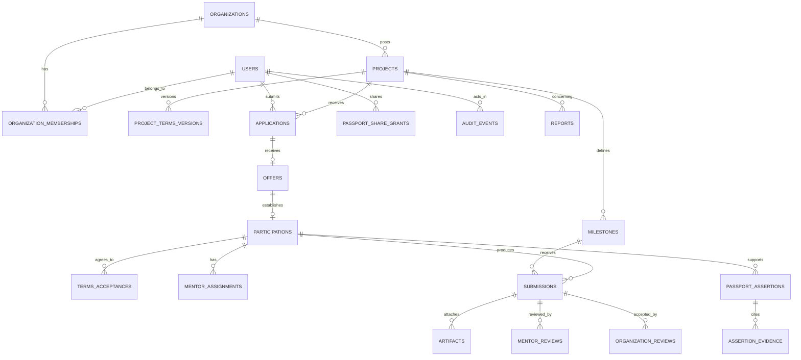

# ExperienceBridge — Database & API Specification

**Document ID:** EB-DAS-003  
**Version:** 0.2.0 — Coordinated architecture and release-policy update  
**Date:** 25 October 2026  
**Status:** **DRAFT — contracts and schema NOT implementation-approved**  
**Owner:** JAMS Technical Lead + four domain owners  
**Repository path:** `docs/03-database-api.md`  
**Source of truth:** `docs/01-product-requirements.md` v0.2.0 and `docs/02-system-architecture.md` v0.2.0  
**Next documents:** `docs/04-ui-ux.md`, `docs/05-development-roadmap.md`, `docs/06-engineering-standards.md`  
**Companion executable artifacts, to generate after review:** PostgreSQL/Alembic migrations; generated `openapi.json`; TypeScript API client; contract tests; seed fixtures.

> **Certainty labels:** **AGREED** = explicit product direction; **PROPOSED** = recommended system design requiring human approval; **VALIDATE** = requires pilots, legal/privacy review, or a pending architecture decision. This is a design contract for review; no tables, endpoints, pilot results, employment relationships, payment processing, or formal verification are represented as already implemented.

> **Selected infrastructure baseline:** FastAPI + PostgreSQL on Neon; separate Neon `staging` and `production` branches, and distinct API deployments on Vercel. This document's *proposed* DTOs, statuses, tables and 76 endpoints remain subject to sign-off. Proposed `/health` and `/ready` infrastructure routes are NOT part of that 76-operation product contract.


> **Operational data contract:** Neon is selected; database branches are distinct from Git branches and never automatically receive schema migrations on merge. SQLAlchemy/Alembic migrations will be reviewed under `apps/api/alembic/` once the product schema is approved. Runtime FastAPI reads secret `DATABASE_URL`; frontend reads public `NEXT_PUBLIC_API_BASE_URL` and must not receive database credentials. FastAPI `/openapi.json` is the basis of the generated TypeScript contract after schema approval. Bootstrap `/health` checks liveness; `/ready` checks DB connection; neither is a product endpoint. Use a direct Neon connection for explicit migrations and a vetted runtime pooling strategy.

---

> **Document-only update (25 October 2026).** This revision records the architecture and team workflow selected in the planning conversation. It does **not** mean a GitHub repository, Vercel project, Neon database, Codex integration, or CI/CD workflow has been configured or deployed. Do not treat proposed implementation details as approved product contracts. All six documents remain subject to review.

## Selected environment and API integration contract (25 October 2026)

**Selected providers:** FastAPI is the sole application business-logic API; it will be separately hosted on Vercel and connected to Neon PostgreSQL. The Next.js frontend is a separate Vercel project. The **same endpoint conventions and OpenAPI schema** apply in both environments, but staging and production use **different API origins and database credentials**.

| Concern | Contract for implementers |
|---|---|
| Browser API origin | `NEXT_PUBLIC_API_BASE_URL` contains the current environment's public API base URL only; it is not a secret. |
| Database credentials | `DATABASE_URL` and any direct-migration URL are FastAPI-side/deployment-side secrets. Never prefix these with `NEXT_PUBLIC_`. |
| Staging resources | Staging FastAPI deployment + isolated Neon staging branch; never connect shared staging app or preview code to production Neon. |
| Production resources | Production FastAPI deployment + separate protected Neon production branch. |
| Typed frontend client | Generate TypeScript types/client from the **reviewed** FastAPI OpenAPI schema; reject unapproved DTO duplication. |
| Authentication/authorization | Server-side identity verification and context-sensitive permissions on each endpoint; Clerk identity and browser/API token transport are specified by approved ADR-002. |
| Contract changes | Require schema review, regenerated client, compatible deployment order and targeted integration tests before merge. |
| Database schema | Reviewed Alembic migrations; Neon database branches do not track Git merges or receive migrations automatically. |

**API lifecycle:** PR checks against isolated CI data; protected `staging` branch invokes staging deployment and endpoint smoke tests; after approval, `main` invokes production deployment. The release pipeline must handle backend/frontend API compatibility and separately review production migrations. Do not allow feature PRs or untrusted automated reviews to access deployment secrets.

**No new product API approval is implied.** Endpoint inventory, DTOs, authentication provider, application constraints and status machines remain draft, including previously identified conflicts between a submission's status and independent mentor/organization review records. Infrastructure liveness/readiness endpoints are only proposed until implemented and tested.

---

## 0. Scope, engineering rules and outstanding decisions

### 0.1 Why this document exists

Four AI-assisted contributors must produce one interoperable system. This document defines **data meaning**, **resource boundaries**, **state transitions**, **API behavior**, **authorization conditions**, **errors**, **concurrency rules** and **test cases** so agents do not invent incompatible semantics. It translates PRD requirements into contracts, but actual machine-readable OpenAPI and database migrations become authoritative for implementation **only after contract approval**.

The selected deployment architecture is Next.js/TypeScript frontend plus separate FastAPI/Python modular backend, with Neon PostgreSQL. **ADR-001 approves the technical stack and ADR-002 approves Clerk identity/session verification; business models, DTOs, state transitions and production data permissions remain subject to their separate approval gates.** The backend will publish OpenAPI; frontend integrations consume an approved generated TypeScript client, not independently invented DTOs.

### 0.2 Non-negotiable product semantics [from agreed direction / PRD]

1. **A person's identity is not a role.** Contextual memberships/assignments determine authority; client-supplied role labels are never trusted.
2. **Organization verification, mentor assessment and organizational deliverable acceptance are independent claims.** One does not imply the others.
3. **Both paid and unpaid projects are supported in principle**, but unpaid commercial production is blocked under the **proposed initial** project policy. No unpaid onboarding until required legal/operational reviews are complete.
4. **Compensation is disclosed before application**, captured in immutable terms versions, and explicitly accepted before active participation.
5. **The platform initially does not hold or transfer funds.** External payment statuses are parties' assertions, not escrow or payment guarantees.
6. **Evidence is private by default.** Public or link-accessible disclosure requires grants and item-level publicity checks.
7. **No silently fabricated verification, reviews, accepted work, settlement or recruiter use.** Review records carry real actor IDs and evidence references.
8. **Audit consequential actions.** Corrections supersede source records; do not secretly rewrite their historical meaning.
9. **Low-risk 18+ pilot scope.** Do not ingest customer secrets, production credentials, health/financial records or other sensitive datasets by default.

### 0.3 Decision gates — BLOCKING before implementation or release

| Gate | Decision | Blocks | Status |
|---|---|---|---|
| ADR-001 / PRD DEC-011 | FastAPI backend selected (ADR-001) | No longer blocks runtime foundation; domain schema still gated | **APPROVED (stack only)** |
| ADR-002 | Identity provider and browser/API session model | Real authentication | **APPROVED — see ADR-002** |
| ADR-003 / PRD DEC-012 | Approval of lifecycle transitions below | State-changing API implementation | **OPEN** |
| ADR-004 / PRD DEC-009 | Solo-first vs team-based execution | Final participation/milestone assignment schema | **OPEN**; **recommend solo-first release** |
| PRD DEC-004 | Pilot bounds for duration and hours | Posting policy | **OPEN** |
| PRD DEC-005/006/010 | IP rights, retention/privacy, public sharing | Real-data or public-passport release | **OPEN** |
| PRD DEC-008 / ADR-008 | Mentor vetting, conflicts and assignment controls | Real mentor endorsements | **OPEN** |
| ADR-005 | Storage provider, scanning protocol | Real evidence upload | **OPEN** |
| ADR-007 | Legal classification, pay and volunteer policy | Real project onboarding | **OPEN** |

**Decision protocol:** Add/approve an Architecture Decision Record (ADR), update affected PRD/SAD sections, update this specification, implement tests, then generate code. Agents **must not resolve OPEN decisions by assumption**. API examples below describe proposed contracts, not approved production endpoints.

### 0.4 Release slices

- **P0 / first functional release:** identities, organization/project moderation, paid/unpaid disclosure, student application, offer/terms consent, assignment, project milestones, submission record, assigned mentor review, assigned org acceptance, provenance-aware private passport; safe admin and audit paths. **P0 is a priority class, not a promise that all P0 endpoints ship by the 6 November BUILD deadline.** See §6.8 for an intentionally smaller demonstration subset.
- **P1 / real public onboarding:** comprehensive verification, complete sharing/revocation, secure actual uploads, stronger reporting/payment acknowledgment, operational privacy and abuse processes, notifications.
- **P2 / validated expansion:** teams at scale, matching, payments integration, recruiter search, analytics, public discovery, university/program partnerships.

**Do not convert a P0 mock to “verified” merely to complete a demo.** Synthetic fixtures must remain labeled as such.

---

## 1. Shared naming and type conventions [PROPOSED]

| Convention | Contract |
|---|---|
| Public base path | `/api/v1` |
| JSON field names | `snake_case` consistently across requests and responses; generated TypeScript client may preserve these names |
| Tables/columns | lowercase `snake_case`, plural table names; migrations owned by the backend/domain reviewer |
| Identifiers | server-created UUID, represented as canonical UUID strings |
| Identity | external OIDC `issuer + subject` mapped to an internal `users.id`; never trust user IDs supplied by frontend for ownership |
| Time | `timestamptz` UTC in DB; ISO 8601/RFC 3339 UTC timestamps in API (`2026-10-25T13:30:00Z`) |
| Money | `numeric(14,2)` plus ISO 4217 currency (`GHS` initially); never floating-point. Rate units explicitly stated |
| Estimated work | integer minutes or decimal hours with explicit unit; cap/rounding policy TBD |
| String status | constrained TEXT + SQL CHECK or lookup (not PostgreSQL enums initially, to ease migrations) |
| Versioning | `row_version` integer for mutable aggregate roots, `version_no` for immutable documents/terms |
| Common columns | `id`, `created_at`; `updated_at` on mutable records; actor IDs on consequential transitions |
| Soft deletion | Only where supported by approved privacy/retention policy; no unreviewed hard delete of assessed work or audit |
| Nullability | Explicit in detailed schema; `NULL` means *unknown/not applicable*, never implicitly approved |
| List endpoints | `limit` default 20, max 100; opaque cursor; deterministic sorting `created_at DESC, id DESC` unless specified |
| Errors | Structured error envelope (§9); safe messages; include request correlation ID |
| Idempotency | `Idempotency-Key` for offer acceptance, posting publication, final submission, org review and share creation; same key+same payload returns prior result |
| Transaction boundaries | All state changes, consent, audit and outbox events commit atomically in one PostgreSQL transaction |

Suggested PostgreSQL naming: `pk_<table>`, `fk_<table>_<column>`, `uq_<table>_<columns>`, `ix_<table>_<columns>`, `ck_<table>_<rule>`; exact identifiers may be shortened under PostgreSQL's 63-byte constraint.

### 1.1 Identity versus app-user model

- Identity provider stores passwords and recovery/authentication information. ExperienceBridge does **not** store credentials.
- Backend verifies an access token/session and maps it to local `users.id`.
- A global `PLATFORM_ADMIN` grant and organization membership/mentor assignment are different authorization mechanisms. Roles must not be inferred from arbitrary editable profile flags.
- A student may be a mentor or an organization member in different contexts. Any dual-authority action identifies its actual actor and capacity.

### 1.2 API envelope conventions

**Success:** return a typed resource object, not a generic `{success:true}`. Commands that create resources return `201 Created` + `Location`; a no-body command may return `204 No Content`. List endpoints return `{ "items": [...], "next_cursor": string | null }`.

**Error:** `{ "error": {"code": "...", "message": "...", "field_errors": {...}?}, "request_id": "..." }`. Use HTTP `401` for unauthenticated, `403` for authenticated but unauthorized when disclosure is safe, `404` for inaccessible private resources to avoid enumeration, `409` for conflicts, `412` for stale `If-Match`, `422` for invalid submitted values, `429` for throttling, and `503` for temporarily unavailable providers. API consumers must inspect machine-readable `error.code`.

---

## 2. Conceptual relational design



**Scope note:** this diagram is a starting point, not a claim that all rows have already been implemented. Team submissions are deliberately excluded from the first-release schema until ADR-004 is resolved; see §5.7 for an extension path. A conceptual relationship may require additional composite foreign keys and checks to enforce matching project/organization IDs.

### 2.1 Aggregate boundaries

| Aggregate | Owns transactional consistency for | Responsible module |
|---|---|---|
| Identity | local user & identity mapping | `identity` |
| Organization | org, members, verification and moderation | `organizations` |
| Project | project, immutable terms, milestones, publication decisions | `projects` + `milestones` |
| Application | application, offer and terms consent at acceptance | `applications` |
| Participation | accepted assignment, mentor assignment, submission lifecycle | `participations`, `mentorship`, `submissions` |
| Review | independently authored mentor/org review decisions | `mentorship`, `organization_reviews` |
| Passport | derived assertions, evidence references, share grants | `passports` |
| Operational governance | reports, holds, audit and outbox | `moderation`, `audit`, `notifications` |

Cross-module operations use application services and one explicit transaction, not direct cross-module SQL mutations from arbitrary route handlers.

---

## 3. Detailed logical table catalog [PROPOSED]

**Legend:** `PK` primary key, `FK` foreign key, `UQ` unique, `NN` NOT NULL, `IMM` immutable once published/accepted. Assume `id uuid PK` + `created_at timestamptz NN` on all tables unless specified; mutable rows also have `updated_at timestamptz NN` and `row_version int NN DEFAULT 1` where concurrent updates matter. All `user_id` values are internal UUIDs and must resolve to `users.id`.

### 3.1 Identity and organization

**`users`**

| Field | Type / constraint | Meaning |
|---|---|---|
| `id` | `uuid PK` | Internal account ID |
| `identity_issuer` | `text NN` | Approved OIDC issuer |
| `identity_subject` | `text NN` | Provider subject; unique together with issuer |
| `display_name` | `varchar(160) NN` | User-provided display name |
| `email` | `citext` or normalized text, nullable | Contact, **not** an authority key |
| `email_verified_at` | `timestamptz` nullable | Trusted provider verification timestamp |
| `account_status` | `active | suspended | disabled` | Block access if not active |
| `created_at`, `updated_at`, `row_version` | standard | Temporal/concurrency |

- `UQ(identity_issuer, identity_subject)`. Email is **not** the primary identity key; a user may change it.
- Do not store password hashes, recovery codes or provider client secrets.

**`user_role_grants`**: `id`, `user_id FK`, `role` (`student`, `mentor_candidate`, `platform_admin`), `granted_by_user_id FK nullable`, `granted_at`, `revoked_at`, `reason`. `UQ` partial `(user_id, role) WHERE revoked_at IS NULL`. Global grants do **not** automatically confer resource access; `platform_admin` requires elevated administrative controls.

**`organizations`**: `id`, `legal_name varchar(255) NN`, `display_name varchar(160) NN`, `description text`, `contact_email`, `country_code char(2)` (`GH` initially), `website_url`, `verification_status` (`draft | submitted | under_review | changes_requested | verified | rejected | restricted`), `created_by_user_id FK`, `verified_at nullable`, `created_at`, `updated_at`, `row_version`.

- `verified_at` may be present only when a documented completed verification decision supports it. `restricted` does not erase prior verification history; public projection must reflect current restriction.
- Organization identity verification is **not** certification of payment reliability or project quality.

**`organization_memberships`**: `id`, `organization_id FK NN`, `user_id FK NN`, `role` (`owner | project_manager | reviewer`), `status` (`invited | active | suspended | removed`), `invited_by_user_id FK`, `accepted_at`, `ended_at`, timestamps. `UQ(organization_id, user_id, role) WHERE status IN ('invited','active')`. A user may hold multiple scoped roles, but must be explicitly assigned to a project to accept deliverables.

**`organization_verification_reviews`**: `id`, `organization_id FK`, `admin_user_id FK`, `decision` (`request_changes | verify | reject | restrict | restore`), `reason_code`, `private_notes`, `created_at`. IMM. No admin creates a `verify` decision without documented required checks (policy to be approved).

**`mentor_profiles`**: `id`, `user_id FK UQ`, `bio`, `skills jsonb` (initial bounded tags; skill taxonomy may become lookup table), `availability_text`, `capacity_limit int`, `eligibility_status` (`pending | approved | rejected | suspended`), `reviewed_by_user_id FK nullable`, `reviewed_at nullable`, timestamps. *Actual competency verification/vetting policy remains OPEN.*

### 3.2 Project listing and frozen terms

**`projects`**

| Field | Type / constraint | Meaning |
|---|---|---|
| `id` | UUID PK | Project ID |
| `organization_id` | FK NN | Tenant owner; immutable after creation |
| `created_by_user_id` | FK NN | Authorized creator |
| `project_manager_user_id` | FK NN | Current accountable manager/member |
| `org_reviewer_user_id` | FK NN | Authorized assigned deliverable reviewer |
| `title` | `varchar(180) NN` | Display title |
| `problem_statement` | `text NN` | Genuine work description |
| `scope_in`, `scope_out` | `text NN` | Explicit boundaries |
| `deliverables_spec` | `jsonb NN` validated | Required artifacts/results and acceptance criteria |
| `skills_required` | `jsonb NN` bounded array | Skills tags; do not claim verified |
| `estimated_minutes` | `int NN CHECK > 0` | Workload |
| `start_on`, `due_on` | dates nullable before publish | Expected timeframe |
| `capacity` | `int NN CHECK > 0` | Maximum selected participants |
| `visibility` | `public | limited` | Discovery policy |
| `risk_classification` | `low | restricted | prohibited` | Based on approved review |
| `status` | constrained state §5 | Lifecycle; never free-form patch |
| `published_terms_version_id` | FK nullable | Terms visible to applicants |
| `published_at`, `closed_at` | timestamps nullable | Timeline |
| `created_at`, `updated_at`, `row_version` | standard | Concurrency |

**Cross-field invariants:** project reviewer must have active organization `reviewer`/manager authority **and** be explicitly assigned; dates must be sensible; `open` requires approved organization, content moderation and an approved immutable terms version. If a project's reviewer leaves, block future acceptance until a qualified replacement is assigned.

**`project_terms_versions`**: `id`, `project_id FK NN`, `version_no int NN`, `compensation_type` (`paid_fixed | paid_time | sponsored_learning | volunteer_community | unpaid_commercial | unclassified`), `currency char(3)` (`GHS` for monetary terms), `fee_amount numeric(14,2) nullable`, `hourly_rate numeric(14,2) nullable`, `max_billable_minutes int nullable`, `expense_policy text NN`, `payer_description text`, `due_schedule jsonb`, `estimated_minutes int`, `learning_objectives text`, `mentor_plan text`, `ip_ownership_terms text`, `portfolio_rights_policy text`, `confidentiality_level` (`public_safe | restricted | confidential`), `work_location text`, `terms_text text NN`, `created_by_user_id FK`, `created_at`, `approved_at nullable`, `content_hash char(64) NN` (hash of normalized approved snapshot). `UQ(project_id, version_no)`; immutable after acceptance/publishing; amendment creates new version.

- Required `CHECK` logic at API + DB level: `paid_fixed` requires amount > 0 and currency; `paid_time` requires rate > 0, max hours and currency; volunteer requires **GHS 0** meaningfully (not `NULL`) and approved policy; `unpaid_commercial` and `unclassified` must never become publishable.
- `content_hash` supports integrity checks, **not** a digital signature or proof of independent third-party verification.
- Approved version must be fixed before posting. Material amendments create another version and re-review/affected-party consent. Older applications/acceptances continue referencing original versions for historical trace.

**`project_moderation_decisions`**: `id`, `project_id FK`, `terms_version_id FK`, `admin_user_id FK`, `decision` (`approve | request_changes | reject | suspend`), `policy_checks jsonb`, `reason_code`, `explanation text`, `created_at`, IMM.

**`milestones`**: `id`, `project_id FK NN`, `sequence_no int NN`, `title varchar(180) NN`, `description text NN`, `acceptance_criteria jsonb NN`, `due_at timestamptz`, `status` (`planned | active | archived`), `created_at`, `updated_at`, `row_version`. `UQ(project_id, sequence_no)`. For the P0 solo-first model these are defined once per project and shared as templates; **submission records separately identify individual contributions**. Material published milestone edits require new agreed terms or tracked approved change.

### 3.3 Applications, offers and consent

**`applications`**: `id`, `project_id FK NN`, `student_user_id FK NN`, `terms_version_id FK NN`, `motivation text`, `status` (`submitted | under_review | shortlisted | rejected | offered | withdrawn`), `created_at`, `updated_at`, `row_version`.

- **Initial recommendation:** `UQ(project_id, student_user_id)`. Reapplication after withdrawal/rejection is blocked in P0 and may be reconsidered in P1. This is stricter and clearer than partial “active application” uniqueness. Amend PRD APP-001 wording if ratified.
- Student can read only own application; assigned org managers can read applications for their project. No recruiter/other applicant access.
- `terms_version_id` captures the posting terms the student saw at application; offer may reference updated approved terms subject to renewed disclosure and consent.

**`offers`**: `id`, `application_id FK UQ`, `project_id FK NN`, `student_user_id FK NN`, `terms_version_id FK NN`, `status` (`offered | accepted | declined | expired | revoked`), `expires_at timestamptz NN`, `offered_by_user_id FK`, `created_at`, `updated_at`, `row_version`.

- DB/API service must validate `offers.application_id` resolves to identical project and student; terms belong to that project; org may not exceed project capacity.
- `offer` expires by explicit job/event or by `expires_at` predicate at acceptance; never treat a stale offer as valid because job has not run.

**`terms_acceptances`**: `id`, `participation_id FK nullable during atomic acceptance`, `offer_id FK NN`, `student_user_id FK NN`, `terms_version_id FK NN`, `accepted_at timestamptz NN`, `acceptance_method` (`web_confirmation`), `terms_hash char(64) NN`, `created_at`. IMM. `UQ(offer_id, student_user_id, terms_version_id)` for initial offer. Future re-consent records may require a separately modeled `project_term_change_acceptances` resource rather than overloading offer acceptance.

**`participations`**: `id`, `project_id FK`, `student_user_id FK`, `offer_id FK UQ`, `accepted_terms_version_id FK`, `status` (`pending_terms | active | under_review | completed | partially_completed | withdrawn | cancelled | disputed`), `started_at`, `completed_at`, `withdrawn_at`, `created_at`, `updated_at`, `row_version`. `UQ(project_id, student_user_id)` for P0. An active participation requires accepted offer and matching terms acceptance; cannot be created by client setting status.

**IMPORTANT CONSISTENCY:** Acceptance of a valid offer creates `terms_acceptances` and `participations` **in one transaction**. The `participation_id` FK on consent is set in that transaction; an offer never produces two participations. An accepted offer's `terms_version_id` is not silently replaced if project terms change later.

### 3.4 Mentor assignment, evidence and independent reviews

**`mentor_assignments`**: `id`, `participation_id FK`, `mentor_user_id FK`, `assigned_by_user_id FK`, `status` (`proposed | accepted | declined | ended | suspended`), `conflict_declared boolean`, `conflict_reviewed_by_user_id FK nullable`, `accepted_at`, `ended_at`, timestamps. At most one accepted active primary mentor per participation in P0: partial unique `(participation_id) WHERE status='accepted'`. Do not assume a listed mentor has agreed to serve.

**`submissions`**: `id`, `participation_id FK`, `milestone_id FK`, `submitted_by_user_id FK`, `revision_no int NN`, `summary text NN`, `status` (`draft | submitted | revision_requested | withdrawn`), `submitted_at nullable`, `supersedes_submission_id FK nullable`, `created_at`, `updated_at`, `row_version`. `UQ(participation_id, milestone_id, revision_no)`; submitted versions become immutable; a revision creates a new row referencing the prior version. Avoid embedding `mentor_reviewed` or `org_accepted` as mutable submission statuses: those are independent review records (see §5.5). Ensure milestone/project/participation relationship matches.

**`artifacts`**: `id`, `submission_id FK`, `kind` (`uploaded_file | external_url | text_excerpt`), `storage_key text nullable`, `external_url text nullable`, `name text NN`, `mime_type text`, `bytes bigint`, `sha256 char(64)`, `upload_state` (`pending | uploaded | scanned | rejected | quarantined`), `visibility_class` (`private | share_eligible | prohibited`), `ip_release_status` (`unreviewed | approved | denied`), `added_by_user_id FK`, `created_at`, `finalized_at nullable`.

- For `uploaded_file`, bucket/object key is internal; never return provider credentials or permanent public URLs.
- Before downloadable use, require completed upload and required scanning/safety policy. `external_url` must pass scheme/host validation, and links are **not automatically trustworthy**.
- Artifacts remain private unless separate sharing checks pass. `ip_release_status=approved` is not itself a passport-sharing grant.

**`mentor_reviews`**: `id`, `submission_id FK`, `mentor_assignment_id FK`, `mentor_user_id FK`, `rubric_version varchar(40) NN`, `decision` (`reviewed | revision_requested | unable_to_assess`), `observations jsonb`, `scores jsonb` (structured rubric criteria + basis), `private_feedback text`, `shareable_summary text nullable`, `created_at`, `supersedes_review_id FK nullable`, IMM. A correction appends a superseding review; explicit evidence references in `review_evidence_links` may be added for validated provenance.

**`organization_reviews`**: `id`, `submission_id FK`, `project_id FK`, `reviewer_user_id FK`, `decision` (`accepted | revisions_requested | rejected`), `criteria_results jsonb NN`, `explanation text NN`, `created_at`, `supersedes_review_id FK nullable`, IMM. Reviewer must be authorized for that project at action time; organization approval never implicitly grants skill certification. An org may accept deliverables even if mentor notes limitations; represent both accurately.

**`review_evidence_links`**: `id`, `review_type` (`mentor | organization`), `review_id uuid`, `artifact_id FK`, `reason text`, IMM. *For strict SQL referential integrity, prefer two concrete tables (`mentor_review_evidence`, `organization_review_evidence`) over a polymorphic `review_type` FK. The implementation must choose the concrete-table design unless ADR approves a safe alternative.*

### 3.5 Passport, publicity and revocation

**`passport_assertions`**: `id`, `participation_id FK`, `assertion_type` (`project_participation | skill_observation | deliverable_outcome | organization_identity_check`), `claim_text text NN`, `claim_status` (`self_reported | platform_recorded | mentor_reviewed | organization_accepted | disputed | corrected | revoked`), `source_type` (`participation | submission | mentor_review | organization_review | organization_verification`), `source_id uuid`, `issued_at`, `supersedes_assertion_id FK nullable`, `created_at`, IMM after publication. **Never let clients set verification level or point assertions to unrelated resources.** Prefer typed source link columns or join tables for enforceable foreign keys; see implementation gate §12.

**`assertion_evidence`**: `id`, `passport_assertion_id FK`, `artifact_id FK nullable`, `mentor_review_id FK nullable`, `organization_review_id FK nullable`, `note`, `created_at`; CHECK at least one reference. Validate all referenced evidence is within authorized participation or project. Visibility may differ from source record; public view projects only approved safe fields.

**`passport_share_grants`**: `id`, `student_user_id FK`, `token_hash char(64) NN UQ`, `scope jsonb NN` (allowlisted assertion IDs and allowlisted public-safe field IDs), `expires_at`, `revoked_at`, `created_at`, `last_accessed_at`, `view_count int`. Token should be generated with ≥256 bits of cryptographic randomness, returned **only once** in the creation response. Store only hash; omit from logs, analytics query strings and audit payloads. Sharing should use a privacy-reviewed URL approach (token in fragment/exchange if possible) to reduce leakage via referrers/history. Share grants are P1 until PRD DEC-010 is approved.

**`passport_corrections`**: `id`, `assertion_id FK`, `requested_by_user_id FK`, `reason_code`, `resolution` (`pending | amended | declined | revoked`), `resolved_by_user_id FK nullable`, `superseding_assertion_id FK nullable`, `created_at`, `resolved_at`. This is not permission for admin to author a fake third-party review; the underlying reviewer must correct their own review or an independent dispute decision must be distinguished.

### 3.6 Payment assertions, reports, audit and events

**`payment_assertions`**: `id`, `participation_id FK`, `terms_version_id FK`, `asserted_by_user_id FK`, `assertion` (`organization_reported_paid | student_confirmed_received | disputed | payment_due | payment_not_due | not_applicable_unpaid`), `amount numeric(14,2) nullable`, `currency char(3) nullable`, `reference_note text`, `created_at`, IMM. Current status is a derived projection from events under documented rules; no P0 integrated payment. `student_confirmed_received` is a student's report, **not independently audited proof**.

**`reports`**: `id`, `project_id FK nullable`, `participation_id FK nullable`, `reported_by_user_id FK`, `category` (`safety | unfair_work | nonpayment | harassment | confidentiality | fraud | other`), `severity` (`low | medium | high | urgent`), `details text`, `status` (`open | triaged | investigating | resolved | escalated`), `assigned_admin_user_id FK nullable`, `restricted_visibility boolean DEFAULT true`, timestamps. Reports are **never** included in a public passport by default.

**`moderation_actions`**: `id`, `admin_user_id FK`, `target_type` (`user | organization | project | mentor | participation | report`), `target_id uuid`, `action` (`hold | restrict | unrestrict | request_changes | reject | resolve | escalate`), `reason_code`, `details text`, `created_at`, IMM. Validate target exists and admin is entitled to execute action; for integrity, create typed target links or authoritative service validation.

**`audit_events`**: `id`, `occurred_at timestamptz NN`, `actor_user_id FK nullable`, `actor_capacity text`, `organization_id FK nullable`, `event_type text NN`, `entity_type text NN`, `entity_id uuid NN`, `request_id text`, `before_summary jsonb`, `after_summary jsonb`, `reason_code text`, `source_ip_hash text nullable`. Append-only from application perspective; restrict direct update/delete permissions. Avoid storing passwords, secrets, passport-share tokens, sensitive free-text or full confidential artifact contents. Strong tamper evidence is a later operational decision.

**`outbox_events`**: `id`, `aggregate_type`, `aggregate_id`, `event_type`, `payload jsonb` (minimized), `created_at`, `processed_at nullable`, `attempt_count int`, `last_error_code text`, `next_attempt_at`. Written in same transaction as business state changes; worker can retry idempotently without resending multiple contradictory notifications.

**`idempotency_records`**: `id`, `actor_user_id FK`, `method`, `route_template`, `key_hash`, `request_hash`, `response_status`, `response_body jsonb` (avoid secrets), `created_at`, `expires_at`; `UQ(actor_user_id, method, route_template, key_hash)`. Store sanitized responses only; separate special handling for one-time secret-bearing share creation.

### 3.7 Schema rules, indexing and tenant safety

**Required foreign-key/index checks**

- Every child references an existing parent. `offers.project_id/student_user_id` must match its application; `terms_acceptances.terms_version_id` must match offer; `submissions.milestone_id` must refer to the participation's project. Enforce via composite unique+FK where practical and transactional service checks otherwise.
- At least `ix_projects_organization_status`, `ix_projects_status_published`, `ix_applications_project_status`, `ix_applications_student_created`, `ix_participations_student_status`, `ix_submissions_participation_milestone`, `ix_reviews_submission_created`, `ix_reports_status_created`, `ix_audit_entity_time`, `ix_outbox_next_attempt`.
- Private list queries always filter by resource ownership/active membership/assignment; **a guessed UUID must never bypass tenant checks**.
- For P0 choose application-layer authorization with explicit integration tests. Consider PostgreSQL row-level security as defense-in-depth only after proving session/connection-pool context propagation, not as a substitute for backend checks.
- Normal application roles must not be able to `UPDATE/DELETE` historical reviews, consent snapshots or audit rows. Migrations/backups use separate credentials.
- Unique constraints, locks and isolation protect capacity on concurrent offer acceptance: lock project/capacity allocation or use a transaction-safe seat allocation table; count-then-insert without a lock is unsafe.
- Application input fields exclude `verified_at`, `moderation_decision`, `reviewer_user_id` unless the actor and operation explicitly permit them. Reject mass assignment.


---

## 4. Resource permissions and data visibility [PROPOSED]

### 4.1 Authorization symbols

- **SELF:** authenticated user owns the record.
- **ORG:** active organization membership with the correct role and requested organization's tenant boundary.
- **PROJECT_MANAGER:** member assigned as project manager for the exact project.
- **ORG_REVIEWER:** qualified and explicitly assigned organizational reviewer for the project.
- **MENTOR:** assigned mentor has accepted assignment for the participation being read/reviewed.
- **ADMIN:** active elevated platform administrator, with case-specific reason and audit.
- **SHARE:** public-safe projection covered by an unexpired/unrevoked valid share grant.

A person with multiple roles must meet the *resource-specific* predicate for the action. Example: being an approved mentor generally does **not** entitle someone to review a particular student's private work.

### 4.2 Permissions matrix

| Resource/operation | Student | Org owner / manager | Assigned org reviewer | Assigned mentor | Admin | Share recipient |
|---|---|---|---|---|---|---|
| Self profile | own read/edit | own | own | own | restricted support read | no |
| Organization setup | apply/create | own org manage | limited authorized org read | no | review/moderate | public-safe identity only |
| Draft project | no | own org create/edit | authorized preview | assigned preview only | review | no |
| Open project listing | read | read | read | read | read | public listing only |
| All applications to project | own application | assigned manager | **no by default** | no | case-limited | no |
| Create application | eligible self | no | no | if also eligible student, self | no impersonation | no |
| Issue offer | no | assigned manager | no | no | incident intervention only | no |
| Accept offer | **only recipient** | no | no | no | no impersonation | no |
| Milestone/workspace | assigned self | assigned manager | project-scoped | assigned participation | case-limited | no |
| Submit evidence | assigned self | no | no | no | no impersonation | no |
| Review competencies | see own review | no | no | **assigned mentor** | correction/incident process, not forged review | explicitly safe summary only |
| Accept deliverable | see own result | no unless separately assigned reviewer | **assigned reviewer** | no unless separately and explicitly authorized + conflict approved | cannot forge org approval | outcome label only |
| Passport | owner private | no general access | relevant source records only | relevant source records only | privacy-case limited | SHARE only |
| Payment assertion | self confirms/disputes | organization reports | no unless role authorized | no | disputed case handling | no |
| Report safety issue | own/report linked | linked project | linked project | linked project | triage | no |
| Audit history | limited own event history | limited org events if policy allows | no | no | controlled read | no |

**Privacy rule:** Admin capability is not blanket entitlement to browse student submissions for curiosity. Support access must be case-scoped, logged and subject to policy. Public passport fields are a separate *redacted projection*, not serialization of the private internal model.

### 4.3 Example precise predicates

`can_create_project(actor, org) := actor.active AND membership(actor,org).active AND role IN {owner,project_manager} AND org NOT restricted`

`can_apply(actor, project) := actor.active AND student_role(actor) AND project.status=open AND actor.age_eligibility_passed AND NOT exists(application for actor/project) AND terms_visible(project)`

`can_review_as_mentor(actor, submission) := actor.active AND exists accepted mentor_assignment for submission.participation AND eligibility_approved(actor) AND conflict_policy_satisfied`

`can_accept_deliverable(actor, submission) := actor.active AND project.org_reviewer_user_id=actor.id AND matching active org membership AND project not on administrative hold AND explicit conflict policy satisfied`

`can_view_artifact(actor, artifact) := artifact is in an accessible submission AND role/assignment grants access AND project not blocked by safety restriction AND artifact upload_state permits access` (or controlled SHARE access to *specifically* released artifact).

**Information leak rule:** Private records inaccessible to the actor may be returned as `404 NOT_FOUND`; do not disclose whether another organization's project/application/report UUID exists. Apply consistent policy across endpoints.

---

## 5. Lifecycle state-machine contracts [PROPOSED; ADR-003 approval required]

**Do not implement `PATCH /resource {"status":"anything"}`.** Each mutation is a named command enforcing actor authorization, origin state, guards, effects, audit and notification. A state column is a projection of authorized events; review/verification/payment dimensions must not be collapsed into one "verified" flag.

### 5.1 Organization verification

| From | Command / actor | To | Required guard |
|---|---|---|---|
| `draft` | `submit_for_verification` / owner | `submitted` | Required org fields/evidence |
| `submitted` | `start_review` / admin | `under_review` | Admin authority |
| `under_review` | `request_changes` / admin | `changes_requested` | Reason captured |
| `changes_requested` | `resubmit` / owner | `submitted` | Required deficiencies addressed |
| `under_review` | `verify` / admin | `verified` | Checks documented; decision logged |
| `under_review` | `reject` / admin | `rejected` | Reason logged |
| `verified` | `restrict` / admin | `restricted` | Incident/policy reason |
| `restricted` | `restore` / admin | `verified` or `under_review` | Fresh review decision, not silent status write |

**No automatic verification** from merely completing a profile. Draft organization may prepare draft projects but cannot publish without approved policy.

### 5.2 Project publication and execution

| From | Command | To | Guards / side effects |
|---|---|---|---|
| `draft` / `changes_requested` | `submit_for_review` | `pending_review` | Complete brief, valid terms, approved organization, assigned org reviewer |
| `pending_review` | `request_changes` | `changes_requested` | Admin reason and audit |
| `pending_review` | `reject` | `rejected` | Admin decision logged |
| `pending_review` | `approve_and_publish` | `open` | Admin approval; policy checks; immutable published terms |
| `open` | `close_applications` | `closed_to_applications` | Manager or policy-based close |
| `open` / `closed_to_applications` | `start_execution` | `in_progress` | ≥1 active participation with accepted terms; mentor policy met |
| `in_progress` | `complete_project` | `completed` | Completion policy, outcome documentation; no unresolved blocking holds |
| eligible nonterminal states | `cancel_project` | `cancelled` | Reason, student notices, compensation obligations reviewed |

- Project status describes **overall project**, not individual student's progress. `in_progress` and `closed_to_applications` can be independent concepts in a future revision; for P0 we must decide whether a project can accept more students while already underway. **Recommended P0: no; close applications when execution starts.**
- Any material edit to a published project creates new terms version, blocks affected workflow as needed, triggers re-review/consent. Avoid overwriting accepted terms.
- Administrative holds are separate from main lifecycle; an active project may be `in_progress` and `on_hold=true` (record hold reason and policy). Do not erase original state when imposing a hold.

### 5.3 Application, offer and participation

| Resource | State / command | Guards and guarantees |
|---|---|---|
| Application | `submitted` → `under_review` → `shortlisted` or `rejected` | Manager on same project; audit decision |
| Application | `submitted/under_review/shortlisted` → `offered` | Create offer for project, terms version, expiry, seats check |
| Application | eligible nonterminal → `withdrawn` | Student is owner, reason optional; do not erase history |
| Offer | `offered` → `accepted` | Offer recipient only, not expired/revoked, precise terms consent, seat available |
| Offer | `offered` → `declined` | Recipient only |
| Offer | `offered` → `expired` | Deadline passed, reject stale acceptance even if job delayed |
| Offer | `offered` → `revoked` | Org manager, reason and notice; fair-process rules apply |
| Participation | created as `active` in accepted-offer transaction | Consent in same transaction; mentor assignment needed before supervised work starts |
| Participation | `active` → `under_review` | Work submitted, awaiting review/completion check |
| Participation | `under_review` → `completed` or `partially_completed` | Recorded outcomes and acceptance/corrections attached |
| Participation | permitted nonterminal → `withdrawn/cancelled/disputed` | Report reason, consequences and audit; compensation reporting separately |

**Offer acceptance atomicity:** lock offer and project capacity; check current accepted/active participations; assert exact terms hash; append consent; create participation; update offer/application; append audit and outbox event; COMMIT. If concurrent acceptance exceeds capacity, return `409 CAPACITY_EXCEEDED` and create **no** partial participation.

### 5.4 Project milestones

- `planned` means available template; `active` means assigned work is open; `archived` means no longer active.
- Milestone changes after accepted terms require approved project change management. A late submission is stored with accurate timestamp, not silently rejected unless policy defines a strict deadline.
- **P0 solo-first recommendation:** milestone template belongs to project; each participation creates its own revisioned submissions against it.

### 5.5 Submission, mentor review and organization acceptance

**Key modeling correction:** the PRD uses conceptual `mentor_reviewed` / `organization_accepted` submission stages. In the concrete DB those are **separate, independently authored review facts**, not mutable submission statuses.

Submission revision lifecycle: `draft → submitted → revision_requested` or `withdrawn`; a new revision creates `revision_no + 1` with `supersedes_submission_id`. Organization acceptance is derived from the **current valid** org review of a particular submission revision. Mentor assessment is derived from the **current valid** mentor review of that same revision. Older revision decisions remain historical; they must not automatically approve a newer revision.

| Action | Actor | Preconditions | Recorded effect |
|---|---|---|---|
| Submit revision | Assigned student | Participation active; valid milestone; file checks passed where needed | Immutable submitted revision + timestamp |
| Record mentor review | Accepted assigned mentor | Relevant submitted revision; eligibility/conflicts satisfied | Immutable `mentor_reviews` record, rubric version, observed evidence |
| Request mentor revision | Assigned mentor | Submitted revision | Review `decision=revision_requested`; student notified |
| Accept deliverable | Assigned org reviewer | Submitted revision; correct project; no hold; acceptance criteria reviewed | Immutable `organization_reviews(decision=accepted)` |
| Request org revisions | Assigned org reviewer | Submitted revision | Immutable `organization_reviews(decision=revisions_requested)` |
| Reject deliverable | Assigned org reviewer | Submitted revision | Immutable `organization_reviews(decision=rejected)` |
| Resubmit corrected work | Assigned student | Revision requested, or documented new submission permission | New `submissions` row; prior record preserved |
| Amend erroneous review | Original reviewer (or controlled dispute workflow) | Explicit reason, valid review | New review with `supersedes_review_id`; no history rewrite |

**Policy decision:** Is mentor review required before organization acceptance? **Recommend yes for the P0 supervised project flow**, but organization acceptance is still a separate action and can record different findings. Document exception paths for mentor absence or conflict before approving production workflow.

### 5.6 Passport assertion lifecycle and sharing

- Passport assertions are *derived from* specific source facts. There is no API accepting `claim_status=organization_accepted` from the student.
- `self_reported`: student-authored claim without third-party review (may be displayed with appropriate caveat).
- `platform_recorded`: participation/submission event recorded, **not independently judged for skill**.
- `mentor_reviewed`: particular observation tied to an authored mentor review; it does not certify all competencies.
- `organization_accepted`: specific deliverable acceptance tied to an authored organization review; this is not automatic identity verification or proof of payment.
- `disputed/corrected/revoked`: visible according to redaction/dispute rules, with history preserved privately.
- Passport update projects source records into private summaries and public-safe projections; secrets, confidential file links, assessment private notes and internal IDs must be filtered out.
- A share grant can be revoked, expired or made invalid by corrected source evidence. A valid token alone never bypasses artifact/IP consent constraints.

### 5.7 Team-project extension [P2 / pending ADR-004]

If later enabling groups, add `project_teams`, `team_memberships` and `milestone_team_assignments`; submissions may be group-level but **every Experience Passport claim must link to individually attributable contributions and reviews**. Teams cannot give all members identical unqualified skill endorsements solely because one team deliverable was accepted. For P0 keep team UI/DB disabled unless team confirms attribution policy and schema.

### 5.8 Payment reporting (not custody)

- `not_applicable_unpaid` when approved zero-monetary volunteer participation.
- For paid work, `not_due` or `due` is derived from agreed terms and time; an organization may assert `organization_reported_paid`, student may assert `student_confirmed_received`, either may dispute.
- Report disagreement rather than overwriting the other's statement. No field labeled `guaranteed_paid` or `escrow_released` exists in P0/P1.

---

## 6. API surface: paths, access, inputs and outputs [PROPOSED]

**Path convention:** all paths below include `/api/v1` prefix. `:id` denotes a path UUID. Requests accept JSON unless stated. `P0` = first functional release scope (broader than BUILD deadline), `P1` = public readiness, `P2` = future. Each operation has a named domain service command, server-side authorization and a traceable test. `PATCH` is allowed for editable *fields* on drafts/profiles, never unrestricted workflow state.

### 6.1 Identity and organization

| ID / Priority | Method + path | Who / guard | Core request → response |
|---|---|---|---|
| API-ID-01 P0 | `GET /me` | Authenticated | No body → `200 UserSelf` with grants and effective contexts |
| API-ID-02 P0 | `PATCH /me` | SELF | Editable display fields → `200 UserSelf` |
| API-ORG-01 P0 | `POST /organizations` | Authenticated eligible creator | Org draft → `201 Organization` |
| API-ORG-02 P0 | `GET /organizations/:id` | Authorized org member or allowed public projection | → `200 OrganizationView` (redacted by viewer) |
| API-ORG-03 P0 | `PATCH /organizations/:id` | Org owner; mutable fields only, `If-Match` | Org patch → `200 OrganizationView` |
| API-ORG-04 P0 | `POST /organizations/:id/submit-verification` | Org owner | Completeness guard → `200 OrganizationView` |
| API-ORG-05 P1 | `GET /organizations/:id/members` | Org owner | → `200 Page<Membership>` |
| API-ORG-06 P1 | `POST /organizations/:id/invitations` | Org owner; cannot grant admin | Email + limited scoped role → `201 Invitation` |
| API-ORG-07 P1 | `POST /organization-invitations/:id/accept` | Intended authenticated invitee | → `200 Membership` |
| API-ORG-08 P0 | `GET /me/organizations` | SELF | → `200 Page<OrganizationSummary>` |

**No `POST /organizations/:id/verify` under organization access.** Verification decisions are in the admin API only.

### 6.2 Project, terms and milestones

| ID / Priority | Method + path | Who / guard | Core request → response |
|---|---|---|---|
| API-PROJ-01 P0 | `POST /organizations/:org_id/projects` | Org owner/project manager | Project draft → `201 Project` |
| API-PROJ-02 P0 | `PATCH /projects/:id` | Assigned manager, draft/changes requested; `If-Match` | Editable brief → `200 Project` |
| API-PROJ-03 P0 | `GET /projects` | Public approved `open` listings; authenticated access for restricted listings | Filters `skills`, `compensation_type`, cursor → `200 Page<ProjectCard>` |
| API-PROJ-04 P0 | `GET /projects/:id` | Public if open, otherwise authorized | → `200 ProjectDetails` including approved terms disclosure |
| API-PROJ-05 P0 | `GET /organizations/:org_id/projects` | Organization member | → `200 Page<Project>` scoped to org |
| API-PROJ-06 P0 | `POST /projects/:id/terms-versions` | Assigned manager; policy allows change | Complete terms snapshot → `201 TermsVersion` |
| API-PROJ-07 P0 | `POST /projects/:id/submit-review` | Assigned manager | → `200 Project(status=pending_review)` |
| API-PROJ-08 P0 | `POST /projects/:id/close-applications` | Assigned manager; state guard | → `200 Project` |
| API-PROJ-09 P0 | `POST /projects/:id/start` | Assigned manager; ready participations | → `200 Project` |
| API-PROJ-10 P0 | `POST /projects/:id/complete` | Assigned manager; outcome guard | → `200 Project` |
| API-PROJ-11 P0 | `POST /projects/:id/cancel` | Assigned manager/admin; reason & safety guard | Reason → `200 Project` |
| API-MILE-01 P0 | `POST /projects/:id/milestones` | Assigned manager; allowed state | Milestone draft → `201 Milestone` |
| API-MILE-02 P0 | `GET /projects/:id/milestones` | Project-scoped, approved public summary if permitted | → `200 Page<Milestone>` |
| API-MILE-03 P0 | `PATCH /milestones/:id` | Assigned manager, changes allowed; `If-Match` | Patch → `200 Milestone` |

Terms creation and project publishing must perform the compensation and legal policy checks in §7.1; terms version cannot be arbitrarily edited by student/org-reviewer after publication.

### 6.3 Applications, offers, participation

| ID / Priority | Method + path | Who / guard | Core request → response |
|---|---|---|---|
| API-APP-01 P0 | `POST /projects/:id/applications` | Eligible STUDENT; one per project | Application motivation + observed terms version → `201 Application` |
| API-APP-02 P0 | `GET /me/applications` | SELF | → `200 Page<Application>` |
| API-APP-03 P0 | `GET /projects/:id/applications` | Assigned project manager | → `200 Page<ApplicantSummary>` |
| API-APP-04 P0 | `POST /applications/:id/shortlist` | Assigned manager; state guard | → `200 Application` |
| API-APP-05 P0 | `POST /applications/:id/reject` | Assigned manager; explanation | → `200 Application` |
| API-APP-06 P0 | `POST /applications/:id/withdraw` | Owner student; state guard | → `200 Application` |
| API-OFFER-01 P0 | `POST /applications/:id/offer` | Assigned manager; terms and seat checks | Terms version, expiry → `201 Offer` |
| API-OFFER-02 P0 | `GET /me/offers` | SELF | → `200 Page<Offer>` |
| API-OFFER-03 P0 | `POST /offers/:id/accept` | **Offer recipient**, exact terms hash, not expired | Accepted version/hash → `201 Participation` |
| API-OFFER-04 P0 | `POST /offers/:id/decline` | Offer recipient | → `200 Offer` |
| API-OFFER-05 P1 | `POST /offers/:id/revoke` | Assigned manager, audit reason | → `200 Offer` |
| API-PART-01 P0 | `GET /participations/:id` | Assigned student, manager/reviewer, mentor as appropriate | → `200 ParticipationView` redacted by viewer |
| API-PART-02 P0 | `GET /me/participations` | SELF | → `200 Page<ParticipationSummary>` |
| API-PART-03 P0 | `POST /participations/:id/withdraw` | Assigned student | Reason optional → `200 Participation` |
| API-PART-04 P0 | `POST /participations/:id/mark-ready-for-review` | Student/authorized workflow | → `200 Participation` |
| API-PART-05 P0 | `POST /participations/:id/finalize` | Assigned manager following review/consent policy | Outcome + reason → `200 Participation` |

Students cannot submit or accept their own offer on behalf of another user's student ID; recipient identity comes from the verified session.

### 6.4 Mentorship, submissions and organization decisions

| ID / Priority | Method + path | Who / guard | Core request → response |
|---|---|---|---|
| API-MENT-01 P0 | `POST /participations/:id/mentor-assignments` | Project manager or approved admin | Mentor user ID, rationale → `201 MentorAssignment(proposed)` |
| API-MENT-02 P0 | `POST /mentor-assignments/:id/accept` | Named mentor, eligibility/conflict guard | Conflict declaration → `200 MentorAssignment(accepted)` |
| API-MENT-03 P0 | `POST /mentor-assignments/:id/decline` | Named mentor | → `200 MentorAssignment(declined)` |
| API-MENT-04 P0 | `GET /me/mentor-assignments` | SELF | → `200 Page<MentorAssignment>` |
| API-SUB-01 P0 | `POST /participations/:id/submissions` | Assigned STUDENT | Milestone ID, summary, links/artifact IDs → `201 Submission(draft/submitted)` |
| API-SUB-02 P0 | `POST /submissions/:id/submit` | Student owner; validates artifact readiness | → `200 Submission(submitted)` |
| API-SUB-03 P0 | `GET /participations/:id/submissions` | Participant, assigned mentor, project authorities | → `200 Page<Submission>` |
| API-SUB-04 P0 | `GET /submissions/:id` | Authorized project participant/reviewer | → `200 SubmissionDetail`, private by default |
| API-SUB-05 P0 | `POST /submissions/:id/revisions` | Student owner, requested/allowed | New summary, artifacts → `201 Submission(revision_no + 1)` |
| API-MENT-05 P0 | `POST /submissions/:id/mentor-reviews` | Accepted assigned mentor | Rubric version, observations, evidence, decision → `201 MentorReview` |
| API-MENT-06 P0 | `GET /submissions/:id/mentor-reviews` | Authorized parties, private fields redacted | → `200 Page<MentorReviewView>` |
| API-OREV-01 P0 | `POST /submissions/:id/organization-reviews` | Assigned ORG_REVIEWER | Acceptance criteria, decision, explanation → `201 OrganizationReview` |
| API-OREV-02 P0 | `GET /submissions/:id/organization-reviews` | Authorized parties | → `200 Page<OrganizationReview>` |

**Critical:** No endpoint accepts a request body specifying `reviewer_user_id` and thereby grants itself reviewer privileges. The backend supplies reviewer identity from verified context. A mentor's review and an org's acceptance are separately attributed even if the same human holds both approved capacities.

### 6.5 Evidence/artifact lifecycle [P0 metadata-only; P1 actual private upload]

| ID / Priority | Method + path | Who / guard | Core request → response |
|---|---|---|---|
| API-EV-01 P1 | `POST /submissions/:id/artifact-upload-intents` | Owning student; draft submission | Name, MIME, size → `201 UploadIntent` for private storage |
| API-EV-02 P1 | `POST /artifacts/:id/finalize` | Owner, upload metadata verified | Object checksum/size confirmation → `200 Artifact` |
| API-EV-03 P1 | `GET /artifacts/:id/access` | Resource-bound actor, safe scan state | → short-lived authorized URL or streamed download |
| API-EV-04 P0 | `POST /submissions/:id/external-artifacts` | Owning student | Validated HTTPS URL or text summary → `201 Artifact` |
| API-EV-05 P1 | `POST /artifacts/:id/approve-for-sharing` | Authorized rights owner + reviewer/policy | IP and publicity assessment → `200 ArtifactRelease` |

**Safety:** Do not upload files directly to public buckets. Client-supplied `content_type` and extension cannot establish safety. Signed URLs should be short-lived, single-purpose, object-scoped and validated on finalization. External URLs may expose private repositories; share only when rights and permission are confirmed.

### 6.6 Experience Passport, compensation and reports

| ID / Priority | Method + path | Who / guard | Core request → response |
|---|---|---|---|
| API-PASS-01 P0 | `GET /me/passport` | Student SELF | → `200 PrivatePassport` derived from source records |
| API-PASS-02 P0 | `GET /participations/:id/passport-preview` | Participation owner | → `200 PrivatePassportSection` with provenance |
| API-PASS-03 P1 | `POST /me/passport-shares` | Student SELF, evidence release guard | Allowlisted assertion IDs, expiry → `201 ShareGrant` plus one-time capability |
| API-PASS-04 P1 | `GET /me/passport-shares` | Student SELF | → `200 Page<ShareGrantMeta>`; never full tokens |
| API-PASS-05 P1 | `DELETE /me/passport-shares/:id` | Student SELF | Revoke → `204`; audit |
| API-PASS-06 P1 | `POST /shared-passports/exchange` | Valid capability, rate-limited | Secret token → `200 PublicSafePassport` or short-lived scoped session |
| API-PASS-07 P1 | `POST /passport-assertions/:id/corrections` | Owner or source author; case-scoped | Reason/evidence → `201 CorrectionCase` |
| API-PAY-01 P1 | `GET /participations/:id/payment-assertions` | Student + authorized payer/admin case | → `200 Page<PaymentAssertion>` |
| API-PAY-02 P1 | `POST /participations/:id/payment-assertions` | Student/org manager as assertion type permits | Type, amount, note → `201 PaymentAssertion` |
| API-REP-01 P0 | `POST /reports` | Authenticated affected person | Report target, category, severity, details → `201 ReportReceipt` |
| API-REP-02 P1 | `GET /me/reports` | Reporter SELF | → `200 Page<ReportSummary>` |

**Token handling:** A creation response may return a one-time share capability, but do not persist its raw value in idempotency response caches or logs. `GET /shared-passports/:token` in the SAD was *illustrative*; this proposed contract replaces it with POST exchange to reduce token exposure in URL/referrers. Update SAD §12 after decision approval.

### 6.7 Administration and moderation

| ID / Priority | Method + path | Who / guard | Core request → response |
|---|---|---|---|
| API-ADM-01 P0 | `GET /admin/organizations/pending` | ADMIN | → `200 Page<OrganizationReviewQueueItem>` |
| API-ADM-02 P0 | `POST /admin/organizations/:id/decisions` | ADMIN | `verify / request_changes / reject / restrict` + reason → `201 Decision` |
| API-ADM-03 P0 | `GET /admin/projects/pending` | ADMIN | → `200 Page<ProjectModerationItem>` |
| API-ADM-04 P0 | `POST /admin/projects/:id/decisions` | ADMIN | `approve / request_changes / reject / suspend`, version+policy checks → `201 Decision` |
| API-ADM-05 P0 | `GET /admin/reports` | ADMIN with assigned support duties | Filters/status → `200 Page<ReportCase>` |
| API-ADM-06 P0 | `POST /admin/reports/:id/actions` | ADMIN | Triage/resolution/restriction, reason → `201 ModerationAction` |
| API-ADM-07 P1 | `GET /admin/audit-events` | Elevated/authorized investigation | Scoped entity/case filter → `200 Page<AuditEventSafe>` |

**Admin isolation:** Admin routes require strong authentication and auditable authorization. They cannot submit a review purportedly authored by someone else. Emergency disabling affects future actions and access; existing evidence is corrected through a transparent process.

### 6.8 BUILD deadline candidate subset (not equivalent to all P0 endpoints)

**Capacity warning:** The complete P0 API surface is larger than a four-person team should assume it can responsibly build, test, integrate and deploy in ~12 days. The **BUILD demonstration** should prioritize the following *candidate* 20-operation path, with audited seed data for known test accounts and a **clearly labeled demo/staging environment**. A seeded organization is *not* independent verification; it must never be passed off as a real approved external organization. This list must be further estimated by the team, and may be reduced.

| Phase | Minimal operations |
|---|---|
| Identity and organization setup | `GET /me`; controlled admin-created demo org/account fixtures (not a public endpoint) |
| Project setup/review | `POST /organizations/:org_id/projects`; `POST /projects/:id/terms-versions`; `POST /projects/:id/submit-review`; `POST /admin/projects/:id/decisions` |
| Discovery/application | `GET /projects`; `GET /projects/:id`; `POST /projects/:id/applications`; `GET /projects/:id/applications` |
| Selection/consent | `POST /applications/:id/offer`; `POST /offers/:id/accept` |
| Work and supervision | `POST /projects/:id/milestones`; `GET /participations/:id`; `POST /participations/:id/mentor-assignments`; `POST /mentor-assignments/:id/accept` |
| Delivery/review/passport | `POST /participations/:id/submissions`; `POST /submissions/:id/submit`; `POST /submissions/:id/mentor-reviews`; `POST /submissions/:id/organization-reviews`; `GET /me/passport` |

**BUILD constraints:** Use verified authorization in every implemented route, persisted PostgreSQL records, realistic error/duplicate cases and audit events. Demo users/orgs/testimonials must be marked as synthetic; never turn seeded statuses into claims of real interviews, actual employer approvals or payment. No genuine private file ingestion, live compensation promises or public recruiter passport link until launch gates pass. Stakeholder interviews/pilot remain separate operational work and require consent and genuine results.

---

## 7. Validation rules and business invariants [PROPOSED]

### 7.1 Project and compensation validation

`PROJ-002`, `PM-*`, `UP-*` (PRD) are enforced on the backend, not solely via UI:

1. Required title/problem/scope/deliverables/acceptance criteria/reviewer/workload/terms present.
2. Organization eligible to publish; org reviewer authorized; low-risk data classification for first release.
3. `paid_fixed`: `fee_amount > 0`, currency provided, payer and due schedule explicit; project never displays compensation as `GHS 0`.
4. `paid_time`: `hourly_rate > 0`, currency, approved estimated/max minutes and payment schedule present.
5. `sponsored_learning`: sponsor/funding arrangement, stipend details if any, scope and legal classification required.
6. `volunteer_community`: monetary compensation exactly zero, clear volunteer learning objectives and mentor commitments, nonprofit/community eligibility, special admin approval and legal review gating.
7. `unpaid_commercial` / `unclassified`: cannot submit for publication, regardless of user label or vague “exposure” terms.
8. Material changes require **new** `project_terms_versions` record, re-review when required and renewed participant acceptance.
9. Posting does not guarantee payment, job offers, recruiter attention or transferable rights to confidential output.

### 7.2 Application, offer and participation invariants

- Application project must be `open`; student must be eligible; rejected/withdrawn user cannot reapply in initial P0 uniqueness policy.
- Published terms version must equal the version submitted as “seen” by student (stale terms → `409 TERMS_CHANGED`).
- One offer per application initially; cannot issue an offer with unapproved/stale material terms.
- Offer expires in UTC; expiry guard is evaluated transactionally, not by frontend clock.
- Offer acceptance requires exact immutable terms hash and accepted checkboxes/consents appropriate to policy; cannot auto-accept.
- Active participation is created once per offer/student/project and does not exceed capacity under concurrency.
- Withdrawals leave audit and financial assertions intact; no automatic deletion of previously accepted evidence or incurred obligations.

### 7.3 Review and passport invariants

- Mentor can review only submissions for an *accepted* assignment; reviewer eligibility and conflicts policy apply.
- Organization reviewer must be explicitly project-assigned and still authorized at decision time.
- Mentor rubric rating indicates **observed criterion only** and includes explanation/evidence; do not transform into a generalized professional certification.
- Organization acceptance applies to a **specific submission revision**, not an abstract student profile or every future submission.
- Passport projection is derived server-side from source records; no end-user may patch `claim_status` directly.
- Corrected source reviews produce updated passport projections and invalidate/qualify stale public assertions.
- Public views suppress internal notes, unrelated students' work, hidden IP, sensitive data and private artifact links even if the requesting student shares a URL.

### 7.4 Confidentiality, privacy and retention

- First release uses fake/anonymized pilot data wherever feasible. Real identity collection is minimized to operational need.
- Access to private artifacts always rechecks assignment and privacy policy at access time; a stale signed URL should not outlive its narrow expiry.
- Define deletion, subject access, consent withdrawal and retention policy with counsel/privacy owner before real-data launch. **No unsupported promise of instant deletion from backups**.
- Moderator incident investigation data is separate from shareable passport data.
- Retention intervals are **TBD**; agents may not hard-code arbitrary forever/30-day policies without approval.

---

## 8. Normalized DTOs and payload examples [PROPOSED]

### 8.1 Project creation input

```json
{
  "title": "Five-page informational website",
  "problem_statement": "Our community organization needs a simple informational site.",
  "scope_in": "Five responsive informational pages and handover notes.",
  "scope_out": "No payment processing or customer account system.",
  "deliverables_spec": [
    {"key": "site", "name": "Responsive website", "acceptance_criteria": ["All five pages load on mobile and desktop", "Content is approved"]}
  ],
  "skills_required": ["html", "css", "javascript"],
  "estimated_minutes": 900,
  "capacity": 1,
  "start_on": "2026-11-09",
  "due_on": "2026-11-23",
  "org_reviewer_user_id": "33333333-3333-4333-8333-333333333333"
}
```

**Example data is synthetic.** The organization context is taken from the path and verified actor membership; the backend must check the supplied org reviewer is an active eligible member of the same organization. A draft project is **not** immediately visible to public users.

### 8.2 Proposed terms version payload

```json
{
  "compensation_type": "paid_fixed",
  "currency": "GHS",
  "fee_amount": "450.00",
  "hourly_rate": null,
  "max_billable_minutes": null,
  "expense_policy": "No reimbursable travel expected; remote project.",
  "payer_description": "Organization pays externally after accepted handover.",
  "due_schedule": [{"event": "accepted_handover", "days_after": 7}],
  "estimated_minutes": 900,
  "learning_objectives": "Practice front-end delivery and stakeholder communication.",
  "mentor_plan": "Check-ins after project kickoff and first prototype.",
  "ip_ownership_terms": "Proposed: organization owns accepted deliverables upon agreed payment; subject to reviewed terms.",
  "portfolio_rights_policy": "Only individually approved non-confidential excerpts may be shared.",
  "confidentiality_level": "restricted",
  "work_location": "Remote",
  "terms_text": "Human-readable final agreement; example only, not approved legal terms."
}
```

**Money strings** in JSON preserve decimal precision. Never present `GHS 450` as a real agreed amount for a currently available project; this is fictional. Production legal terms cannot simply reuse this example.

### 8.3 Application and offer acceptance

```http
POST /api/v1/projects/11111111-1111-4111-8111-111111111111/applications
Authorization: Bearer <access_token>
Content-Type: application/json
Idempotency-Key: 8844d5c1-1234-4ab6-8765-123456789abc
```

```json
{
  "motivation": "I have built student projects in React and would like supervised real work.",
  "seen_terms_version_id": "22222222-2222-4222-8222-222222222222"
}
```

```http
POST /api/v1/offers/44444444-4444-4444-8444-444444444444/accept
Authorization: Bearer <access_token>
Content-Type: application/json
Idempotency-Key: c67ecb93-f33a-4b3b-a111-123456789abc
```

```json
{
  "terms_version_id": "22222222-2222-4222-8222-222222222222",
  "terms_hash": "d4f6c2b970ee609538d1b6c5b0e6b98ce2601e013de911f0f79ca1ad9dcd1823",
  "explicitly_accepted": true
}
```

Server must verify current approved version, immutable terms hash, student identity, offer expiry and available capacity. A malicious client cannot supply `student_user_id` to accept another student's offer. Return `201 ParticipationView` with the recorded accepted terms version, never a claim that a mentor or organization has already reviewed work.

### 8.4 Mentor review example

```json
{
  "rubric_version": "web-delivery-v1",
  "decision": "reviewed",
  "observations": [
    {"criterion": "responsive_layout", "observation": "Pages rendered correctly at the tested widths.", "basis_artifact_ids": ["55555555-5555-4555-8555-555555555555"]}
  ],
  "scores": [
    {"criterion": "responsive_layout", "scale": "1-4", "score": 3, "reason": "One minor mobile alignment issue remained."}
  ],
  "private_feedback": "Please improve spacing on small screens.",
  "shareable_summary": "Demonstrated effective responsive layout with minor refinements needed."
}
```

The actor is derived from authentication and linked to their active mentor assignment. Review facts must be generated by a real reviewer, not an AI tool impersonating one. Rubric schema/version must be stored server-side and validated; scores cannot exceed scale.

### 8.5 Organization review example

```json
{
  "decision": "revisions_requested",
  "criteria_results": [
    {"criterion": "contact_page", "met": false, "reason": "Contact details need updating."},
    {"criterion": "responsive_pages", "met": true, "reason": "All pages display on our test devices."}
  ],
  "explanation": "Please correct the contact page before handover."
}
```

An org decision is an acceptance/revision/rejection of the deliverable; it must not automatically change student skill ratings.

### 8.6 Private passport versus share-safe projection

```json
{
  "student_display_name": "Example Student",
  "projects": [
    {
      "project_title": "Five-page informational website",
      "participation_status": "under_review",
      "organization_identity_status": "verified",
      "evidence": [
        {"description": "Responsive site submission", "verification": "platform_recorded"},
        {"description": "Responsive layout observation", "verification": "mentor_reviewed"},
        {"description": "Organization requests contact-page edits", "verification": "organization_reviewed_revisions_requested"}
      ],
      "limits": ["Organization has not accepted the current submission revision."]
    }
  ]
}
```

**Semantics note:** `organization_reviewed_revisions_requested` is a display label derived from `organization_reviews.decision`; it is **not** an additional `passport_assertions.claim_status` value. Public/share-safe views must omit internal identifiers and unapproved artifacts, and may expose less information than a student's private passport.

### 8.7 Error and pagination examples

```json
{
  "error": {
    "code": "TERMS_CHANGED",
    "message": "The project terms changed. Review the latest version before proceeding.",
    "field_errors": {"seen_terms_version_id": ["The latest approved terms must be reviewed."]}
  },
  "request_id": "req_91b68d3c"
}
```

```json
{
  "items": [
    {"id": "11111111-1111-4111-8111-111111111111", "title": "Five-page informational website", "compensation_type": "paid_fixed", "currency": "GHS", "fee_amount": "450.00"}
  ],
  "next_cursor": null
}
```

Return `ETag: "7"` for editable records when `row_version=7`; require `If-Match: "7"` on state-sensitive draft edits, reject old revisions with `412 STALE_VERSION`. ETag is a concurrency token, not a permission token.


---

## 9. Stable error catalog and transport controls [PROPOSED]

| HTTP | Code | When used | Example consumer behavior |
|---|---|---|---|
| 401 | `AUTH_REQUIRED` | No valid session/access token | Sign in |
| 403 | `FORBIDDEN` | Authenticated but operation not allowed (safe to reveal) | Explain permission limitation |
| 404 | `NOT_FOUND` | Missing or undisclosable private resource | Generic inaccessible page |
| 409 | `DUPLICATE_APPLICATION` | Same student applies twice to project | Show existing application |
| 409 | `INVALID_STATE` | Command not allowed in current state | Refresh state and explain |
| 409 | `TERMS_CHANGED` | Submitted terms version/hash not current or consent needed | Display new terms before action |
| 409 | `OFFER_EXPIRED` | Offer expired at transaction time | Cannot accept; request new offer |
| 409 | `CAPACITY_EXCEEDED` | No available seats during offer acceptance | Notify manager/student |
| 409 | `REVIEW_CONFLICT` | Existing review, conflict, or invalid review author | Show existing review or escalate |
| 409 | `UNPAID_POLICY_BLOCK` | Unpaid-commercial or unapproved volunteer terms | Require valid classification |
| 409 | `ORG_NOT_VERIFIED` | Operation requires currently verified organization | Request verification |
| 409 | `EVIDENCE_NOT_RELEASABLE` | IP/confidentiality or scan restriction blocks sharing | Offer safe alternatives |
| 412 | `STALE_VERSION` | `If-Match` fails | Refresh, compare, retry |
| 413 | `PAYLOAD_TOO_LARGE` | Size limit exceeded | Reduce upload |
| 422 | `VALIDATION_ERROR` | Typed input validation fails | Highlight indicated fields |
| 422 | `RUBRIC_INVALID` | Unknown criterion or score outside rubric | Correct assessment |
| 429 | `RATE_LIMITED` | Authentication, reporting, share exchange or API throttled | Wait per `Retry-After` |
| 503 | `TEMPORARY_UNAVAILABLE` | Storage/identity/email dependency unavailable | Retry safely |

**Security expectations**

- HTTPS only; reject cleartext externally. Secure headers, CORS and CSRF strategy depend on final auth architecture.
- Clerk JWT verification: signature, issuer, subject, expiry and not-before are required; validate authorized party (`azp`) against configured frontend origins when present, and validate audience (`aud`) only when `CLERK_AUDIENCE` is configured, per approved ADR-002. Never trust frontend role switches.
- Parameterized queries and ORM protections; no dynamic SQL from filter input.
- `Idempotency-Key` required on critical commands; replay of key with different body → `409 IDEMPOTENCY_CONFLICT`. Expiry policy TBD.
- Request body limits, throttling and upload limits require an ADR; do not invent rate limits with false security claims.
- Standard validation error messages must not include confidential data, secrets, tokens or full internal stack traces.
- Cursor should be opaque/signed or server-validated; users cannot edit filters or cursors to cross tenant boundaries.
- Permission tests cover both “not my organization” and “same organization but wrong project role.”

---

## 10. Transactions, idempotency and concurrency

### 10.1 Transaction examples

**Project publish:** lock project, verify current org status and reviewer, validate terms, record moderation decision, move project to `open`, set `published_terms_version_id`, append audit/outbox. One atomic commit. Duplicate approval commands cannot publish twice or send duplicated published messages.

**Offer accepted:** lock offer + project capacity allocation, verify recipient and expiration, compare terms version/hash, write acceptance, create participation, update offer and application, append audit/outbox. One atomic commit. Duplicate retry returns same participation; racing acceptors never exceed capacity.

**Submit evidence:** verify active participation and milestone, validate file metadata and scan status, create immutable submitted version, append audit/outbox. If storage unavailable, do not mark uploaded file safe or create completed submission falsely.

**Review and passport:** store immutable review and audit event transactionally; rebuild passport assertions as derived projections after commit or in same transaction. If projection fails, preserve truthful source and retry projection through outbox—do not drop review and do not display fabricated passport status.

### 10.2 Concurrency requirements

- Protect `projects`/`offers` against over-allocation on simultaneous acceptance. Either lock relevant rows, use a capacity allocation table with constrained seats, or equivalent proven transactional control.
- Guard terms edits/publication with `row_version`, `If-Match`, and current approved version.
- Prevent two reviewers from accidentally creating contradictory simultaneous “final” reviews for the same submitted revision without explicit amendment semantics. Prefer unique current-review designation or event sequencing; preserve full history.
- Files and database writes cannot be globally atomic; use staged upload intents, finalize only after storage verification, and cleanup orphaned objects with scheduled jobs.
- Share revocation must be reflected on each exchange/access decision; avoid caching unrestricted passport payloads beyond approved privacy policy.
- Backfills and background workers require idempotent retries and dead-letter/alert policies when events repeatedly fail.

### 10.3 Isolation and audit

Use PostgreSQL transactional constraints as the primary correctness guard; application pre-checks alone are not sufficient. Log state-transition actor, capacity/terms version and resource ID without leaking sensitive submitted content. High-severity disputes and admin overrides are separately visible in controlled audit trails.

---

## 11. Test matrix: acceptance, security and contracts

All tests use synthetic records. Tests are required before claiming P0 functionality. Add a unique test ID to each case and map it to PRD requirement ID and API command in GitHub Issues.

| Test ID | Requirement | Scenario | Expected result |
|---|---|---|---|
| T-AUTH-001 | AUTH-001 | Anonymous request to `GET /me` | `401 AUTH_REQUIRED` |
| T-AUTH-002 | AUTH-002/SEC-001 | Student A guesses Student B participation UUID | `404` / no private data |
| T-AUTH-003 | AUTH-002 | Organization A manager reads B's application list | Forbidden/inaccessible |
| T-ORG-001 | ORG-001 | Member without role creates project | Authorization denial |
| T-ORG-002 | ORG-002 | Org submits verification; only admin may approve | Correct review and audit trail |
| T-PROJ-001 | PROJ-001 | Draft missing acceptance criteria | Cannot submit for moderation |
| T-PROJ-002 | PROJ-002 | Business chooses `unpaid_commercial` | Publishing blocked with policy code |
| T-PROJ-003 | UP-005 | Volunteer project without special approval | Cannot publish |
| T-PROJ-004 | PROJ-003 | Manager attempts to publish without admin approval | Denial |
| T-PROJ-005 | PM-002 | Terms changed after application | Existing accepted terms unchanged; re-consent required |
| T-APP-001 | APP-001 | Student applies twice | One application, `409 DUPLICATE_APPLICATION` or valid retry response |
| T-APP-002 | APP-001 | Student applies to non-open project | `409 INVALID_STATE` |
| T-OFFER-001 | APP-002 | Student A accepts B's offer | Denied, no participation |
| T-OFFER-002 | APP-002 | Student accepts expired offer | `409 OFFER_EXPIRED` |
| T-OFFER-003 | APP-002 | 2 concurrent acceptances for final seat | Exactly one successful seat allocation |
| T-TERMS-001 | PAY-001 | Student sees old version before accepting | `409 TERMS_CHANGED`, no acceptance |
| T-TERMS-002 | PAY-001 | Exact terms accepted once | Immutable acceptance + one participation |
| T-MENT-001 | MENT-001 | Unassigned mentor reviews submission | Denied, no review |
| T-MENT-002 | MENT-002 | Real assigned mentor submits rubric score | Attributed immutable review |
| T-MENT-003 | MENT-002 | Score outside rubric scale | `422 RUBRIC_INVALID` |
| T-OREV-001 | REVIEW-001 | Project org reviewer accepts own project's deliverable | Recorded separate org acceptance |
| T-OREV-002 | REVIEW-001 | Org reviewer from other project attempts acceptance | Denied |
| T-SUB-001 | WORK-002 | Student submits link to private repo | No automatic public artifact release |
| T-SUB-002 | WORK-002 | New revision follows request changes | New revision created, old review not inherited |
| T-PASS-001 | PASS-001 | Student submits GitHub link without reviews | Displays `platform_recorded`, not organization-accepted |
| T-PASS-002 | PASS-001 | Mentor review only | Displays mentor observation, no org acceptance |
| T-PASS-003 | PASS-001 | Org accepts one revision | Only matching revision outcome appears |
| T-PASS-004 | PASS-002 | Share grant revoked | Exchange/access denied after revocation |
| T-PASS-005 | PRIV-001 | Confidential artifact ID leaked | Still cannot download through share view |
| T-PAY-001 | PAY-002 | Org reports paid; student disputes | Both assertions retained; status disputed |
| T-REPORT-001 | SAFE-001 | Student reports harassment | Case private; admin review possible; no public passport leak |
| T-AUDIT-001 | AUDIT-001 | Approval/restriction/review correction | Audit event contains author, resource, timestamp |
| T-COMP-001 | QUAL-001 | OpenAPI generated from backend | CI detects breaking change vs approved contract |
| T-UX-001 | ACC-001/MOB-001 | Apply workflow on mobile/slow network | Usable without revealing sensitive data in errors |

**Testing layers**

1. Schema/constraint tests: FK violations, uniqueness, terms checks, allowed states.
2. Domain tests: positive and negative state transitions, policy and role predicates.
3. API contract tests: sample requests/responses, error codes, JSON/OpenAPI validation.
4. Integration tests: PostgreSQL transaction boundaries, concurrency, outbox, private storage adapter.
5. E2E tests: one complete low-risk synthetic project from organization creation to private passport.
6. Security tests: broken object-level authorization (IDOR/BOLA), role spoofing, rate limiting, file upload misuse, share token revocation, log redaction.
7. Migration smoke tests: fresh database and upgrade from previous schema; backup/restore in staging before critical production migration.

**Minimum CI:** lint/typecheck; migration validation; unit tests; API contract validation; authorization/integration tests; frontend compile; dependency vulnerability checks; secret scanning. A human reviewer is still required, especially for AI-generated authorization, database, payment and privacy logic.

---

## 12. Executable contract generation and synchronization

### 12.1 Which artifact is authoritative?

Before approval, this Markdown specification is **proposed**. After agreement:

- Product semantics: approved PRD and decision records.
- Tables and referential integrity: applied SQL migrations and declared ORM models, reviewed against this specification.
- API shape: version-controlled OpenAPI schema generated from the deployed backend, reviewed for consistency with PRD and this specification.
- Frontend types: generated from OpenAPI; no hand-authored incompatible parallel request types.
- Test requirements: GitHub Issues and contract test suite traceable to requirement IDs.

Do not let AI agents “fix” mismatches by changing a single interface or database field without updating all affected artifacts. **Contract changes are PR-reviewed architectural work.**

### 12.2 Candidate FastAPI contract pipeline (if ADR-001 selects FastAPI)

```text
Pydantic request/response schemas
       ↓
FastAPI OpenAPI generation
       ↓
Committed openapi.json (diff checked in CI)
       ↓
Generated TypeScript client and types
       ↓
Next.js feature routes/components
       ↓
Contract + integration tests
```

A TypeScript-only decision would substitute the matching schema/type generation chain; the principle of **one authoritative API schema** is unchanged.

### 12.3 Example minimal Pydantic schema (ILLUSTRATIVE, not executable implementation)

```python
from decimal import Decimal
from pydantic import BaseModel, Field

class PaidFixedTerms(BaseModel):
    compensation_type: str = "paid_fixed"
    currency: str = Field(min_length=3, max_length=3)
    fee_amount: Decimal = Field(gt=0)
    payer_description: str

class ApplicationCreate(BaseModel):
    motivation: str = Field(min_length=1, max_length=3000)
    seen_terms_version_id: str  # UUID in final schema
```

**Important:** this snippet does not implement policy, server-side auth, enum validation or persistence. The corresponding real DTO must use UUID type, union/discriminated validation for compensation variants and explicit permission service checks. AI agents must not treat this fragment as a deployable endpoint.

### 12.4 Recommended database change process

1. Change request references PRD requirement(s) and affected endpoints/clients.
2. Domain owner drafts migration and documents nullability, indexes, data transforms, rollback/recovery.
3. Review by technical lead and affected feature owners.
4. Apply to disposable local DB, run tests with synthetic fixtures.
5. Apply to staging, run smoke tests and verify no unrelated private records exposed.
6. After approval, deploy with backup/recovery ready; never auto-run destructive migrations on production without review.

For multi-step breaking changes, prefer expand-and-contract migration: add compatible column/new path, backfill, migrate clients, deprecate, then remove only after verification.

---

## 13. Integration ownership: four JAMS developers

| Owner | Proposed domain responsibilities | API/schema dependencies | Required integration partner |
|---|---|---|---|
| **D1 — Technical Lead / Foundations** | identity, organization scope policy, shared migrations, CI, audit, OpenAPI/code generation, deployment | All domain contracts; stack/auth ADRs | All |
| **D2 — Student Experience** | project discovery, application UX, participation workspace, submission UI, private passport UX | `projects`, `applications`, `offers`, `participations`, `submissions`, `passports` | D1 (identity/API), D3 (projects/offers), D4 (passport) |
| **D3 — Organization Experience** | organization onboarding UI, posting/terms, applicant selection, organization reviews | `organizations`, `projects`, `terms`, `offers`, `organization_reviews` | D1 (permissions/schema), D2 (application shapes), D4 (review evidence) |
| **D4 — Mentor / Passport / Admin** | mentor consent/reviews, provenance projection, limited admin queues, correction paths | `mentor_assignments`, `mentor_reviews`, `organization_reviews`, `passport_assertions`, `moderation` | D1 (auth/audit), D2 (submission), D3 (org decisions) |

**Ownership is not sole implementation authority.** Each module may be implemented as a vertical slice by its owner, but shared schema/API contracts require explicit review by affected owners. All four developers must write tests and perform peer review; D1 should not become the only reviewer or single point of failure.

### 13.1 Minimal cross-team contracts to freeze first

1. `UserSelf`, `Organization`, active organization context and role/assignment predicates.
2. `Project`, `TermsVersion`, `ProjectCard`, `ProjectDetails`, `Milestone` DTOs.
3. `Application`, `Offer`, `TermsAcceptance`, `Participation` DTOs and capacity allocation.
4. `Submission`, `Artifact`, `MentorReview`, `OrganizationReview` DTOs.
5. `PrivatePassport` and share-safe assertion source model.
6. Standard errors, pagination, timestamps, idempotency, concurrency and audit event schema.

### 13.2 Implementation sequence and handoff checklist

| Slice | Prerequisites | Owner | Deliverable for next developer |
|---|---|---|---|
| Foundation | ADR-001/002 decisions | D1 | Auth context, migrations, tenant guards, generated client setup |
| Project & terms | Foundation + paid/unpaid policy | D3 | Approved project DTO and terms version endpoint |
| Apply & offer | Project DTO + terms | D2 + D3 | Applicant views, selected-offer acceptance flow |
| Participation/milestones | Offers + capacity | D1 + D2 + D3 | Workspaces with attributable student IDs |
| Submission & mentor review | Participation + mentor rule | D2 + D4 | Evidence and rubric review records |
| Org acceptance & passport | Submission/review sources | D3 + D4 | Truthful private passport with verified-source labeling |
| Moderation/test/release | All above | D1 coordinates | Staging E2E and documented limitations |

**AI agent PR checklist:** identify requirement/test IDs; reference this spec and relevant ADR; list modified tables/endpoints/DTOs; include generated contract diff; test forbidden and cross-tenant cases; explain concurrency impact; document outstanding assumptions; give manual verification steps; note actual output vs mocked behavior. No agent can self-approve security-sensitive changes.

---

## 14. Requirement traceability to PRD and SAD

| Requirements | This specification | SAD reference |
|---|---|---|
| `AUTH-*`, `SEC-*` | §§1, 3.1, 4, 6.1, 9–11 | §§3.2, 8, 16, 18 |
| `ORG-*` | §§3.1, 5.1, 6.1, 6.7 | §§4–8 |
| `PROJ-*`, `PM-*`, `UP-*` | §§3.2, 5.2, 6.2, 7.1 | §§4–7, 10 |
| `APP-*`, `WORK-*` | §§3.3–3.4, 5.3–5.5, 6.3–6.4 | §§4–7, 12 |
| `MENT-*`, `REVIEW-*` | §§3.4, 4, 5.5, 6.4, 7.3 | §§4–8, 11 |
| `PASS-*`, `REC-*`, `PRIV-*` | §§3.5, 5.6, 6.6, 7.4 | §§9, 11 |
| `PAY-*` | §§3.2, 3.6, 5.8, 6.6, 7.1 | §§7, 10 |
| `ADMIN-*`, `SAFE-*`, `AUDIT-*` | §§3.6, 4, 6.7, 11 | §§4, 8, 13, 18 |
| `QUAL-*`, `AIA-*`, `REL-*` | §§9–13 | §§14–19 |

### 14.1 Intentional refinements requiring reconciliation

1. **Submission status:** PRD §6 conceptual `mentor_reviewed`/`organization_accepted` become separate review records, not submission statuses (§5.5). Update PRD §6 and SAD §7.1 after approval.
2. **Application uniqueness:** proposed one application ever per student per project for P0 (rather than ambiguous “one active”). Update PRD APP-001 or choose explicit reapplication policy.
3. **First release solo-first:** proposed only; team-based milestone ownership deferred to ADR-004. If JAMS chooses teams, revise schema before implementation.
4. **Passport share endpoint:** token exchange via POST proposed instead of illustrative GET URL to reduce leakage. Update SAD §12.2 after approval.
5. **Public-safe projection:** approval/source assertions are separate from reviewer private notes; no generic `GET /passports/:id` that leaks all joins.
6. **Production upload:** actual safe file upload is P1; P0 may use validated external URLs and synthetic examples. Never mark an unscanned uploaded file safe by default.
7. **Team assignment:** D4 has overlapping mentor, passport and moderation scope; keep P0 admin narrow or explicitly reassign when workload is measured.

---

## 15. Approval checklist and next steps

### 15.1 Before turning this specification into code

- [x] ADR-001 technology stack and ADR-002 identity/session transport are decided. (This does not approve the remaining draft database/API contracts.)
- [ ] Approve ADR-003 independent state dimensions and all P0 state transitions.
- [ ] Approve ADR-004 solo-first or revise schema for teams and individual attribution.
- [ ] Approve project paid/unpaid publishing rules and limitations with suitable legal review before **real** projects.
- [ ] Approve reviewer/mentor selection criteria, conflict rules, and whether review is a completion prerequisite.
- [ ] Approve terms/IP/personal-data rules and define how evidence can be made shareable.
- [ ] Review all tables for FK integrity, uniqueness, indexes, null semantics and deletion policy.
- [ ] Review each P0 endpoint for tenant-scoped resource permissions and negative tests.
- [ ] Finalize OpenAPI field naming, error catalog, pagination, idempotency and concurrency conventions.
- [ ] Decide which evidence storage/upload capabilities are usable safely in BUILD vs launch.
- [ ] Link each P0 requirement to an issue, human owner and test case.
- [ ] Update PRD and SAD with intentional design refinements in §14.1.

### 15.2 Minimal team contract-review meeting (60–90 minutes)

1. **10 min:** Ratify precise P0 user flow (one organization, one project, one student, one mentor, one org reviewer).
2. **15 min:** Choose stack/auth and authorize domain schema scaffold.
3. **15 min:** Approve lifecycle separation, terms versioning and capacity/uniqueness semantics.
4. **10 min:** Agree paid/unpaid safeguards and real-project launch restrictions.
5. **10 min:** Freeze P0 API paths, DTO fields, standard errors and authorization predicates.
6. **10 min:** Name schema/API owners and peer reviewers; split GitHub Issues.
7. **10 min:** Record open legal/IP/privacy/pilot decisions and date for resolution.

### 15.3 Criteria for v1.0

This document is implementation-approved only when product and engineering owners sign off the gates; companion schema/OpenAPI artifacts exist; generated clients compile; migration tests pass; negative authorization and concurrency tests pass; and the documentation is reconciled with the actual deployed implementation. It is **not proof of a real employer pilot, recruiter acceptance, or legal compliance**.

**Next document:** `docs/04-ui-ux.md` — full sitemap, dashboards, screen flows, forms, state-specific UI, accessibility, responsive behavior and a component library mapped to API operation IDs here.

---

**End of ExperienceBridge Database & API Specification v0.1.**
