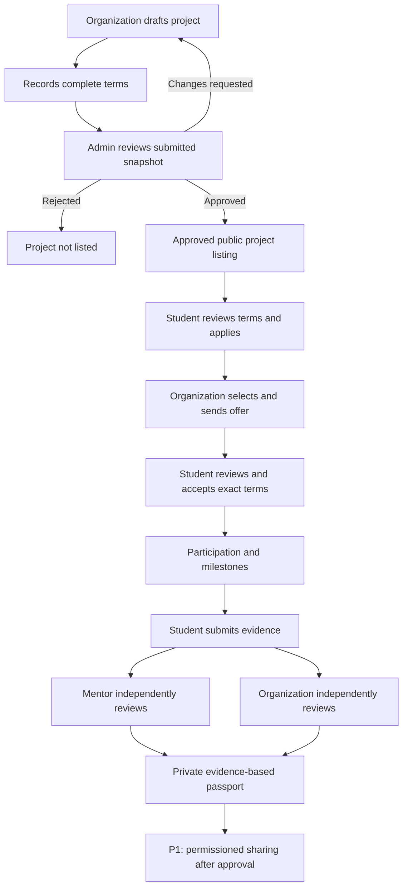

# ExperienceBridge — UI/UX Design Specification

**Document ID:** EB-UX-004  
**Version:** 0.2.0 — Coordinated architecture and release-policy update  
**Date:** 25 October 2026  
**Status:** **DRAFT / NOT DESIGN-APPROVED / NOT IMPLEMENTATION-APPROVED**  
**Owner:** JAMS Product/Technical Lead + nominated design owner  
**Repository path:** `docs/04-ui-ux.md`  
**Depends on:** `01-product-requirements.md` (PRD), `02-system-architecture.md` (SAD), `03-database-api.md` (DB/API).  
**Next documents:** `05-development-roadmap.md`, `06-engineering-standards.md`, `AGENTS.md`.

> **Certainty legend:** **AGREED** = explicitly selected direction; **PROPOSED** = concrete team-review recommendation; **VALIDATE** = unverified operational/product assumption; **BLOCKED** = requires a named decision or operational safeguard before release. All routes, labels, colors and layouts here are design proposals, not evidence of working implementation. Never present seeded demo activity as real organizational review, paid work, mentor participation, adoption, or recruiter approval.

---

> **Document-only update (25 October 2026).** This revision records the architecture and team workflow selected in the planning conversation. It does **not** mean a GitHub repository, Vercel project, Neon database, Codex integration, or CI/CD workflow has been configured or deployed. Do not treat proposed implementation details as approved product contracts. All six documents remain subject to review.

## Delivery-environment UI contract (25 October 2026)

The team has **selected two decoupled Vercel applications**: a Next.js frontend and a FastAPI backend. The frontend is one role-aware application; Student, Organization, Mentor, Admin and Recruiter-verification screens must all consume the same typed FastAPI contract instead of creating separate APIs for each portal.

| Design/implementation case | Required behavior |
|---|---|
| Local developer testing | Use a safe local API or reviewed mock fixtures clearly labeled as simulated. |
| Shared staging website | Use the **staging** FastAPI API origin, backed by **Neon staging**, with synthetic or approved protected test records. |
| Live production website | Use the **production** FastAPI API origin, backed by **Neon production**, after separate release approval. |
| Frontend preview for feature PR | Do not silently connect previews to production data; use isolated mocks or expressly approved safe preview/staging API configuration. |
| Missing or incompatible API | Show explicit loading/error/retry/maintenance states; do not display fabricated success, verified reviews, payments or passports. |
| API base URL configuration | Read the per-environment `NEXT_PUBLIC_API_BASE_URL`; do not hardcode either deployment URL in UI components. |

UI work enters shared staging only after the contributor's PR receives automated checks, an advisory Codex review request, and independent human approval. After staging deployment, confirm the complete end-to-end interaction—including negative permission/error states—before the `staging` → `main` production release. Exact screen design and route IDs otherwise remain draft until approved.

---

## 0. Purpose, authority, and handoff rules

### 0.1 Objective

Define the **information architecture, screens, navigation, forms, visual language, interaction rules, failure behavior, responsive designs, accessibility expectations, and acceptance tests** for one ExperienceBridge web application supporting:

1. Students and recent graduates (student workspace).
2. Organization owners, project managers, and designated reviewers (organization workspace).
3. Assigned mentors (mentor workspace).
4. Platform administrators (moderation/support workspace).
5. Limited recruiter/third-party passport viewers (**P1** verification-only, not a general candidate marketplace).

**AGREED product direction:** paid and safeguarded unpaid projects; real organizational tasks; accountable mentors and organization reviewers; evidence-backed Experience Passports; production architecture designed for future scale, but staged implementation.

### 0.2 Decision precedence

| Topic | Source of truth | UI implementation consequence |
|---|---|---|
| Product eligibility, compensation and use cases | PRD | Never weaken a PRD safeguard for a more convenient screen |
| Trust boundaries, deployment and data ownership | SAD | Never enforce security only by hiding buttons |
| Tables, endpoints, statuses, authorization, response shapes | DB/API plus approved executable OpenAPI once generated | Do not invent fields or call arbitrary undocumented endpoints |
| Screen behavior, layouts and microcopy | This document | Build against screen IDs and acceptance criteria |
| Task owner and priority | Development roadmap / GitHub Issue | No unassigned redesign or change of scope |
| Engineering practices and agent constraints | Engineering standards / `AGENTS.md` | Tests and review required |

**Conflict rule:** If specifications disagree, pause the affected implementation, record an issue/ADR, and obtain a documented decision. Do not have an AI agent silently “fix” product policy or rename canonical API fields. `PRD §6` contains preliminary compound submission states; **DB/API §5.5 explicitly separates submission revision, mentor review, and organization acceptance**. This UI adopts the latter, richer model while recording the PRD reconciliation as pending.

### 0.3 Scope identifiers

- **P0:** complete core workflow, not all promised for XANIX BUILD.
- **BUILD:** candidate narrow demonstration before **6 Nov 2026**, subject to actual developer capacity.
- **P1:** safeguards and usability needed for broader real-user release.
- **P2:** conditional future capability, only after validation.

The UI may **show a disabled/“coming later” feature only if clearly labeled**, but do not ship fake buttons or pretend there is functional backend support. For BUILD, prefer removing unfinished navigation items rather than dead-end pages.

### 0.4 Design success criteria

- Student can discover a legitimate approved project, understand compensation/scope, apply once, consent to exact terms, submit evidence, see feedback, and preview a truthful Experience Passport.
- Organization can complete a transparent brief, send it to review, see applications, offer a place, review submitted work, and record acceptance/revision/rejection.
- Assigned mentor can accept/decline assignment and record evidence-linked evaluation without acting as an organization reviewer.
- Admin can review organization/project queues, make reasoned decisions and access incident reports within permission bounds.
- No screen implies that self-report is independent verification, unpaid work is compensated, an organization has been verified without checks, or external payment is guaranteed.
- Essential flows work with keyboard-only navigation, reduced motion, mobile widths, and weak/variable connections.

---

## 1. Human-centered design rules

**UX-PR-01 — Clarity of commitment.** Display compensation, expected hours, duration, required equipment/transport, support, acceptance criteria, rights/confidentiality and review windows before applying or accepting an offer.

**UX-PR-02 — Progressive disclosure.** Make complex project forms multi-section but show all legally/materially significant terms in a final review step. Never bury unpaid status in a tooltip.

**UX-PR-03 — Evidence has provenance.** Explain **who stated a fact**, **who reviewed it**, **what was accepted**, and **what has not been independently checked**. A single blanket “Verified Experience” badge is prohibited.

**UX-PR-04 — Preserve agency.** Make “Decline offer”, “Withdraw application”, “Report a concern”, “Request correction”, and “Revoke share” discoverable without manipulative copy.

**UX-PR-05 — Mobile and low bandwidth by default.** Students may primarily access by phone; core forms should function without heavy charts, animation, or image-dependent controls.

**UX-PR-06 — Inclusive by design.** Use plain English, legible contrast, semantic components, focus management, error summaries and never rely on color alone.

**UX-PR-07 — No fake completion.** A toast or optimistic state is not evidence of persistence; show success only after confirmed API response. Critical transitions display server-returned status and timestamp.

**UX-PR-08 — One identity, many contexts.** UI context switching changes the *view*; backend permissions decide allowed actions. Organization context is scoped to membership, not chosen arbitrarily.

**UX-PR-09 — Confidential by default.** Private artifacts, unpublished student profiles, reviewer notes and disputes remain private; share-safe passport content is a separately projected subset.

**UX-PR-10 — Honest demo.** Synthetic accounts, example projects, simulated payment statuses and sample passports must be prominently marked **Demo / Synthetic Data**.

---

## 2. Roles, access and common shell

### 2.1 Person versus role versus resource relationship

| Context | Can enter shell when | Primary navigation | Important limit |
|---|---|---|---|
| Student | Authenticated, eligible student grant | Explore, Applications, My Projects, Experience Passport, Profile | Cannot access other students' applications |
| Organization | Active membership in selected organization | Overview, Projects, Applicants (within projects), Reviews, Organization, Team [P1] | Cannot access another organization's records |
| Mentor | Mentor enrollment plus a valid assignment for protected project detail | Assignments, Reviews, Mentor Profile | Cannot approve deliverable on organization's behalf without separate project authorization |
| Admin | Elevated platform-admin grant and controls | Overview, Organizations, Project Queue, Reports, Audit [P1] | No silent impersonation or forged review authorship |
| Recipient/recruiter | Valid limited share capability [P1] | Verification view only | No default unrestricted student directory |

A user can hold multiple grants and organization memberships. Show a context selector only for **effective contexts returned by `GET /api/v1/me` and `GET /api/v1/me/organizations`**; never use a frontend-controlled `role` flag as security authority.

### 2.2 Unified application shell [PROPOSED]

Desktop >= 1024 px:

```text
┌──────────────────────────────────────────────────────────────────────────────┐
│ ExperienceBridge           [Workspace selector]     Notifications   Account │
├────────────────┬─────────────────────────────────────────────────────────────┤
│ Primary nav    │ Breadcrumb / page title                          Help      │
│ context-based  │ ─────────────────────────────────────────────────────────── │
│                │ Main content (responsive grid / form / detail)               │
│                │                                                             │
│ Support        │                                                             │
└────────────────┴─────────────────────────────────────────────────────────────┘
```

Mobile <= 767 px: compact header with menu, current workspace, page title; opened navigation drawer with dialog semantics and an explicit close; full-width inputs; no fixed sidebar. If a bottom navigation is later considered, limit it to <=5 destinations and always include labels.

**Global components:** skip link; logo/home link; global context indicator; user menu; help/report shortcut; primary navigation; breadcrumb on deep pages; page title/subtitle; main landmark; consistent toast area; modal/dialog host. Notification center is **P1**, not a fake populated feed in BUILD.

### 2.3 Sign-in and first visit

- Single sign-in via approved identity provider; never design an internal password vault if using managed OIDC.
- After callback, resolve `GET /me`; load permitted contexts; route to last valid user-selected context if available, else context selection or role-appropriate onboarding.
- An account without a student grant can request student onboarding; an org representative can begin organization registration; mentor eligibility and admin grants are *not* self-awarded.
- Authentication expired: show non-destructive message, preserve safe unsent form drafts where possible, re-authenticate, and retry only with explicit user action for critical commands.
- Suspended or disabled user: explain access is restricted, show safe support route, no protected content.
- Admin sessions: separate stronger reauthentication flow according to identity architecture decision; do not fake MFA in UI.

---

## 3. Information architecture and route registry

Route paths are **frontend proposals**, not FastAPI endpoints. API operations use `/api/v1` per DB/API §6. Routes may be refined during UX review but must have stable **screen IDs** referenced in issues/tests.

### 3.1 Public/auth screens

| Screen ID | Route | Access | Priority | Purpose |
|---|---|---|---|---|
| PUB-01 | `/` | Public | BUILD | Explain value proposition and actor-specific entry points |
| PUB-02 | `/projects` | Public filtered listing | BUILD | Browse approved open opportunities; no private content |
| PUB-03 | `/projects/[projectId]` | Public for open projects | BUILD | Project brief, terms, owner information, apply CTA |
| PUB-04 | `/how-it-works` | Public | P1 | Fair work and passport explanation |
| PUB-05 | `/safety` | Public | P1 | Reporting, privacy and working rules |
| AUT-01 | `/sign-in` | Anonymous | BUILD | Redirect to approved auth flow |
| AUT-02 | `/auth/callback` | Auth callback | BUILD | Exchange auth/session securely; transient status only |
| AUT-03 | `/onboarding` | Authenticated | P0 | Choose authorized path / complete basic profile |
| SYS-01 | `/access-denied` | Appropriate | BUILD | Forbidden or wrong-workspace guidance |
| SYS-02 | `/not-found` | Appropriate | BUILD | No existence leak for private resources |
| SYS-03 | `/service-unavailable` | Appropriate | P1 | Recovery from a sustained dependency failure |

### 3.2 Student screens

| Screen ID | Route | Priority | Description |
|---|---|---|---|
| STU-01 | `/student` | BUILD | Overview: current applications, active project, next action |
| STU-02 | `/student/profile` | P0 | Editable profile, availability and skill self-report |
| STU-03 | `/student/applications` | BUILD | My applications and status |
| STU-04 | `/student/applications/[id]` | P0 | Application detail, offer and withdrawal |
| STU-05 | `/student/offers/[id]` | BUILD | Terms comparison and consent/accept/decline |
| STU-06 | `/student/projects` | BUILD | Assigned work list |
| STU-07 | `/student/projects/[participationId]` | BUILD | Work overview, milestones, mentor, terms, alerts |
| STU-08 | `/student/projects/[participationId]/submit` | BUILD | Evidence submission with summary and links |
| STU-09 | `/student/submissions/[id]` | P0 | Version history and mentor/org decisions |
| STU-10 | `/student/passport` | BUILD | Private evidence-based passport preview |
| STU-11 | `/student/passport/sharing` | P1 | Share grant creation/revocation and release permissions |
| STU-12 | `/student/reports/new` | P0 | Confidential report/safety issue |

### 3.3 Organization screens

| Screen ID | Route | Priority | Description |
|---|---|---|---|
| ORG-01 | `/org/[orgId]` | BUILD | Workspace overview and pending actions |
| ORG-02 | `/org/new` | P0 | Create organization profile |
| ORG-03 | `/org/[orgId]/settings` | P0 | Organization information and verification status |
| ORG-04 | `/org/[orgId]/projects` | BUILD | List projects by status |
| ORG-05 | `/org/[orgId]/projects/new` | BUILD | Project brief and compensation disclosure wizard |
| ORG-06 | `/org/[orgId]/projects/[projectId]` | BUILD | Project detail/manage, lifecycle actions |
| ORG-07 | `/org/[orgId]/projects/[projectId]/applications` | BUILD | Applicant list; shortlist/reject/offer |
| ORG-08 | `/org/[orgId]/projects/[projectId]/milestones` | BUILD | Milestone plan |
| ORG-09 | `/org/[orgId]/participations/[id]` | BUILD | Student participation, submissions and assigned mentor |
| ORG-10 | `/org/[orgId]/submissions/[id]/review` | BUILD | Separate organization accept/revise/reject decision |
| ORG-11 | `/org/[orgId]/team` | P1 | Invite members and assign org-scoped roles |
| ORG-12 | `/org/[orgId]/payments` | P1 | Reported external payment assertions, never escrow |

### 3.4 Mentor screens

| Screen ID | Route | Priority | Description |
|---|---|---|---|
| MEN-01 | `/mentor` | BUILD | Assignment queue and next reviews |
| MEN-02 | `/mentor/assignments/[assignmentId]` | BUILD | Accept/decline assignment; conflict declaration |
| MEN-03 | `/mentor/participations/[id]` | BUILD | Student project context and relevant milestone evidence |
| MEN-04 | `/mentor/submissions/[id]/review` | BUILD | Rubric review, observations and decisions |
| MEN-05 | `/mentor/profile` | P1 | Skills, capacity, eligibility and availability |

### 3.5 Admin screens

| Screen ID | Route | Priority | Description |
|---|---|---|---|
| ADM-01 | `/admin` | BUILD | Pending moderation and reports snapshot |
| ADM-02 | `/admin/organizations` | P0 | Verification queue |
| ADM-03 | `/admin/organizations/[id]` | P0 | Evidence, review, reasoned organization decision |
| ADM-04 | `/admin/projects` | BUILD | Project publication moderation queue |
| ADM-05 | `/admin/projects/[id]` | BUILD | View submitted snapshot, approve/request changes/reject |
| ADM-06 | `/admin/reports` | P0 | Confidential incident/report list |
| ADM-07 | `/admin/reports/[id]` | P0 | Triage, restriction and resolution timeline |
| ADM-08 | `/admin/audit` | P1 | Restricted audit search |

### 3.6 Passport recipient verification

| Screen ID | Route | Priority | Description |
|---|---|---|---|
| VER-01 | `/verify` | P1 | Exchange share capability and render public-safe passport |
| VER-02 | `/verify/unavailable` | P1 | Expired/revoked/invalid share, no sensitive hints |

**Scope footnote:** BUILD can include STU-10 private passport preview **without** a usable public share link. Do not ship a disabled-looking public verification flow that implies it works. Public P1 sharing requires security/privacy approvals.

---

## 4. Global layout, states and content patterns

### 4.1 Dashboard skeleton and information hierarchy

- Top: page title + clear one-sentence context + primary action (if authorized).
- First region: **Next action / Action required** (offers to accept, work to submit, pending review, unresolved incident).
- Second: summary counts from server (not arbitrary totals; never imply verified impact).
- Third: list of recent, permission-scoped items, with status and timestamp.
- Footer/side help: report a concern, policy links, support contact.
- For empty states, teach the user's next legitimate action rather than fabricate metrics.

### 4.2 UI state contract for each data-backed component

| State | Required behavior | Example copy |
|---|---|---|
| Initial loading | Skeleton or lightweight spinner with accessible status; avoid layout shift | “Loading projects…” |
| Empty genuinely | Explain absence; contextual CTA if available | “You have not applied to any projects yet.” |
| No filter results | Reset filters without losing current query | “No projects match these filters.” |
| Unauthorized 401 | Prompt sign-in/re-auth; do not show data | “Your session has expired. Sign in again to continue.” |
| Forbidden 403 | Do not reveal private fields; safe back link | “You don't have access to this project.” |
| Not found 404 | Generic private-safe message | “We couldn't find that page.” |
| Conflict 409 | Explain state and refresh | “This opportunity is no longer accepting applications.” |
| Stale 412 | Preserve edits; show comparison/refresh | “This project changed while you were editing. Review the latest version.” |
| Validation 422 | Field-level error + summary focused | “Enter a submission deadline after the start date.” |
| Rate limit 429 | Disable repeated request until retry; explain | “Too many attempts. Please try again shortly.” |
| Service failure 503 / network | Preserve safe work, retry; don't falsely confirm | “We couldn't save this yet. Your changes have not been submitted.” |
| Success | Confirm server-returned result and next step | “Application submitted. Status: Submitted.” |
| Partially loaded | Show supported content; isolate failed widget | “Feedback is temporarily unavailable.” |
| Restricted/suspended | Explain allowed action and support route | “This organization is currently restricted.” |

**Rule:** status color alone is insufficient; always display a text label. Retry safety: `POST` mutations must use idempotency where contracts require; UI must not blindly resubmit sensitive actions on network failure.

### 4.3 Dialog and destructive-action standards

- Use confirmation for **publish submission, offer acceptance, offer decline, application/participation withdrawal, project cancellation, admin restriction, report closure, passport revocation**, and material terms change.
- Dialog must name target (project, student or organization) and effect. No vague “Are you sure?” by itself.
- Default focus on safe action; Esc closes non-critical dialogs; return focus to initiating control after close.
- If a confirmation could be invalidated by concurrent changes, backend must recheck rules and UI handle conflict.
- Do not display a “This cannot be undone” sentence unless accurate. Submission revisions and corrections may be allowed, but original audit history remains.

### 4.4 Data formatting and terminology

- Project amounts: `GHS 450.00` or a typed currency from API; **never infer currency from Ghana location**. Unpaid: **“Unpaid (GHS 0)”** and reason. Sponsored: clearly state who receives funds and whether students are paid.
- Hours: “Estimated 8–12 hours total” versus “8–12 hours per week”; never conflate. Time zone: display as **GMT (UTC+0)** for Ghana-first context, but preserve UTC timestamps and allow later locale settings.
- Deadline: explicit calendar date, local clock time, time zone, and optionally relative label.
- Dates and names: server-provided facts; no invented identity, mentor credentials, approvals or verification dates.
- Organization status: `Submitted`, `Under review`, `Verified identity`, `Restricted`, `Rejected`, etc. Label **“Organization identity checked”** only if recorded checks support it; not “Trusted employer”.
- Claims: `Self-reported`, `Platform-recorded`, `Mentor-reviewed`, `Organization accepted`, `Disputed`, `Corrected`, `Revoked` as separate assertion status labels where supported.
- Payment: “Organization reported payment” vs “Student confirmed receipt”; never “Paid” based on one claim.

---

## 5. Public discovery and application UX

### 5.1 PUB-01 Landing page [BUILD]

**Audience:** students, organizations, prospective mentors. **Objective:** explain the distinctive real-work-to-evidence loop in <30 seconds.

**Above-the-fold elements:** 
- Headline: **“Gain experience by solving real problems.”**
- Supporting line: **“Work on scoped projects with guidance, documented feedback and evidence you can share—where permissions allow.”**
- CTAs: `Explore projects` → PUB-02; `For organizations` → explainer section, then sign-in/onboarding; `How it works` [P1].
- Plain-language steps: post a real problem → apply/agree → complete work → receive review → build evidence-backed passport.
- Transparency note: paid/unpaid opportunities labeled; no job or hiring guarantee.
- No unverified client logos, fake quotes, fake impact counters, or ambiguous “verified” badges.

**Acceptance UX-PUB-01:** screen remains useful without external images; primary CTAs work; mobile screenshot at 360 px fits without horizontal scrolling; claims align with PRD §1.

### 5.2 PUB-02 Discovery [BUILD, `GET /projects`]

**Primary controls:** search title/skills [search contract to be finalized], skills tags, compensation type, location/remote (filter only if API supports), duration (filter only if API supports), reset filters, sort (only supported options).

**Card data minimum:** title, organization public display name and accurately scoped identity status, project type, paid amount or unmistakable unpaid label, estimated hours/duration, skill requirements, application deadline, short deliverable, `View details`.

**States:** opening/published only; `no results` with reset; loading; pagination/load more controlled by server cursor; missing optional property shows `Not specified` where lawful to publish, never invented placeholder facts.

**UX-PUB-02 acceptance:** filters synchronized with URL query (excluding secrets); page refresh preserves filter state; cards have accessible link names; not authorized project drafts cannot appear or be directly fetched.

### 5.3 PUB-03 Project detail [BUILD, `GET /projects/:id`]

**Sections, in order:**
1. Title, organization, factual verification status, project current application status.
2. Compensation **above first application CTA**, including `GHS 0` for unpaid and cost/reimbursement disclosures.
3. Problem, beneficiaries, specific deliverables, acceptance criteria, out-of-scope work.
4. Estimated work hours, time window, milestones/deadline, location/remote, equipment/transport.
5. Required skills, expected level, places available (only if supported).
6. Mentor arrangement, organization reviewer, review window (do not name unconfirmed individual).
7. Confidentiality/IP summary and shareable-evidence rules.
8. Terms version and change policy, safety/report route, apply CTA.

**Apply CTA rules:** anonymous → sign in preserving destination; ineligible → explain reason; own existing application → `View application`; project not `open` → disabled with status; eligible → confirm material terms before `API-APP-01`.

**UX-PUB-03 acceptance:** unpaid nature cannot be hidden below fold on mobile; project details are exact terms from latest *approved* snapshot; cannot apply to pending/cancelled projects; disclose policy limits.

### 5.4 Application entry (PUB-03 → STU-03/STU-04) [BUILD]

**Inputs (API-APP-01):** motivation/fit answer (with defined max length), acknowledgment of **observed terms version**, optional portfolio/relevant evidence only if actual contract supports it.

**Required pre-submit disclosure:** project, expected time, compensation type/amount, direct expenses, relevant sharing/IP conditions, deadline, terms version. Checkbox: “I have reviewed the project terms shown above.” The checkbox is acknowledgment of terms viewed, **not** acceptance of an employment agreement or project offer.

**Result:** 201 creates submitted application. Duplicate returns stable `ALREADY_APPLIED`-type conflict if defined in the API error catalog; show view-existing action, do not reset user's progress. Server idempotency prevents double application. No submission success based on frontend animation.

---

## 6. Student workspace detailed screens

### 6.1 STU-01 Dashboard [BUILD]

**Data:** viewer `GET /me`, `GET /me/applications`, `GET /me/participations`, `GET /me/offers`, optionally passport summary after authenticated fetch. Query only the signed-in student.

**Regions:**
- Welcome/context and `Explore opportunities`.
- Action required: outstanding offer with expiry; awaiting student submission; requested revisions; unresolved access issue.
- Applications by status and active projects (do not overemphasize vanity counts).
- Recent mentor/organization decisions with exact attribution and next action.
- Passport preview CTA.

**Empty:** `You don't have an active project yet. Browse approved opportunities to get started.`

**Acceptance UX-STU-01:** no data from competing applicants, no fake completed projects, status after API failure reflects uncertainty not success.

### 6.2 STU-02 Student profile [P0]

- Editable `display_name` (API-ID-02), basic student-provided description/interests and skill claims **only where backend contract supports**; otherwise create explicit API extension issue before building.
- Clearly distinguish self-reported skills from assessed skills.
- Availability and portfolio links are student-controlled, private by default unless their visibility is explicitly agreed.
- An identity verification marker is shown only from trusted provider/program status, not from an editable checkbox.

**Acceptance:** saved field is confirmed from server; owner only; changes to public visibility require consent.

### 6.3 STU-03/04 Applications and application detail [BUILD/P0]

**List columns/cards:** project, organization, submitted date, status (`submitted`, `under_review`, `shortlisted`, `rejected`, `offered`, `withdrawn`), offer deadline if applicable, `View`.

**Detail:** submitted answers, snapshot of observed terms version, activity/history if API provides it, withdrawal action with confirmation, rejection reason only where authorized and safely disclosed, offer CTA. Never show other applicants' information.

**Concurrency:** an application may become an offer after the student opens the screen; refresh/revalidate before an irreversible action.

### 6.4 STU-05 Offer and consent [BUILD, `GET /me/offers`, `POST /offers/:id/accept`]

**Critical screen: cannot simplify.**

**Sections:** selected position/project, offered capacity, exact terms version/hash, compensation details, duration, expenses, rights, confidentiality, project owner, mentor status, expiry, material differences from terms previously seen.

**Controls:** `Accept these terms` (affirmative consent), `Decline offer`, download/print-safe terms summary [P1]. If offer is expired/revoked or terms stale, block acceptance and show reason. Accept action posts exact approved version/hash and idempotency key.

**Confirmation copy:** “You are accepting project terms version **[version]** for **[project]**, including **[compensation summary]**. You can report concerns or request a review if terms change.”

**Acceptance UX-STU-05:** no prechecked acceptance checkbox; exact terms visible; no participation created on failed request; offer accepted → server-provided participation navigated to STU-07.

### 6.5 STU-06/07 My projects and participation workspace [BUILD]

**Data:** `GET /me/participations`, `GET /participations/:id`, `GET /projects/:id/milestones`, `GET /participations/:id/submissions`, authorized mentor assignment status.

**Tabs/sections:** `Overview`, `Milestones`, `Submissions`, `Feedback`, `Agreed terms`, `Support`.

**Overview:** participation state, current milestone, due time, accountable org representative, confirmed mentor (or `Mentor pending acceptance`), next step, versioned agreed terms, relevant scoped files/links.

**Submissions:** newest revision first with version numbering and lineage; `Draft`, `Submitted`, etc. Separate cards for `Mentor review` and `Organization decision` rather than a single “Approved” indicator.

**Errors:** removed mentor → show `Mentor reassignment pending` and prevent unsupported reviewer actions; project restricted → read-only if directed by restriction policy; private artifact restricted → plain explanation.

**Acceptance:** student sees only own participation and allowed shared project context; status messages match independent review fields.

### 6.6 STU-08 Evidence submission [BUILD links/text; P1 secure file uploads]

**Minimum BUILD form:** assigned milestone (selected from authorized data), work summary, personal contribution statement, external HTTPS link(s) or artifact metadata supported by API. Do not fabricate an upload feature when actual storage finalization is not ready.

**P1 file additions:** attachment picker, type/size help, private-by-default warning, upload progress, cancel/retry, malware/scan state, artifact classification and permission-for-sharing gate.

**Warnings:** “Do not include passwords, production credentials, sensitive customer records, or information you don't have permission to share.”

**Commands:** Save draft (`API-SUB-01` per allowed implementation); Submit (`API-SUB-02`); add revision (`API-SUB-05`) only when permitted. On successful submit, show submission ID, version, timestamp, and who can review it.

**UX-STU-08 acceptance:** disable duplicate click while processing, but retain safe data after error; no public artifact URL accidentally leaked; editable draft and submitted version are distinguishable.

### 6.7 STU-09 Submission detail [P0]

Timeline: created → submitted → mentor review event(s) → organization decision event(s) → revision version(s), each from source records. Distinguish project acceptance from skill assessment. Never erase earlier revisions from a historical timeline. Show `Respond with revision` only where terms/status permit.

### 6.8 STU-10 Private Experience Passport [BUILD]

**The central differentiator.**

**Header:** student display name; neutral `Experience Passport` title; explicit statement: `This record combines self-reported information with recorded reviews. Each item shows its evidence level.`

**Per-project passport card:** title; organization; actual participation dates; student's contribution; deliverables; links where permitted; mentor observations (reviewer identity and date); organization acceptance state (reviewer identity and date); evidence status for each assertion; correction/dispute state.

**Visual rule:** separate `Identity checked`, `Work submitted`, `Mentor reviewed`, `Deliverable accepted` rather than `Verified` umbrella. Work that was not accepted may still have recorded learning/evidence, but cannot be labeled `accepted`.

**BUILD:** private, authenticated preview via `GET /me/passport` and `GET /participations/:id/passport-preview` only. No “Share publicly” button unless P1 share service and confidentiality gates actually work.

**Acceptance UX-STU-10:** a self-reported skill does not gain review status because another project was accepted; missing review plainly reads `No mentor review recorded`; disputed record warns that assertion is under review; demo evidence is visibly synthetic.

### 6.9 STU-11 Sharing and revocation [P1, BLOCKED until privacy/security approval]

**Flow:** select individual assertion/evidence items → rights/privacy review → choose expiry/recipient restrictions if supported → server issues one-time capability → display copy/share UI and expiration → view grant list → revoke.

**Safe verification transport proposal [requires security ADR]:** share link like `/verify#cap=<opaque-capability>`; browser removes fragment from URL after reading and posts capability to `POST /api/v1/shared-passports/exchange`, with no token in analytics, URL query or server logs. Alternatively, a secure access-code exchange can avoid embedding capability in shared URL. Final implementation must be security reviewed, and CSP/referrer/no-cache policies specified. Do not save raw capability in browser persistence.

**Revoked/expired:** show generic unavailable state; no protected fields, no indication of which student owns a bad token. `Get share link` never implies recruiters have independently endorsed it.

### 6.10 STU-12 Confidential reporting [P0]

Form: category, target type/ID, incident date if relevant, factual description, optional evidence route if supported, urgency, safe contact preference where policy allows. Help text: explain who receives report, what is private, expected acknowledgment and emergency limitations. Do not promise immediate action or guaranteed confidentiality beyond actual policy.

**On submit:** server returns `ReportReceipt` with case ID and recorded timestamp; no exposing sensitive details in toast/email subject. Duplicate/failed submit safely handled.

---

## 7. Organization workspace detailed screens

### 7.1 ORG-01 Overview [BUILD]

**Audience:** org owner/project manager, with permissions filtered. Show: `Create project`, draft and pending-review projects, approved/open opportunities, applications awaiting action, submitted work awaiting authorized review, verification and policy warnings.

**Rules:** do not show another organization's counts, acceptances or applicants; organization context selector lists only actual memberships.

### 7.2 ORG-02/03 Organization setup, verification and settings [P0]

**Form:** legal and display names, country, contact email, website (optional), description, authorized representative. Evidence requirements only after admin-reviewed verification policy specified. Display server status: `draft`, `submitted`, `under_review`, `changes_requested`, `verified`, `rejected`, `restricted`.

**CTA:** `Submit for verification`, with review of submitted details. If unverified publishing is prohibited, show informative disabled state, not a misleading green “Verified”. Do not promise verification timelines unless actual SLA exists.

**Security:** sensitive verification attachments only through private upload flow when ready; not in public organization profile.

### 7.3 ORG-04 Project list [BUILD]

Filters: status, responsible project manager, date (only supported server filters). Each row includes title, current lifecycle state, compensation type, current application count (only owner-authorized counts), deadline and next action. Provide `Edit draft`, `Review applications`, `View submissions` based on effective permissions.

### 7.4 ORG-05 Project creation wizard [BUILD]

Use progressive sections; persist draft to server if API supports (`API-PROJ-01`, `API-PROJ-02`), otherwise explicitly label unsaved local draft and protect against navigation loss.

| Step | Fields | Minimum validation & disclosure |
|---|---|---|
| 1. Organization & objective | Organization context (read-only), project title, problem, beneficiaries, work purpose | Eligible authorized org; real and bounded objective |
| 2. Scope & outputs | Deliverables, acceptance criteria, out-of-scope items, number of places, skills/difficulty | Deliverables measurable; exclude unsafe/prohibited scope |
| 3. Time & supervision | Start date, duration, expected hours total/per week, milestones/deadline, review window, accountable project manager/reviewer, mentor arrangement | End >= start; hours intelligible; named org reviewer; mentor not falsely implied accepted |
| 4. Fair compensation | Canonical category `PAID_FIXED`, `PAID_TIME`, `SPONSORED_LEARNING`, `VOLUNTEER_COMMUNITY`; amount/currency, rate or milestone schedule, payer, expenses, transport/equipment, volunteer rationale | Paid: full material terms; unpaid: visibly `GHS 0` and safeguards; commercial-unpaid blocked |
| 5. Rights, privacy and safety | Data classification, access requirements, confidentiality, IP ownership/license, portfolio-sharing policy, reporting/support contact | Block prohibited sensitive access; privacy and IP cannot be blank when material |
| 6. Review & submit | Full terms snapshot, acknowledgments, correction controls, version indicator | Server validation; publish only after admin approval |

**Important schema note:** precise field keys and limits must match `03-database-api.md §3.2` and approved DTOs in §8.1–8.2; the screen is a **semantic form spec**, not permission to add unreviewed SQL columns. Differences create an explicit API-contract issue.

**Interaction:** `Save draft`, `Previous`, `Next`, `Review`, `Submit for approval`. Save does not mean published. On submit, show `Pending review`, submission time and next responsibility.

**Cross-form validation:** start before deadline, amount/rate >= valid minimum as approved policy, consistent hours/duration, at least one review criterion, no duplicate terms, identifiable reviewer, no invalid project classification.

**UX-ORG-05 acceptance:** cannot publish from client alone; compensation remains visible in review; changing commercial to unpaid requires fresh moderation; errors identify step; mobile wizard preserves progress.

### 7.5 ORG-06 Project detail/manage [BUILD]

Top: status, version, last updated, project manager; relevant actions based on server effective authorization. Tabs: `Overview`, `Terms`, `Applications`, `Milestones`, `Participants`, `Activity` (only if actual event API).

Actions: `Edit draft`, `Submit for review`, `Close applications`, `Start project`, `Complete`, `Cancel` with applicable permissions and state checks. Material terms change requires new version and renewed affected-party consent; show impact before submission. `Request revision of terms` should never overwrite a signed snapshot.

### 7.6 ORG-07 Applicants, shortlist and offer [BUILD]

**List:** applicant display name, self-reported skills, application timestamp, relevant evidence visible by consent, application status. Do **not** expose protected personal information unrelated to selection.

**Detail/commands:** shortlist, reject (record reason), create offer (`API-OFFER-01`), offer expiry, seats. Confirmation shows **exact offer terms version**. Show warning when current terms differ from terms viewed at application.

**Acceptance:** no offer to unrelated applicant, no duplicative seat use, no unseen change to applicant's terms, no false auto-acceptance.

### 7.7 ORG-08 Milestones [BUILD]

Minimum per milestone: title, output description, acceptance criteria, due date and order. Validate against project term limits. Add/edit only when authorized (`API-MILE-01/03`); if active scope changes, require correct amendment path instead of silent edits.

### 7.8 ORG-09 Participation oversight [BUILD]

Show accepted terms, named student, milestones, submissions, mentor assignment state, accountable reviewer, deadline, support/report actions. Actions permitted by role: propose mentor, manage milestones where policy allows, open organization review. If mentor declines, display need for reassignment rather than claiming active mentorship.

### 7.9 ORG-10 Organization review [BUILD]

**Data:** authorized submission detail, agreed acceptance criteria, submission revision, mentor observations where viewable. **Reviewer action must be independent** of mentor scoring.

**Required reviewer inputs:** criterion outcomes, decision `accept | request_revision | reject` per backend contract, factual reason, reviewed artifact references, confirmation that they are acting for this organization.

**Buttons:** `Accept deliverable`, `Request changes`, `Reject deliverable`; each labeled by actual effect and confirmation. No unrestricted reviewer name field—actor is derived by backend.

**Acceptance UX-ORG-10:** mentor review is displayed as a separate attributed section; organization acceptance does not automatically assert all skills; repeated review should respect concurrency and audit rules.

### 7.10 ORG-11/12 Memberships and payments [P1]

**Memberships:** invite by email, choose only org-scoped role allowed by policy, state `invited/active/suspended/removed`. Never expose a UI control granting platform admin. Backend rechecks inviter authority.

**Payments:** clearly show **external-party reports**, not funds held by ExperienceBridge. Different labels for `organization_reported_paid` and `student_confirmed_received`. In disputes, surface both accounts without declaring payment settled.

---

## 8. Mentor workspace detailed screens

### 8.1 MEN-01 Dashboard [BUILD]

Show assignment proposals needing acceptance, current accepted assignments, outstanding evidence to review, deadlines when available and capacity warning. Only fetch `GET /me/mentor-assignments` and authorized project data. Do not let arbitrary mentors browse all students' submissions.

### 8.2 MEN-02 Assignment decision [BUILD]

**Information before accepting:** project scope, duration/expected check-ins, student count, expected mentor workload, compensation/incentives if applicable, conflict-of-interest policy, confidentiality and review requirements.

**Inputs:** conflict declaration, accept/decline decision. If mentor eligibility policy blocks acceptance, show reason and support contact; no ability to self-approve eligibility.

**UI-UX acceptance:** proposed assignment != active mentor; decline triggers honest `Mentor unassigned / reassignment pending` status for affected workspace where authorized.

### 8.3 MEN-03 Project context [BUILD]

Read-only where appropriate: student participation and project scope, assigned milestones, relevant submitted evidence, approved rubric version, prior review events. Action: `Review submission` only for an *accepted* assignment; no `Approve for organization` button.

### 8.4 MEN-04 Rubric review [BUILD]

- Heading includes student's contribution, project, specific submission revision and milestone.
- Each rubric criterion has description, allowed scores/levels from **approved rubric version**, short observable justification and evidence reference.
- Overall decision uses only the mentor-review state labels defined by DB/API §5.5 (`observed`, `needs_revision`, etc. as approved), not invented organization acceptance terminology.
- Show `Save draft` only if corresponding API exists; otherwise do not promise drafts.
- Submission confirmation: “Your assessment records your observations. It does not accept the organization's deliverable.”
- Persist author identity, rubric version and timestamp from server response; never accept reviewer identity from client body.

**Acceptance UX-MEN-04:** no blind star rating unsupported by observations; score out of range rejected; missing rubric requires blocking feedback and configuration issue; mentor cannot review unrelated or declined assignment.

### 8.5 MEN-05 Profile/capacity [P1]

Editable expertise and availability; verified eligibility shown only if a documented admin/program check exists. Never let a mentor set `eligibility_status=approved` through profile edit. For over-capacity, show explicit warning but do not misrepresent hard cap unless backend enforces it.

---

## 9. Admin workspace detailed screens

### 9.1 ADM-01 Moderation overview [BUILD]

Cards: projects pending review, organizations pending verification [only when built], reported incidents [only when supported], recently decided cases. All counts sourced from server. No generic “organization trustworthy” label based solely on status.

### 9.2 ADM-02/03 Organization verification [P0]

Queue → organization facts and required evidence checklist → decision. Decision choices are `verify`, `request_changes`, `reject`, `restrict` **only if permitted in current state**, with **required reason**. The exact verification checklist is **BLOCKED on compliance/process approval**; until then, demo queues use synthetic records, no real “verified” declarations.

**Controls:** compare evidence, add private notes, confirm consequence, decision history. `Verify` must not merely toggle a client badge.

### 9.3 ADM-04/05 Project moderation [BUILD]

Queue shows project, organization status, compensation, risks, last terms version, submission date. Review page shows **frozen submitted snapshot** alongside policy checklist: scope; fairness/pay; volunteering rationale; hours; reviewer/mentor; data/IP; prohibited content.

Decision buttons: `Approve and open`, `Request changes`, `Reject`, `Suspend` (state-dependent). Require reason; after approval show actual API-returned open state, not client-side mock transition. If new terms version arrives during review, show `Stale version` and force refresh.

### 9.4 ADM-06/07 Safety reports [P0]

Sensitive data is role-scoped; list reveals only minimal case metadata. Case page has timeline, affected project/entity, severity, evidence available to assigned staff, notes, controls to pause/restrict when authorized, and outcome. Reporter identity should not be unnecessarily exposed. No one-click irreversible “delete complaint” action.

**Support text:** do not make promises about investigation timelines that the team cannot fulfill. Serious danger requires practical escalation process outside the software, documented by policy.

### 9.5 ADM-08 Audit [P1]

Search by limited entity and time range, safely redacted events. Export is **not** default; requires privilege and purpose. Show author/time/reason/version and avoid logging credential payloads.

---

## 10. Passport verification recipient UX [P1; not available in first BUILD slice]

### 10.1 VER-01 Authorized view

**Entry:** recipient opens an approved share link or enters one-time code. View is readable without a platform recruiter account only if share policy authorizes it. Exchange capability with approved API method; no universal directory by default.

**Header:** `Experience Passport — Shared Evidence`, visible student-provided identifier, explicit viewing scope, “This record documents evidence and recorded reviews; it does not guarantee skill or employment outcomes.”

**Per assertion:** statement, underlying project, status, reviewer identity only where consent and policy permit, exact evidence type, review/approval date, link/file access only if included in grant, correction/dispute labels.

**Footer:** expiration/revocation explanation, how to report suspicious content, allowed use limitation.

**Unavailable state:** generic message; no personal identifiers. Do not reveal whether a token belonged to a particular person.

### 10.2 Trust-label glossary [PROPOSED]

| Label | Intended meaning | Explicitly does **not** mean |
|---|---|---|
| Self-reported | Student stated this | Independently reviewed |
| Platform-recorded | A workflow action was recorded with actor/time | Action's factual content independently verified |
| Mentor-reviewed | Identified assigned mentor assessed specified evidence | Organization accepted output; all skills certified |
| Organization accepted | Authorized project reviewer recorded acceptance against agreed criteria | Student automatically hired; every skill independently checked |
| Organization identity checked | Platform completed its documented org checks | Organization guarantees pay, work quality or financial solvency |
| Disputed | Recorded assertion is under question/review | Proven fraudulent |
| Corrected | Earlier assertion was amended with history | Original event silently erased |
| Revoked | Sharing/credential validity withdrawn | All historical work necessarily never occurred |

Never use deceptive shield/check icons without adjacent textual evidence levels. The user must be able to understand these labels without hovering.

---

## 11. Cross-role critical journeys and exception paths

### 11.1 Primary experience journey (BUILD target)



**Important:** Mentor and organization review are **parallel independent assertions**. One may be absent or in progress; the passport must describe partial progress truthfully. Terms acceptance, project start, and finalization happen according to approved state rules, not simply from following links in diagram.

### 11.2 Failure and recovery matrix

| Event | User-visible state | Required next action | No misleading behavior |
|---|---|---|---|
| Organization not verified | `Verification required / pending` | Finish verification or contact admin | Never label as verified |
| Project not published | `Draft / pending review` | Submit or await moderation | Not visible as open listing |
| Project policy rejection | `Changes requested` or `Rejected` with authorized reason | Edit/resubmit if permitted | No client-side “force publish” |
| Project fills before apply | `Applications closed` | Return to discovery | No phantom success |
| Duplicate application | Existing application and safe link | View status | Never create duplicate |
| Offer expires | `Offer expired` | Contact organization / await fresh offer | No accept CTA |
| Terms change after application | `Updated terms—review before accepting` | Compare version and explicitly consent | No silent acceptance |
| Mentor declines | `Mentor assignment pending` | Org manager reassigns | Never mark mentor reviewed |
| Student uploads rejected file | `Upload not accepted` with specific safe reason | Replace permitted evidence | No public orphan link |
| Student requests revision | Version N+1 submission | Compare previous feedback | Preserve history |
| Organization rejects output | Separate organization decision reason | Revise/appeal if allowed | Do not erase mentor assessment |
| Organization unresponsive | `Awaiting organization review` | Escalation/support | Do not claim acceptance |
| Payment reported by org | `Organization reported payment` | Await student acknowledgment or dispute | Do not label settled |
| Passport share revoked | `Link unavailable` | Student can create new valid grant | No cached protected view |
| Active safety dispute | Scoped warning/status and protected reporting | Admin triage | Don't expose reporter details |
| API temporarily unavailable | Unsaved/sync-unknown state | Check status before retry | Don't double create resources |

---

## 12. Form conventions and component library

### 12.1 Shared component inventory [PROPOSED]

| Component ID | Component | Variants / required behaviors |
|---|---|---|
| C-01 | AppShell | desktop sidebar/mobile drawer; role-scoped navigation; skip link |
| C-02 | PageHeader | heading, subtitle, primary action, breadcrumb |
| C-03 | StatusLabel | explicit text, icon optional, semantic tone; no color-only status |
| C-04 | MoneyDisclosure | amount/currency or GHS 0, fixed/hourly/sponsored, expenses, payer |
| C-05 | ProjectCard | title, status, pay, hours, deadline, skills, owner info |
| C-06 | ProjectTermsSummary | immutable version, IP, workload, accepted terms hash where applicable |
| C-07 | Timeline | event actor, time, action, version, ability to expand safely |
| C-08 | MilestoneList | due dates, state, description, owner/participant views |
| C-09 | ArtifactList | private/share eligibility, type, version, scan/access state |
| C-10 | EvidenceLevel | glossary-linked provenance/status, not blanket verification |
| C-11 | AssessmentRubric | criteria, allowed score range, evidence reference, review author |
| C-12 | DecisionPanel | role-scoped actions, confirmation, server errors |
| C-13 | DataTable/CardList | responsive list; sorting only if backend supports |
| C-14 | EmptyState | clear explanation and valid next action |
| C-15 | InlineAlert | concise severity and recovery action, accessible live region |
| C-16 | FormField | label, description, constraints, example, inline error |
| C-17 | ConfirmationDialog | target/effect, safe default, proper focus management |
| C-18 | PaginationControl | cursor, `Load more`, keyboard and screen reader support |
| C-19 | FileUpload [P1] | private, progress, retry, scan/eligibility states |
| C-20 | ReportConcern | discreet safe route from participation and policy pages |
| C-21 | DemoDataBanner [BUILD] | persistent label on synthetic demo screens |
| C-22 | WorkspaceSelector | effective contexts from authenticated backend |

**Reuse rule:** components must accept typed domain presentation props (not hardcoded simulated project objects) and use UI tokens. Domain components must not perform arbitrary SQL or infer access from their own visibility.

### 12.2 Form field patterns

- Every field has persistent visible label, help text as needed, format sample and error message linked with `aria-describedby`.
- Required status conveyed in text or native required semantics; absence of asterisk never excuses unclear requirement.
- Textareas show limit (if specified by approved API), do not invent max lengths.
- Calendar and datetime inputs must be keyboard-operable; show clear timezone and avoid locale conversion surprises.
- Radio options for compensation categories include descriptions; `VOLUNTEER_COMMUNITY` triggers dedicated rationale and safeguards, not a hidden zero-amount hack.
- Currency values typed and validated server-side; no silent conversions or fake payment calculations.
- Keep Save Draft separate from Submit for Approval; do not use `Publish now` when admin approval is mandatory.
- Errors are shown at field and top-of-form summary; summary receives focus after failed submit; data remains intact.
- On successful mutation, announce status via accessible polite live region.
- Material terms changes show explicit comparison (old → new) and require re-consent where PRD mandates.

### 12.3 Confirmation copy examples [PROPOSED]

| Trigger | Confirmation title | Clear consequence |
|---|---|---|
| Submit project | Submit project for review? | “Your project won't appear publicly until approved.” |
| Send offer | Send participation offer? | “The student must accept the specified terms before joining.” |
| Accept offer | Accept these project terms? | “Your acceptance is recorded against terms version [v].” |
| Submit evidence | Submit this version for review? | “Mentor and organization reviewers will see this submission under project permissions.” |
| Org accept | Accept this deliverable? | “This records organization acceptance for this specific submission and criteria.” |
| Withdraw | Withdraw from [project]? | “Your participation status changes; earlier activity and applicable obligations remain recorded.” |
| Revoke share | Revoke this passport link? | “Recipients using this grant will no longer have authorized access.” |
| Restrict organization | Restrict [organization]? | “This may stop new projects and affect active work; record a reason.” |

---

## 13. Proposed visual design system (not brand-approved)

### 13.1 Principles

Professional, modern, calm, credible; prioritize readable text and evidence detail over gamification or decorative trust badges. Design should feel supportive to students and operationally clear for busy organizations. Use neutral surfaces and one accessible primary accent. Avoid “AI” branding where it obscures what the product actually does.

### 13.2 Initial design tokens [PROPOSED]

| Token | Light value (proposal) | Role |
|---|---|---|
| `color.canvas` | `#F8FAFC` | App background |
| `color.surface` | `#FFFFFF` | Cards and form surfaces |
| `color.text` | `#0F172A` | Primary text |
| `color.textMuted` | `#475569` | Secondary text |
| `color.border` | `#CBD5E1` | Input and section borders |
| `color.primary` | `#1D4ED8` | Primary interactive emphasis |
| `color.primaryHover` | `#1E40AF` | Hover state |
| `color.focus` | `#2563EB` | Focus ring with appropriate contrast |
| `color.positive` | `#166534` | Confirmed successful operation |
| `color.caution` | `#92400E` | Pending/action needed |
| `color.danger` | `#B91C1C` | Errors and destructive actions |
| `radius.card` | `12px` | Cards/dialogs |
| `radius.control` | `8px` | Input/button |
| `space.base` | `4px` | Spacing scale base |

**Critical:** these are starting values, not automatic WCAG-compliant combinations. Test all actual text/background and interactive states with contrast tooling; adjust tokens before approval. Provide a dark theme only after accessible colors and complete interaction states are designed and tested (P2 unless prioritized).

### 13.3 Typography and density

- Use readable system font stack initially; font files must not become a blocking CDN dependency.
- Desktop body 16 px baseline, line-height ~1.5; small metadata 13–14 px minimum depending on verified accessibility design.
- Page title 24–30 px desktop / 22–26 px mobile; headings semantic in actual markup, not only styled.
- Button minimum touch target ~44×44 CSS px where possible; keyboard focus must be visible and not clipped.
- Avoid tables wider than viewport on mobile; use cards for key records, tables with an accessible responsive alternative when necessary.
- Use spacing consistently: e.g., 4/8/12/16/24/32 px rhythm. Test with 200% zoom and text enlargement.

### 13.4 Icons, charts and motion

- Icons support text rather than replace it, especially statuses like paid/unpaid and verification.
- No dashboard charts before there is trustworthy data; empty-chart illustrations are not real outcomes.
- Honor `prefers-reduced-motion`; animation must not gate task completion or signal a successful save before API confirmation.
- Unverified portraits/logos must be omitted or marked as placeholders, not shown as endorsed organizations.

---

## 14. Responsive and offline-tolerant behavior

### 14.1 Breakpoints [PROPOSED]

| Size | Typical width | Behavior |
|---|---|---|
| Small mobile | 320–479 CSS px | One-column, drawer nav, stacked form buttons, no fixed sidebar |
| Mobile | 480–767 px | One-column cards, expandable filters, safe field sizes |
| Tablet | 768–1023 px | Two-column where legible, compact nav |
| Desktop | >=1024 px | Sidebar and primary detail panes |

Test at **320, 360, 390, 768, 1024, 1280, and 1440 CSS px** and at 200% zoom. These are QA widths, not device claims.

### 14.2 Low-connectivity contract

- Limit third-party scripts, imagery and excessive hydration. Prefer server-rendered public project summaries when appropriate.
- Provide explicit progress for uploads; ability to retry without reselecting if browser security rules allow.
- Preserve safe draft fields during transient network errors. Avoid offline queues for high-stakes mutations (offer acceptance, org approval, payment assertions); these require confirmed current server state.
- No background silent retries that could trigger duplicate applications or decisions.
- Avoid auto-refresh that discards form inputs; label stale snapshots and allow user to refresh.
- Disclose when information is cached or not current; private responses must not persist in public caches.

---

## 15. Accessibility and inclusive content requirements

**Target:** WCAG **2.2 AA** as a design-and-test goal for the eventual public platform (not a claim that it is currently compliant).

**A11Y-01:** complete main journeys with keyboard only and meaningful tab order.  
**A11Y-02:** visible focus outline for controls and focus restoration after dialogs/drawer close.  
**A11Y-03:** labels, errors and input instructions programmatically associated.  
**A11Y-04:** status uses words as well as colors/icons.  
**A11Y-05:** descriptive link/button names, unique within context.  
**A11Y-06:** success/error announcements do not steal focus unnecessarily.  
**A11Y-07:** text and component contrast passes chosen guideline; test disabled/focus/hover states.  
**A11Y-08:** skip-to-content, landmarks, correct heading hierarchy, table headers where tables used.  
**A11Y-09:** responsive layout without loss of content on zoom/small screens.  
**A11Y-10:** no time-limited interaction without explicit visible expiry and accessible handling; offer deadline is a business expiry, not a hidden UI timer.  
**A11Y-11:** plain language for students and organizations; explanations for IP, assessment, and terms.  
**A11Y-12:** accessibility checks included in design review, automated tests and manual QA; automated scanners alone are insufficient.

**Localization:** English first. Ghana cedi display is not universal hardcoding; API currency remains authoritative. Prepare strings for extraction; avoid embedding essential values into raster images.

---

## 16. Permission and data visibility UX matrix

| Data / action | Student | Organization manager | Assigned mentor | Admin | Share recipient |
|---|---|---|---|---|---|
| Open approved project | Public | Public | Public | Public | Public |
| Project draft or hidden review | Not generally | Own org, if authorized | Only if assigned and approved access | Assigned moderation | No |
| Application details | Own | Selected project's applicants, if authorized | No by default | Scoped investigations | No |
| Offer terms | Own offer | Own project authorized manager | No unless assigned consent needed | Scoped investigation | No |
| Submission artifacts | Own participation | Authorized project reviewer/manager | Assigned accepted mentor | Only as necessary | **Only explicitly released items** |
| Mentor assessment | Own relevant review, subject to protected notes | As authorized for project | Own assigned review | Scoped investigation | Only released/safe subset |
| Organization acceptance | Own participation | Own authorized project | Read according to participation scope | Scoped investigation | Only released/safe subset |
| Safety report identity | Reporter/authorized affected party | **Not automatic** | **Not automatic** | Assigned case staff | No |
| Organization verification evidence | No | Authorized owner/verification team | No | Assigned verification staff | No |
| Passport private preview | Own | No by default | No by default | Only justified investigation | No |
| Passport share projection | Grant owner | No by default | No by default | Authorized policy investigation | Valid capability, limited content |

**Security statement:** The table is a UI contract and must be enforced in backend resource-scoped authorization (PRD AUTH-002; SAD §8; DB/API §4). When server denies access, conceal protected data even if a component rendered earlier from stale state.

---

## 17. API-to-screen integration map and field ownership

This matrix tells AI agents **which server contract to consult first**. Some pages require additional endpoints, and all fields must be verified against canonical typed DTOs before coding.

| Feature/screens | API operations (DB/API IDs) | Primary owner | Integration gate |
|---|---|---|---|
| Session/context: AUT, all shells | API-ID-01, API-ORG-08 | Dev 1 | Identity architecture ADR and effective grants |
| Public listing/details: PUB-02/03 | API-PROJ-03/04 | Dev 2 | Approved public projection; compensation and terms |
| Student applications: STU-03/04 | API-APP-01/02/06 | Dev 2 | Duplicate guard and terms viewed version |
| Offers/participations: STU-05/06/07 | API-OFFER-02/03/04, API-PART-01/02 | Dev 2 | Exact terms hash + accepted participation |
| Student submissions: STU-08/09 | API-SUB-01/02/03/04/05, API-EV-04 | Dev 2 | Authorized evidence and revision semantics |
| Private passport: STU-10 | API-PASS-01/02 | Dev 4 + Dev 2 | Claims/status provenance and projection agreed |
| Org onboarding/settings: ORG-02/03 | API-ORG-01/02/03/04 | Dev 3 | Approved org verification policy for live users |
| Org project draft/terms: ORG-04/05/06 | API-PROJ-01/02/05/06/07 | Dev 3 | Project/terms schemas frozen |
| Org selection: ORG-07 | API-APP-03/04/05, API-OFFER-01 | Dev 3 | Application/offer states, terms and seats |
| Org milestones: ORG-08 | API-MILE-01/02/03 | Dev 3 | Project scope amendments rules |
| Org final review: ORG-09/10 | API-PART-01, API-SUB-03/04, API-OREV-01/02 | Dev 3 + Dev 4 | Separate org acceptance from mentor assessment |
| Mentor assignment: MEN-01/02/03 | API-MENT-01/02/03/04 | Dev 4 | Eligibility/conflict policy and assignment guards |
| Mentor review: MEN-04 | API-MENT-05/06, API-SUB-04 | Dev 4 | Approved rubric version, reviewer identity backend-derived |
| Admin project queue: ADM-04/05 | API-ADM-03/04 | Dev 1 (temporary) | Moderation contract; Dev 3 assists |
| Admin org/report: ADM-02/03/06/07 | API-ADM-01/02/05/06 | Dev 1 + Dev 4 | Compliance/safety operations approved |
| P1 passport verification: STU-11, VER-01/02 | API-PASS-03/04/05/06 | Dev 4 | Privacy, token security, IP rights and access tests |

**Missing UI endpoints:** if a screen needs a field not in API response, the implementer must file a contract issue; do not use hidden admin endpoints or cross-tenant APIs as substitutes. E.g., in-UI project-owner names, approved mentor biographies, organization dashboard counts and submission history may require response projection or additional endpoints. Mark new endpoint requests explicitly **PROPOSED / requires DB/API update**.

---

## 18. AI-agent implementation packet for any screen

Each GitHub Issue assigned to an AI-assisted developer must include:

```yaml
# EXAMPLE ISSUE METADATA — not a production executable contract
screen_id: STU-08
feature: Student evidence submission
priority: BUILD
domain_owner: developer-2
required_docs:
  - docs/01-product-requirements.md
  - docs/02-system-architecture.md
  - docs/03-database-api.md
  - docs/04-ui-ux.md
related_requirements: [WORK-002, PRIV-001, AUTH-002]
api_operations: [API-SUB-01, API-SUB-02, API-EV-04]
allowed_changes:
  - apps/web/** # tighten to concrete directories when repo scaffold exists
blocked_decisions:
  - Real private file uploads are P1, not part of this BUILD story
acceptance_checks:
  - Only assigned student can submit against participation
  - Work description and external evidence are persisted by real API
  - Duplicate or stale submission shows an honest error
  - Mentor review and organization acceptance remain distinct
  - Mobile, keyboard and error states tested
```

**Mandatory agent behavior:** read linked contracts → summarize assumptions → identify unresolved fields → implement only allowed changes → create tests and screenshots → run typecheck/lint/tests → document deviations → open PR. Do not alter shared schemas, auth policy, project state transitions, status meaning or design tokens without review and agreed documentation update.

---

## 19. Testable acceptance cases and required evidence

### 19.1 End-to-end UI test scenarios (BUILD candidate)

| Test ID | Scenario | Expected visible outcome |
|---|---|---|
| UI-E2E-01 | Org drafts valid paid project | Draft saved; not in public listing |
| UI-E2E-02 | Org proposes commercial unpaid project | Blocked with clear fairness/policy reason |
| UI-E2E-03 | Org submits draft for moderation | Pending review, not public |
| UI-E2E-04 | Admin approves frozen version | Published/open listing only after server success |
| UI-E2E-05 | Student views project on 360 px width | Pay/time/IP/acceptance criteria understandable without horizontal scroll |
| UI-E2E-06 | Eligible student applies | One submitted application; timestamp/status shown |
| UI-E2E-07 | Student reapplies | No duplicate; link to existing record |
| UI-E2E-08 | Org creates valid offer | Student sees exact offered terms and expiry |
| UI-E2E-09 | Terms version changed before accept | Requires re-review/consent; old offer cannot be silently accepted |
| UI-E2E-10 | Student accepts valid offer | Server-created participation and project workspace |
| UI-E2E-11 | Unassigned mentor opens submission | No evidence content, appropriate forbidden state |
| UI-E2E-12 | Accepted mentor reviews submission | Attributed mentor review, no organization acceptance |
| UI-E2E-13 | Org reviewer accepts submission | Separate attributed organization acceptance |
| UI-E2E-14 | Passport private preview loads | Evidence levels from source records, no blanket “verified” claim |
| UI-E2E-15 | Client loses network during submit | No false success; user can refresh/check before retry |
| UI-E2E-16 | Unauthorized user guesses participation URL | No protected content, no data leak |
| UI-E2E-17 | Admin and org roles on same account | Context may switch, permissions remain server-scoped |
| UI-E2E-18 | Synthetic demo fixture used | Clear demo/synthetic label in screenshot and exported evidence |

### 19.2 P1 before actual public release

- Privacy/IP and real file-sharing test: no private artifact linked by an unrelated logged-out user.
- Valid, revoked and expired passport grants checked without token logging or sensitive caching.
- File upload malware/validation and object authorization paths reviewed.
- Accessibility audit with keyboard, 200% zoom, screen-reader sample, color contrast and focus paths.
- Moderation and safe incident-report handling validated by human operations.
- Verified organization identity display tied to approved actual verification procedure.
- Compensation/volunteer legal and operational safeguards confirmed with qualified advisors.

### 19.3 Evidence for PR review

- Before/after screenshots at 360 px and desktop for new UI; blur/redact any private real data.
- Short screen recording for critical interactions or working preview URL if approved.
- Test results (unit/component/integration/E2E); manual accessibility checklist.
- Traceability: linked requirement ID, screen ID, endpoint ID, associated GitHub Issue.
- No material deviation from terms, verification, consent or role permissions.

---

## 20. Screen-level definition of done

A screen is **not complete** until:

1. Its GitHub Issue names a screen ID, requirement IDs, API operations and owner.
2. Actual server data renders; no hardcoded demo data in production mode.
3. Loading, empty, validation, 401, 403/404, conflict and network-error states are handled where relevant.
4. All controls perform a real authorized operation or are deliberately omitted.
5. Layout is checked on mobile and desktop, including zoom.
6. Keyboard/focus/error relationships are checked; contrast audited for actual colors.
7. No confidential information is surfaced via logging, clipboard, analytics, or unauthorized link.
8. Status and claims match the actual recorded evidence and API response.
9. Tests pass, code is reviewed, and documentation updated if contracts changed.
10. Feature works in staging as part of the integrated journey, not only as isolated component mockups.

---

## 21. Pending decisions and change-control register

| ID | Decision to ratify | Why it blocks/affects UI | Proposed owner |
|---|---|---|---|
| UX-DEC-01 | Branding, logo, typography and accessible token palette | Component library acceptance | Product lead + design owner |
| UX-DEC-02 | Final framework architecture: Next.js/FastAPI/PostgreSQL versus approved alternative | Routing/data fetching and generated clients | Technical lead / ADR-001 |
| UX-DEC-03 | Initial solo versus team projects | Application, offer, attribution and participation screens | Product lead + backend owner |
| UX-DEC-04 | Exact project and mentor eligibility/scope limits | Wizard rules and mentor assignment | Product lead, operations/legal review |
| UX-DEC-05 | Required privacy/IP/data permissions | Evidence submission and passport sharing | Product lead + qualified reviewer |
| UX-DEC-06 | Mentor rubric version and decision vocabulary | MEN-04 and passport output | Mentor/workflow owner |
| UX-DEC-07 | Status reconciliation PRD §6 vs DB/API §5 | Every participation and submission status label | All domain owners |
| UX-DEC-08 | Secure passport share approach | STU-11 / VER-01 | Technical lead + security review |
| UX-DEC-09 | Organization verification checklist and operational SLA | ORG-03/ADM-03 | Program/admin owner |
| UX-DEC-10 | Supported project filters, profile fields and dashboard summary DTOs | PUB-02, STU-02, ORG-01 | API contract owner |
| UX-DEC-11 | Support contacts, incident response procedure, consent/privacy notices | Safety screens and reporting | Admin/operations owner |
| UX-DEC-12 | Approved first BUILD screen list and feature freeze | Capacity, navigation and QA | Team lead and four devs |

**No implicit approval:** if an ID remains open, agent must not claim the policy/contract is final. Releasing synthetic preview screens is different from opening real users to live work and payments.

### 21.1 Change request process

1. Raise issue labeled `spec-change` with requirement/screen/API IDs and user problem.
2. Identify source-of-truth impact (PRD/SAD/DB/API/UX), security/privacy/legal implications, and migrations.
3. Owner proposes exact text and migration/compatibility notes.
4. Team/technical lead approves according to contribution rules.
5. Update affected documents, API types, tests and GitHub Issue acceptance criteria **together**.
6. Add date/version note in the change log; announce contract change before dependent PR merges.

---

## 22. Team handoff and design review meeting

### 22.1 Suggested ownership (four active developers, provisional)

| Developer | UX modules | Must coordinate with |
|---|---|---|
| Dev 1, technical lead | Shared shell, identity/context, accessible component foundation, initial admin moderation | All, especially Dev 3 contract owner |
| Dev 2 | Public discovery, student flows, submissions UI | Dev 1 auth, Dev 3 project APIs, Dev 4 passport/reviews |
| Dev 3 | Organization onboarding, project wizard, selection and org acceptance screens | Dev 1 moderation/auth; Dev 2 application data; Dev 4 review boundary |
| Dev 4 | Mentorship, passport provenance, P1 verification and review-related UI | Dev 2 evidence data; Dev 3 org approval; Dev 1 scoped auth |

Workload warning: Dev 1 admin plus infrastructure, and Dev 4 passport plus mentorship, are potentially too large. Prioritize BUILD vertical slice, rebalance via task estimates, and defer P1 items. Everyone reviews and tests, not just one QA owner.

### 22.2 60-minute design alignment meeting

1. **10 min:** agree on user-first experience and minimum BUILD screens.
2. **15 min:** approve public project page, project wizard, terms acceptance and passport trust language.
3. **10 min:** validate route map against actual API operations and unresolved contract fields.
4. **10 min:** assign component ownership, UI library, accessibility baseline and screenshot standards.
5. **10 min:** examine failure states (mentor absent, stale terms, unpaid commercial attempt, refused review).
6. **5 min:** publish design ADRs/issues and schedule integration demo.

### 22.3 GitHub Issue template for screen tasks

```markdown
## Screen / journey
- Screen ID:
- Route:
- Priority: BUILD / P0 / P1 / P2
- Requirement IDs:
- API operation IDs:
- Owner:
- Dependencies:

## Intended user outcome
[One paragraph, no unvalidated impact claim]

## Required data and authorization
[Exact approved response fields, actor scopes]

## Layout / actions
[Screen sections, form fields, primary and secondary buttons]

## States / errors
[Loading, empty, validation, forbidden, conflict, network]

## Accessibility / mobile
[Keyboard, labels, focus, 360px, zoom]

## Acceptance tests
- [ ] Actual server data and action
- [ ] Authorized + unauthorized tests
- [ ] Error state tests
- [ ] Responsive screenshots
- [ ] No fake claims/verification
- [ ] Reviewed and deployed on staging
```

---

## 23. Review checklist for approval to v1.0

- [ ] PRD features, compensation policy, role model and safety obligations are reflected faithfully.
- [ ] Architecture decision for UI framework, auth/session and backend contracts has been approved.
- [ ] Route map and roles have been reviewed by all four developers.
- [ ] Project/terms, application/offer, submission/review, passport screens map to approved APIs.
- [ ] Status model is reconciled between PRD and DB/API documents.
- [ ] Mentor review and organization acceptance cannot be confused in mockups or code.
- [ ] Unpaid work disclosure and volunteer safeguards appear before applying and accepting.
- [ ] No public share link is enabled without release safeguards.
- [ ] Screen-level wireframes exist for BUILD-priority pages and 360px mobile variants.
- [ ] Component tokens pass accessibility review with real themes/states.
- [ ] All critical forms have missing/invalid/stale/network state designs.
- [ ] Developer issue packets and screenshot/test standards are approved.
- [ ] Pilot stakeholders and mentor feedback are incorporated only where real observations exist.

**v0.1 outcome:** detailed UX blueprint and issue-ready screen specifications. **Not** final brand identity, production legal approval, an executable API schema, completed wireframes or a claim of working implementation.

---

## 24. Next drafting/development tasks

1. Team reviews this specification and approves `UX-DEC` decisions needed for BUILD.
2. Produce low-fidelity desktop and mobile wireframes (student project page, org wizard, student terms acceptance, milestone submission, mentor review, organization review, private passport).
3. Validate form field keys and enum vocabulary against approved generated OpenAPI; open change issues where required.
4. Create **Document 5: Development Roadmap & Delivery Plan** with week-by-week priorities, feature ownership, dependencies, integration gates and a strict BUILD demonstration slice.
5. Create **Document 6: Team Collaboration & Engineering Standards**, then `AGENTS.md`, GitHub Issue/PR templates and CI rules.
6. Conduct usability walk-through with prospective students and organization participants; document observations, not imagined findings.

---

## Appendix A. Content examples (illustrative — synthetic)

**Example project label:** `Information website refresh (Demo)`  
**Compensation:** `Paid fixed fee — GHS 450.00 (Example only)`  
**Estimated work:** `10–15 hours total (Example only)`  
**Organization identity:** `Example organization — not independently verified`  
**Passport review:** `Mentor review: not yet recorded`  
**Organization decision:** `Awaiting authorized organization review`.

Never surface these examples in production as genuine organization offerings or completed experiences.

## Appendix B. Traceability index

| UX area | PRD anchor | SAD anchor | DB/API anchor |
|---|---|---|---|
| Compensation disclosure | §§2.1–2.3; PROJ-002; PAY-001 | §10 | §§3.2, 7.1, 8.1–8.2 |
| Auth, contexts and org membership | §§3, 5 AUTH-001/002, ORG-001 | §§3, 8 | §§3.1, 4, 6.1 |
| Project moderation | §§4.1–4.2; PROJ-003; ADMIN-001 | §§4–5 | §§5.1–5.2, 6.7 |
| Student application and offer | §4.3; APP-001/002 | §5 | §§5.3, 6.3 |
| Execution and mentor review | §4.4; WORK, MENT, REVIEW | §§5, 7, 9 | §§5.4–5.5, 6.4 |
| Passport evidence | §4.5; PASS-001/002 | §11 | §§3.5, 5.6, 6.6 |
| Privacy/reports | §§4.6, 5 PRIV/SAFE | §§8–10 | §§4, 6.7, 7.4 |
| BUILD demo scope | §10.1 | §19.1 | §6.8 |

**End of Document 4 — DRAFT v0.2.0.**
