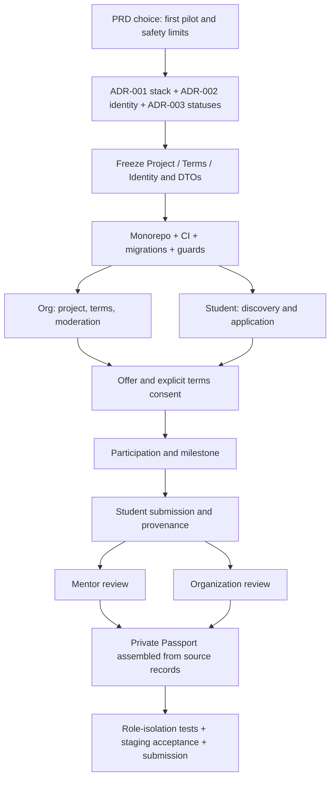

# ExperienceBridge — Development Roadmap & Delivery Plan

**Document ID:** EB-PLAN-005  
**Version:** 0.2.0 — Coordinated architecture and release-policy update  
**Prepared:** 25 October 2026  
**Status:** **DRAFT — REVIEW REQUIRED**  
**Project:** JAMS / XANIX Challenge 2026 — ExperienceBridge  
**Repository target:** `docs/05-development-roadmap.md`  
**Audience:** JAMS product lead, four active AI-assisted developers, future maintainers and their coding agents  
**Depends on:** `docs/01-product-requirements.md`, `docs/02-system-architecture.md`, `docs/03-database-api.md`, `docs/04-ui-ux.md` (all v0.2.0 / DRAFT)  
**Companions beyond the six documents (not part of this documentation-only revision):** root `AGENTS.md`, `.github/ISSUE_TEMPLATE/`, `.github/PULL_REQUEST_TEMPLATE.md`

> **Status convention:** **AGREED** means stated by JAMS in the planning conversation. **PROPOSED** means this roadmap recommends it but the team has not ratified it. **BLOCKED** means a named decision or safeguard must be resolved before doing the dependent work. **VALIDATE** means evidence must be collected from real participants. Target dates and estimates are **planning assumptions, not promises**.

> **Decision update:** Platform lead D1 owns backend, Neon database connections and migrations, Vercel configuration and GitHub Actions. D2–D4 own student/organization/mentor and admin frontend slices, with shared contract review. Feature branches are based on `staging`; PRs merge to `staging` only after Codex advisory review, CI and human approval. Actions deploy staging. An approved `staging` → `main` release PR promotes validated changes to production via Actions. The Nov 6 BUILD scope remains limited and separate from public launch.


---

> **Document-only update (25 October 2026).** This revision records the architecture and team workflow selected in the planning conversation. It does **not** mean a GitHub repository, Vercel project, Neon database, Codex integration, or CI/CD workflow has been configured or deployed. Do not treat proposed implementation details as approved product contracts. All six documents remain subject to review.

## Selected branch-to-environment delivery policy (25 October 2026)

This is **a documented future workflow, not a report of completed setup**. No repository, Vercel deployment, Neon resource or GitHub Actions automation is assumed to exist.

| Phase | Trigger | Responsible decision maker | Result |
|---|---|---|---|
| Feature development | D1–D4 work on branches based on `staging` | Assigned developer | Code + tests + updated relevant spec |
| Pull request | PR targets protected `staging` | Author | CI runs and Codex review is automatically requested, once the integration is configured and proven |
| Integration approval | Tests pass, feedback addressed | Technical lead + independent review as configured | Human-authorized merge to `staging` |
| Staging deployment | Approved merge to `staging` | GitHub Actions runner with staging-only rights | Deploy Next.js and FastAPI to Vercel staging endpoints backed by Neon staging |
| Acceptance testing | Staging deploy is healthy | Product lead and relevant domain owners | Evidence of tested integrated workflows; blockers tracked |
| Production release | Reviewed `staging` → `main` PR | Technical lead/final release approver | Human-authorized production deployment by GitHub Actions to Vercel, using Neon production |
| Postrelease | Live health/smoke checks | Technical lead and backup operator | Monitor, rollback application if needed, handle migration risk separately |

**Scope and accountability:** D1 owns the future backend, API contract, Neon branches/migrations and deployment configuration; D2 owns Student UI, D3 Organization UI and D4 Mentor/Admin/Passport UI. All four remain responsible for tests and integration. Codex review is **advisory** and does not independently approve a PR. Configuring automatic Codex review through MCP, GitHub integration, or an approved automation is an **implementation decision pending verification**, not an already-installed service.

**Deployment gate:** Even after the technical pipeline works, production must not accept real-user/private project data until authentication, privacy, compensation, identity, evidentiary claims and operations pass their separate product/release approvals.

---

## 0. Executive delivery agreement

### 0.1 What we are building [AGREED DIRECTION]

ExperienceBridge connects emerging talent with **genuine, bounded work projects** offered by organizations. Students apply, accept explicit terms, produce work, receive mentor observations and independent organization acceptance, and assemble an **evidence-backed Experience Passport**. The platform eventually supports controlled sharing with recruiters, while a platform-admin experience governs eligibility, project moderation, safety and disputes.

We are designing a **complete long-term production product** but delivering it incrementally. An early working vertical slice must not be called a finished public launch. A polished synthetic demonstration must not be presented as a real employer pilot.

### 0.2 Operating constraints [AGREED / KNOWN]

| Attribute | Planning input |
|---|---|
| Team size | **4 active developers**, including the team lead [AGREED] |
| Coding method | AI-assisted / “vibe coding”, with developers accountable for reviewing and understanding all merged changes [AGREED] |
| Availability | **16+ hours per developer per week** as stated, to re-confirm weekly [AGREED INPUT, not tracked actuals] |
| Challenge checkpoint | **Friday 6 November 2026, 18:00 Ghana time**: BUILD submission; **Saturday 7 November**: live judging [CHALLENGE TIMELINE] |
| Repo | To be created by team lead; code collaborators to be invited [NOT YET CONFIRMED CREATED] |
| Existing prototype | Earlier demo/prototype exists; **code audit required** before reuse/rebuild decision [UNKNOWN CODE QUALITY] |
| Candidate architecture | **Selected:** Next.js + TypeScript (Vercel), FastAPI + Python (Vercel), Neon PostgreSQL; managed identity and private object storage still TBD. ADR-001/009/011 approved for platform setup. |
| First geographical scope | Ghana, low-risk first use cases; target users/industry require validation [PROPOSED] |
| Project payment | Paid and safeguarded unpaid categories in principle; unpaid commercial production blocked under proposed initial policy |
| Pilot status | **No primary interviews, organization pilot, recruiter adoption or mentor availability claimed as completed** by these documents |

### 0.3 Three distinct definitions of delivery

1. **BUILD checkpoint:** A reliable, honest, permission-aware **narrow workflow** and a well-documented learning position by 6 November. It may use **clearly marked synthetic** demo actors where genuine pilots are unavailable.
2. **Controlled operational pilot:** Real organization + actual consenting student participant + available mentor + agreed scope, safety conditions and lawful terms + measurable outcomes. The software must pass the required security/privacy/release gates **before** handling real participant data or confidential work.
3. **Public production launch:** Robust operations, compliance, moderation, reliability, auditability, user support, confidentiality, evidence sharing, and proven ability to deliver value. This is **not** assumed achievable in the BUILD window.

### 0.4 Non-negotiable quality gates

- Authentication and **server-side resource authorization** for every protected read and mutation. Changing dashboard tabs does not grant roles.
- Organization identity checks, mentor assessments, and organizational acceptance are **separate** assertions by attributable actors.
- Paid/unpaid terms, estimated effort, ownership/confidentiality, and participant acceptance are **recorded**, not hidden in copy.
- Student evidence stays **private by default**. No unsecured public storage or public passport links in BUILD.
- Genuine external interviews, pilots, compensation, verification and adoption are never synthesized into marketing claims.
- One reviewed repository workflow: no unchecked AI-generated code directly to `main`, no unreviewed auth/schema changes.
- Compliance and operational approval are prerequisites for **real** compensated/unpaid work and real-data onboarding; mock/sandbox data can be used while decisions are pending.

---

## 1. Planning method and authoritative sources

### 1.1 Documents and precedence

| Source | Governs | What to do if disagreement arises |
|---|---|---|
| PRD, `01` | Product intent, features, user-facing rules, safeguards, requirement IDs | Product lead raises explicit change request |
| SAD, `02` | Architectural boundaries, proposed technology and ADR process | Architecture owner makes ADR, identifies affected modules |
| Database/API, `03` | Proposed data/status semantics, API IDs, permissions, transaction rules | Domain owners reconcile before writing/merging dependent endpoints |
| UI/UX, `04` | Screen IDs, navigation, states, accessibility and user-facing disclosure | Design/feature owners update screen contract after domain agreement |
| This roadmap, `05` | Sequencing, capacity, ownership, milestones and GitHub issue planning | Roadmap changes do **not** redefine product rules |
| Engineering standards, `06` [DRAFT] | PR workflow, naming, test bar and developer/agent behavior | Publish before parallel coding at scale |
| `AGENTS.md` [SEPARATE DRAFT] | Agent entry point; points to the approved sources | Must not invent product rules or override the above |
| Generated executable contracts [PENDING] | Approved, synchronized OpenAPI and migrations for implemented endpoints | Keep specs/tests synchronized via reviewed change process |

**Specification discrepancy already recorded in Document 3 §14.1:** PRD §6 uses review-related *submission* states at the conceptual level; the API model separates **submission**, **mentor review** and **organization review** records. Do **not** ship either interpretation until `ADR-003` and `UX-DEC-07` are resolved. Document 3 also proposes one lifetime application per student/project vs PRD's one active application. These conflicts belong in decision issues, not in silent agent assumptions.

### 1.2 Definition of scope labels

| Label | Meaning | Does it mean shipping by Nov 6? |
|---|---|---|
| `BUILD` | Candidate minimal integrated challenge demonstration | **Only after estimation; may be reduced** |
| `P0` | Full first functional product slice | **No**; may extend beyond BUILD |
| `P1` | Real-public-release features and operational safeguards | **No** |
| `P2` | Expansion dependent on validated demand | **No** |
| `HOLD` | Blocked by legal/security/product decision | **No implementation until cleared** |

### 1.3 Work planning hierarchy

`Vision → user journey → PRD requirement → domain/API/UI contract → epic → GitHub issue → branch/PR → tests → staging demo → release evidence`.

Every issue must identify requirement IDs (e.g. `APP-001`), API IDs (e.g. `API-APP-01`) and UI screens (e.g. `STU-03`) when applicable. `TBD` is preferable to a fabricated mapping. Issue templates appear in §15.

---

## 2. Team operating model and accountability

### 2.1 Four ownership lanes [PROPOSED; choose owners by skills and availability]

| Lane | Working label | Primary domain | Minimum deliverables | Watch-outs |
|---|---|---|---|---|
| **D1** | Technical lead + platform foundation | Repository, CI, identity/session integration, base DB migrations, central authorization, shared API contracts, staging | Bootstrap repo; ADR coordination; runnable environment; auth guard and forbidden-access tests; contract generation; staging gate | **Not** sole backend developer, reviewer or tester; avoid becoming bottleneck |
| **D2** | Student workflow owner | Public project discovery, student applications/offers, participation workspace, evidence submission, private passport UI | Student journey across shared API; accessible UI states; application/submission negative tests | Depends on D3 project and offer contract, D4 passport assertions |
| **D3** | Organization workflow owner | Organization project/terms, applicant management, selection, milestones, organization acceptance | Approved project pipeline, disclosed terms, offer workflow, acceptance decisions | Depends on D1 membership guards, D2 application shape, D4 review provenance |
| **D4** | Mentor + passport owner | Mentor assignments/reviews, rubric versioning, passport private read model; limited moderation UI **only if capacity permits** | Independent mentor review, provenance-rich passport, explicit incomplete states | Full admin/dispute/public sharing scope is **not** feasible as D4's BUILD workload |

**Specific workload balancing:** D1 coordinates temporary *basic* admin fixtures/moderation route with D3, rather than assigning full admin to D4. D3 owns organization acceptance. D4 owns mentor review + passport. Shared UI and contract changes require affected developer review.

### 2.2 RACI-style responsibility matrix

Legend: **A** accountable for decision; **R** implementing or producing work; **C** consulted; **V** independent reviewer/verifier. `Product` is the team lead acting in a product capacity, not an additional fifth developer.

| Deliverable | Product/lead | D1 | D2 | D3 | D4 |
|---|---|---|---|---|---|
| Scope, paid/unpaid and safety policy | A | C | C | C | C |
| Stack/auth ADRs | A | R | C | C | C |
| Shared schema + OpenAPI version | C | A/R | C/V | C/V | C/V |
| Student flow and tests | C | V | A/R | C | C |
| Organization flow and tests | C | V | C | A/R | C |
| Mentor + passport semantics | C | V | C | C | A/R |
| Moderation rules and safe fixtures | A | R | C | R | C |
| Cross-domain E2E and stage release | A | R | R | R | R |
| Pilot recruitment / consent / feedback | A/R | C | C | C | C |
| Operational legal/privacy sign-off | A (seek qualified advice) | C | C | C | C |

The team lead may also be D1; this table does **not** imply five people. No developer may independently approve their own high-risk PR.

### 2.3 Review rotation to avoid a single-person merge queue

- Normal feature PR: one **other** developer reviews; D1 is consulted only for shared contracts/auth/schema.
- Auth, public sharing, compensation policy, migrations, admin permissions: D1 + one affected domain reviewer where practical; product/policy owner approval when business rules change.
- D1-authored high-risk changes: reviewed by D2, D3 or D4, never self-approved.
- If reviewer cannot explain a critical piece of AI-generated logic, PR goes back to draft.
- Shared backend files touched by two issues: designate a temporary integration owner and sequence PRs; do not resolve merge conflicts by throwing away someone else's validation.

### 2.4 Weekly availability and actual-time tracking

The stated **16+ hours per member per week** is a planning input. At every planning meeting each developer reports next-week realistic hours, existing course/exam commitments and any blockers. Record **actual** time spent and throughput; recalibrate estimates after the first cycle. Never plan 100% of available time as feature coding.

---

## 3. Capacity model and delivery feasibility

### 3.1 Conservative BUILD capacity calculation [ESTIMATE]

At 4 developers × 16 hours/week = **64 gross team hours/week**. Approximately 12 days from planning kickoff to deadline corresponds to ~**110 gross person-hours** (`64 × 12 / 7`, rounded). More hours may be volunteered but must not be assumed.

The time is not all feature output. A suggested initial allocation (adjust to observed team velocity):

| Work type | Approximate team hours | Purpose |
|---|---:|---|
| Decisions, contract alignment, repo setup | 14 | Freeze minimal flows, identity model and shared contracts |
| Implement + developer tests | 53 | Smallest critical end-to-end product path |
| Continuous integration / fixing cross-module issues | 15 | Real API + DB + screens working together |
| QA, security checks, accessibility and rehearsal | 13 | Unauthorized access, failures, demo reliability |
| Stakeholder/pilot operations and truthful evidence notes | 7 | Outreach, consent, research, not fabricated outcomes |
| Contingency / submission buffer | 8 | Defects, deployment issues, packaging |
| **Total planning envelope** | **110** | **Provisional; revise after first day** |

**Feasibility assessment:** Document 3's candidate ~20 operations and Document 4's many BUILD-labelled screens are a *stretch*, not a reliable promise inside 53 coding/test hours. For the challenge, prioritize an **integrated subset of actual persisted actions**. If authorization, end-to-end integration or basic project terms fall behind, immediately remove secondary dashboards/filters and narrow the demo. No mock endpoint should be represented as real capability.

### 3.2 Explicit scope gates

| Gate | Date target | What must be true | Outcome if not true |
|---|---|---|---|
| G0: Decisions | **Oct 25–26** | First target scope, stack, identity, lifecycle, project/team mode, terms rules provisionally ratified for safe demo | Freeze to synthetic-only design/prototype; no high-risk implementation assumptions |
| G1: Foundation | **Oct 27** | App boots, CI runs, DB migration in dev, dev identities/context tests, common errors | Stop parallel advanced screens; pair on foundation |
| G2: Core flow integration | **Oct 31** | Project → application → offer/consent persists end-to-end under server auth | Cut mentor/passport scope to honest read-only preview if necessary |
| G3: Review chain | **Nov 2** | Submission + independent reviewer actions + provenance-aware preview, or explicit partial-data state | Demo truthful partial journey; do not forge accepted status |
| G4: Release candidate | **Nov 4** | Stage deploy, critical role-isolation and regression tests, reproducible demo | Stop new features, repair security and reliability |
| G5: Challenge submission | **Nov 6, before 18:00 GMT** | Evidence captured, working link checked, pitch/documents submitted | Submit stable reduced version, no last-hour risky merges |
| G6: Live judging | **Nov 7** | Rehearsed scenario, fallback recording/screens, candid limitations | Present only demonstrably working functionality |

### 3.3 Critical scope cut order

Cut from BUILD in approximately this order if time slips: analytics → advanced dashboard summaries → search filters beyond basic list → self-service organization verification → full admin console → notifications → file uploads → public passport links → payments → matching → team collaboration. Some are already P1/P2. **Do not cut** authorization, terms disclosure, actor attribution, separation of reviews, honest status labels, or non-sensitive-data protections.

---

## 4. Release milestones: full product, staged delivery

### R0 — Architecture and contract readiness [Oct 25–26, PROPOSED]

- Ratify or explicitly defer open blockers listed in §6.
- Choose repo reuse vs rebuild after short existing-code audit; do not conflate running demo pages with sound auth/data architecture.
- Freeze **minimum** `Project`, `TermsVersion`, `Application`, `Offer`, `Participation`, `Submission`, `MentorReview`, `OrganizationReview`, `PrivatePassport` DTOs from Document 3.
- Freeze permitted BUILD user roles and **non-production fixtures**.
- Generate sample issue packets and staging user-test script.

**Exit evidence:** meeting decisions in `docs/decisions/`, linked issue IDs, signed-off API/DTO list, clear BUILD definition.

### R1 — Integrated BUILD demonstration [by Nov 6, PROPOSED]

- Connected role-aware user experiences, persisted PostgreSQL records and audited critical state changes.
- At minimum, demonstrate a coherent subset of organization/project → student application → student/organization decision → participation → submitted work → mentor/org review → private passport provenance. **If any segment cannot be responsibly implemented, label absent functions and state limitations clearly rather than fake the path.**
- Demo/test environment uses synthetic accounts clearly labeled as sample accounts; do not call seeded organizations external partners.
- Test forbidden actors, duplicate application, expired/changed offer, incorrect terms, missing mentor assignment, and cross-organization data access as relevant to implemented operations.
- Deliver honest research/pilot evidence: only first-hand observations actually collected and consented to.

**Exit evidence:** staging link, test report, filmed or written reproducible walkthrough, list of working vs simulated components, open-risk register, BUILD submission artifact.

### R2 — Secure functional beta / full P0 [AFTER BUILD; dates to estimate]

- Fill remaining P0 gaps in Document 3 and incomplete screens in Document 4.
- Organization identity/onboarding, project moderation, real offer acceptance, revisions, withdrawal, support/incident pathways and audit trail.
- Stabilized terms-versioning and business invariants with regression tests.
- Mentor vetting/assignment rules reviewed; more complete project lifecycle.
- No broad production rollout until legal/privacy and security gates in §11 pass.

### R3 — Controlled real-user pilot [AFTER R2 + compliance approval]

- One genuine organization, one or more willing adult students, and at least one eligible mentor with bounded project, documented supervision, rights, remuneration/volunteer terms and consent.
- No company secrets or sensitive user data by default; approved non-sensitive artifacts only.
- Collect predefined metrics and distinct qualitative perspectives; publish results without exaggeration.
- Test whether an organization values the output, a mentor can review fairly, and a recipient understands the passport. **These remain hypotheses until observed.**

### R4 — Wider production launch [CONDITIONAL]

- Clear privacy notices, registration/compliance review, secure file handling, accessible and responsive flows, deletion/correction process, rate limits, abuse support, backups, uptime/error telemetry, on-call/incident playbooks.
- Privacy-reviewed public/share-safe passport projection with expiring and revocable access if selected.
- Operational capacity for project moderation and user support; realistic terms and pricing.
- Do not set a launch date until R3 proves the workflow workable and release gates are met.

### R5 — Evidence-led expansion [CONDITIONAL / P2]

- Team projects with attributable work; institution partnerships; recruiter search; matching/recommendations; supported integrated payments; verified skill taxonomy; analytics; monetization experiments.
- Each major expansion requires a separate product/business hypothesis, data-protection assessment, cost/security review and a measurable success criterion.

---
## 5. Dependency graph and contract freeze

### 5.1 Critical path



Mentor and organization reviews can be independently completed in different orders. A missing review must stay **missing** in the passport; it must never be silently marked completed. The graph shows **dependency order**, not a claim that every node can be built by Nov 6.

### 5.2 Shared contracts frozen before parallel PRs

| Contract packet | Lead | Reviewers | Blocking for | Source |
|---|---|---|---|---|
| C-01 Identity and effective scope (SELF, organization membership, mentor assignment, admin) | D1 | D2, D3, D4 | All protected actions | Doc 2 §8; Doc 3 §§1,4 |
| C-02 Project, terms snapshot, compensation & status | D3 + D1 | D2, D4 | Project cards, application and offer | Doc 1 §§2,4; Doc 3 §§3.2,5.2,6.2 |
| C-03 Application, offer, consent, participation | D2 + D3 | D1 | Offer workflow, workspace | Doc 3 §§3.3,5.3,6.3 |
| C-04 Milestone, submission, external evidence | D2 | D3, D4 | Mentor/org assessments | Doc 3 §§3.4,5.4–5.5,6.4–6.5 |
| C-05 Mentor, organization review, rubric and attribution | D4 + D3 | D1, D2 | Passport representation | Doc 3 §§3.4,5.5,6.4 |
| C-06 Private Passport projection, source attribution, display labels | D4 | D1, D2, D3 | Student passport UI | Doc 3 §§3.5,5.6,6.6; Doc 4 §6.8 |
| C-07 API errors, pagination, time/money conventions | D1 | All | Every API client | Doc 3 §§1,8.7,9 |

**Freeze artifact:** versioned markdown decision + example JSON + approved schema + test fixture. The first approved OpenAPI spec and generated client become a shared build artifact; frontend developers must not maintain separate manually invented DTOs.

### 5.3 What happens when a contract changes

1. Issue describes the reason, affected PRD requirement IDs and consumer modules.
2. Domain owner proposes schema/API change; no direct unreviewed shared change.
3. Impacted developers review compatible migration plan and error cases.
4. API schema, database migration, generated client, tests and docs update together.
5. Staging smoke and cross-tenant tests run before merge.
6. A breaking change must have a coordinated release/migration plan, not merely a modified TypeScript interface.

---

## 6. Blocking decisions and readiness register

The team may prepare documentation, synthetic fixtures and isolated UI components while these decisions are pending, but **must not treat unresolved decisions as production facts**.

| Gate / existing reference | Proposed decision or evidence needed | Accountable party | Due for | Status |
|---|---|---|---|---|
| `ADR-001` / `DEC-011` | Choose **Next.js + FastAPI** versus TypeScript-only stack based on team skills/operational cost; update all docs | D1 + entire team | Runtime scaffold | **OPEN** |
| `ADR-002` | Choose managed auth identity provider, session model, API token verification and CSRF/CORS controls | D1 + reviewer | Real sign-in | **OPEN** |
| `ADR-003` / `DEC-012` | Freeze publication, application, participation, submission and independent review lifecycles | D1 + domain owners | State-changing endpoints | **OPEN** |
| `ADR-004` / `DEC-009` | Solo-first or team execution; recommendation **solo-first** for P0 | Product lead + domain owners | Participation schema | **OPEN** |
| `DEC-004` | Pilot maximum duration, expected hours, age, mentoring support, compensation policy | Product + mentor + organization | Real pilot/posting rules | **OPEN** |
| `DEC-005` | IP ownership, approved artifact excerpts, disclosure rights and consent | Product + qualified advisor | Real signed project | **OPEN** |
| `DEC-006` | Data protection registration/lawful basis, consent/notice, retention, processing/hosting | Privacy owner + qualified advisor | Real personal data | **OPEN** |
| `DEC-007` | Organization verification procedure, decision evidence, indicator semantics | Admin/operations | “Verified organization” claim | **OPEN** |
| `DEC-008` | Mentor vetting, conflict-of-interest, capacity, assignment and replacement | Mentor operations | Genuine endorsements | **OPEN** |
| `DEC-010` | Public/private passport rules, item-level sharing, expiry/revocation | Product + security reviewer | Recruiter sharing | **OPEN** |
| `ADR-005` | Private storage vendor, malware handling, supported artifact type and max size | D1 + privacy review | Real uploads | **OPEN** |
| `ADR-007` / `DEC-002/003` | Ghana work/volunteering, intermediary classification and obligations | Product + Ghana legal advisor | Real operations | **OPEN** |
| `UX-DEC-01` | Branding/tokens, acceptable for accessibility | D2 + design reviewer | UI freeze | **OPEN** |
| `UX-DEC-06` | Mentor rubric version, outcomes and explanatory labels | D4 + mentor advisors | Reviews/passport claims | **OPEN** |
| `UX-DEC-12` | Final BUILD pages and feature cutoff | All; lead approves | Oct 26 | **OPEN** |
| `DEC-001/013` | First pilot user/organization focus and baseline pilot success criteria | Product + outreach | Pilot recruitment | **OPEN** |

**Meeting outcome requirement:** every decision gets either `APPROVED`, `DEFERRED WITH RESTRICTION`, or `BLOCKED`; no silent default. ADR file records alternatives, decision owner, approval date, affected docs and test implications.

### 6.1 Recommended 90-minute team kickoff agenda [Oct 25/26]

| Minutes | Topic | Required result |
|---|---|---|
| 0–10 | Mission and BUILD/public-release distinction | All recognize real vs sample evidence |
| 10–25 | Full journey and scope cut | One candidate flow; one stretch flow; explicit exclusions |
| 25–45 | Stack, authentication and project mode | ADR-001, ADR-002 preliminary, ADR-004 |
| 45–60 | Terms and review truth model | ADR-003, compensation, independent reviewers |
| 60–70 | Ownership and realistic hours | D1–D4 assigned by name; primary and backup |
| 70–80 | GitHub and review policy | Repo, branch protections and PR approvals |
| 80–90 | Issues, acceptance and next check-in | Tasks allocated with first dependency deadline |

**Don't ask AI agents to implement before the team resolves the relevant gate.** A provisional implementation plan can exist while a release remains blocked.

---

## 7. BUILD execution calendar — 25 October to 7 November

**Calendar is proposed.** All times Ghana local time (GMT / UTC+0). The date names and completion evidence are more important than exact daily clock hours; each owner should book working time based on classes and other commitments.

| Date | Team milestone and integration checkpoint | D1 | D2 | D3 | D4 | End-of-day observable evidence |
|---|---|---|---|---|---|---|
| **Sun Oct 25** | Kickoff + document reconciliation | Lead ADR discussions | Review student DTO/screens | Review project/terms DTO | Review mentor/passport semantics | Decisions logged, candidate BUILD scope chosen |
| **Mon Oct 26** | Freeze first contracts and issue ownership | Repo and shared CI skeleton | Student page skeleton + contract tests | Project posting skeleton + compensation rules | Rubric/passport assertion example fixtures | CI green; C-01..C-07 agreed at least for narrow flow |
| **Tue Oct 27** | Foundational runnable integration | Session/auth guard and DB migrations | Project list and application form using generated client | Org project form, approved fixture and project list | Mentor review DTO + truthful passport read model | Postgres-backed route works with role check |
| **Wed Oct 28** | First thin working vertical slice | CI, role-isolation review | Project apply + duplicate handling | Organization approve/offer and terms snapshot | Mentor assignment guard | Authenticated project→application persists |
| **Thu Oct 29** | Offers, workspace and acceptance | Help unstick shared API | Offer consent and participation workspace | Offer creation and milestone setup | Mentor assignment acceptance | Student may accept exact terms; guard rejects invalid recipient |
| **Fri Oct 30** | Evidence + independent review contracts | Audit/events + staging setup | Submit safe external evidence/text | Organization decision input/output | Mentor rubric assessment input/output | Submission visible to assigned reviewers only |
| **Sat Oct 31** | **G2 integration gate** | Run all-hands E2E | Fix student workflow | Fix org/project/offer | Review provenance labels | First full connected core path or reduced explicit status |
| **Sun Nov 1** | Review and passport integration | Check forbidden cases | Private passport screen | Org acceptance decisions | Independent mentor review and passport projection | No self-awarded organizational approval |
| **Mon Nov 2** | **G3 review-chain gate** | Cross-tenant and concurrency tests | UI negative paths | Terms/review failure paths | Missing/disputed review rendering | Demo captures real DB provenance, or honest partial journey |
| **Tue Nov 3** | QA and stakeholder research | Deploy stage, monitoring and smoke tests | Mobile, accessibility and empty/error states | Organization UX and review validation | Mentor UX + passport copy | Test log, fixed critical defects, actual stakeholder notes if available |
| **Wed Nov 4** | **G4 release candidate** | Freeze high-risk changes; roll back broken PRs | E2E recorded walkthrough | Demo data/terms policy check | Passport assertions audit | Staging candidate and reproducible demo |
| **Thu Nov 5** | Rehearsal and submission packaging | Verify links, CI and backups | Demo student flow | Demo organization flow | Demo review/passport flow | Video/screenshots, limitations, pilot evidence correctly attributed |
| **Fri Nov 6** | **Submission by 18:00 GMT** | Deploy stable revision, submit evidence | Smoke check | Smoke check | Smoke check | Submitted artifacts / stable demonstration |
| **Sat Nov 7** | Live judging | Technical response | Student journey | Organization journey | Review/passport trust | Rehearsed honest live demonstration |

**Scheduling caveat:** Nov 7 is the judging checkpoint, not an engineering shipping deadline. Any last-minute fixes before judging should be limited to demonstrably safe repairs.

### 7.1 Short recurring coordination

- **Daily async update (5 minutes):** `Yesterday / Today / Blocker / PR link / test evidence` in the GitHub Project or team chat.
- **Daily integration check (10–20 minutes during BUILD):** D1 plus impacted developers check merges/contract drift; can be asynchronous if no conflicts.
- **Twice weekly pair review:** affected owners demonstrate actual frontend-to-backend calls rather than slide or screenshots alone.
- **Existing Wed/Sat evening team meetings** may serve as sprint reviews when practical; confirm around class schedules. Never treat unconfirmed meeting attendance as done.
- **Weekly estimation refresh:** update actual hours, tasks closed, blockers, issue priority and critical-path risk.

### 7.2 Challenge-week feature freeze policy

From **Nov 4**: no unsolicited redesign, schema rewrite, identity-provider switch, file-upload addition, public sharing feature or new payments logic. Critical security/reliability fixes need independent review and staging verification. Freeze can be relaxed only by explicit product + technical lead decision with rollback plan.

---

## 8. GitHub delivery organization

### 8.1 Repository proposal

One **monorepo**, initially private until the team agrees on licenses and public visibility:

```text
experiencebridge/
├── README.md
├── AGENTS.md                         # To create after Doc 6
├── CONTRIBUTING.md                   # To create after Doc 6
├── .env.example                      # Placeholders only; never secrets
├── apps/
│   ├── web/                          # Next.js client if ADR-001 selects it
│   └── api/                          # FastAPI server if ADR-001 selects it
├── packages/
│   ├── ui/                           # Shared design components if useful
│   └── contracts/                    # Generated/approved API clients/types
├── docs/
│   ├── 01-product-requirements.md
│   ├── 02-system-architecture.md
│   ├── 03-database-api.md
│   ├── 04-ui-ux.md
│   ├── 05-development-roadmap.md
│   ├── 06-engineering-standards.md   # To create
│   ├── decisions/
│   ├── features/
│   └── testing/
├── tests/
│   ├── contract/
│   ├── authorization/
│   └── e2e/
└── .github/
    ├── ISSUE_TEMPLATE/
    ├── PULL_REQUEST_TEMPLATE.md
    ├── CODEOWNERS                    # Optional, needs repo-setting alignment
    └── workflows/
```

The choice of `apps/api/` and framework-specific conventions stays **PROPOSED** until `ADR-001`. Do not initialize incompatible frameworks in parallel.

### 8.2 Branch and PR conventions [PROPOSED]

- `main`: protected, always deployable to **staging**, never direct pushes.
- `feat/EB-024-student-application`, `fix/EB-051-cross-tenant-denial`, `docs/EB-004-state-machine`: example branch names.
- At least **one independent review** and passing required automated checks before merge; stricter for auth, payment terms, data exposure and schema.
- Small PRs that target one coherent issue, preferably mergeable daily.
- `CODEOWNERS` can notify reviewers but must not replace actual branch rules or required human approval.
- Secrets only in provider secrets management, not `.env`, prompts, screenshots or AI chat history.
- `main` merges trigger staging deploy only after tests; production deploy requires separate approval gate.

### 8.3 GitHub Project fields [PROPOSED]

| Field | Type or examples | Purpose |
|---|---|---|
| Status | `Backlog / Ready / In Progress / In Review / Blocked / Done` | Flow state |
| Priority | `Critical / High / Medium / Later` | Deterministic scope cuts |
| Milestone | `R0 / R1 BUILD / R2 Beta / R3 Pilot / R4 Launch / R5 Growth` | Release targeting |
| Owner | D1–D4 + named person | Responsibility |
| Estimate | Focus hours or `S/M/L` | Capacity and scope |
| Domain | `platform / student / organization / mentor / passport / admin / product` | Filtering |
| Depends on | Issue IDs | Avoid starting blocked tasks |
| Contract status | `Draft / Approved / Changed` | Prevent AI-driven drift |
| Risk | `Low / Medium / High` | Reviewer and testing intensity |
| Actual hours | Logged by contributor | Learn real velocity |
| Evidence link | PR/test run/staging demo | Prevent premature Done |

**GitHub Issues** store implementation-ready tasks; **GitHub Projects** stores cross-team schedule and dependency visibility. If free-tier or repository rule availability differs, configure equivalent reviews/checks where supported; do not assume all paid GitHub enforcement controls are available.

### 8.4 Labels [PROPOSED]

`type:feature`, `type:bug`, `type:docs`, `type:security`, `type:research`, `priority:critical`, `priority:high`, `priority:later`, `scope:BUILD`, `scope:P0`, `scope:P1`, `scope:P2`, `blocked:decision`, `blocked:contract`, `needs:review`, `ai-assisted`, `domain:*`.

Use milestone labels/field consistently. Agents may propose issues but must not silently shift a P1 feature to BUILD priority.

---
## 9. First GitHub issue backlog — BUILD candidates

All IDs below are **planned tracking IDs, not issues already created**. The real GitHub issue number will differ. Estimates are **team focus-hours including developer tests** unless marked as meeting/operations. The team must refine each estimate. `MUST` means required for the proposed cohesive story **if feasible**; if infeasible, revisit the story rather than pretending a feature works. No issue is `Done` without its acceptance evidence.

### 9.1 Contract/decision and foundation issues

| Planning ID | Owner | Candidate scope | Estimate | Dependency / critical output |
|---|---|---|---:|---|
| `EB-001` | D1 + all | **MUST** · Scope, role model, project type, state-machine/stack/identity ADR meeting | 4 h team meeting allocation | PRD/SAD/DAS/UI review; approved or explicitly deferred decision list |
| `EB-002` | D1 | **MUST** · Repository, shared scripts, lint/type/test CI skeleton | 4 h | ADR-001; reproducible local setup and green checks |
| `EB-003` | D1 | **MUST** · Backend actor identity and resource-scope guard | 5 h | ADR-002, C-01; forbidden vs permitted request tests |
| `EB-004` | D1 | **MUST** · Core PostgreSQL migration + approved DTO/OpenAPI baseline | 5 h | ADR-003, C-02..C-07; fresh DB migration and sample seed |
| `EB-005` | D1 + D3 | **MUST** · Safe deterministic synthetic fixtures + basic project moderation decision | 3 h | EB-003/004; no fixture presented as externally verified |
| `EB-006` | D1 | **STRETCH** · Structured audit-event helpers & transition telemetry | 3 h | EB-004; meaningful actor/timestamp without secrets in logs |

**Engineering caution:** Five hours for actor/scoped authorization is aggressive. If actual integration demands more, pull time from stretch UI and never skip negative-access tests.

### 9.2 Student journey issues

| Planning ID | Owner | Candidate scope | Estimate | Dependency / critical output |
|---|---|---|---:|---|
| `EB-010` | D2 | **MUST** · Approved project discovery/detail | 3 h | EB-004/005 + `ProjectCard`, `ProjectDetails`; no private drafts shown |
| `EB-011` | D2 | **MUST** · Apply once, duplicate and closed-project handling | 4 h | EB-010 + C-03; owner derived from session |
| `EB-012` | D2 + D3 | **MUST** · Offer consent view with exact terms hash | 3 h | EB-011, EB-021; cannot accept others' or expired offers |
| `EB-013` | D2 | **MUST** · Participation summary + safe text/external evidence submission | 5 h | EB-012, C-04; traceable versioned metadata, private output |
| `EB-014` | D2 + D4 | **STRETCH** · Student private passport screen with contextual status explanations | 3 h | EB-031; no public links or blanket verified labels |
| `EB-015` | D2 | **AFTER BUILD/P0** · Withdrawal, revision, retries and extended empty/error states | TBD | Remaining core endpoints; PRD §§4.3–4.6 |

### 9.3 Organization journey issues

| Planning ID | Owner | Candidate scope | Estimate | Dependency / critical output |
|---|---|---|---:|---|
| `EB-020` | D3 | **MUST** · Draft project, compensation disclosure, terms version and review submission | 6 h | EB-003/004 + C-02; unpaid commercial policy enforced for demo rules |
| `EB-021` | D3 | **MUST** · Applicant list, selection and terms-bound offer | 4 h | EB-011 + C-03; only member with project authority can offer |
| `EB-022` | D3 | **MUST** · Authorized organization review (accept/revise/reject) | 3 h | EB-013 + C-05; distinct from mentor assessment |
| `EB-023` | D3 | **STRETCH** · Editable milestones and overview panels | 4 h | C-04; avoid if critical path slips |
| `EB-024` | D3 | **AFTER BUILD/P0** · Self-service org verification, member invites, exception handling | TBD | Legal/admin policies; `ORG-002` |

### 9.4 Mentor, passport and moderation issues

| Planning ID | Owner | Candidate scope | Estimate | Dependency / critical output |
|---|---|---|---:|---|
| `EB-030` | D4 | **MUST** · Controlled mentor assignment/acceptance and rubric review | 6 h | EB-012/013 + C-05; signed-in accepted assigned mentor only |
| `EB-031` | D4 | **MUST** · Private passport source projection + provenance labels | 5 h | EB-013/022/030 + C-06; separate student, mentor, org assertions |
| `EB-032` | D4 | **STRETCH** · Mentor dashboard/history with empty/partial/error states | 3 h | EB-030; no falsely completed reviews |
| `EB-033` | D4 + D1 | **AFTER BUILD/P0** · Full admin queues, incident triage and richer audit explorer | TBD | Admin support policy and broad regression checks |
| `EB-034` | D4 | **AFTER BUILD/P1** · Safe passport sharing, revocation and verifier view | TBD | `DEC-005/006/010`, `API-PASS-03..06` |

### 9.5 Shared integration, test, release and research issues

| Planning ID | Owner | Candidate scope | Estimate | Dependency / critical output |
|---|---|---|---:|---|
| `EB-040` | D1 coordinates, all R | **MUST** · End-to-end test of persisted project→apply→offer→submit→review→private passport | 8 h shared | EB-005,011,012,013,020,021,022,030,031; reproducible staging evidence |
| `EB-041` | D1 + affected owners | **MUST** · Authorization, duplicate, forged reviewer, terms-change negative tests | 5 h shared | Core routes; failures correct and audited |
| `EB-042` | D1 | **MUST** · Staging configuration, healthcheck, deploy/rollback smoke test | 4 h | EB-002/004 + approved hosting; secret hygiene |
| `EB-043` | D2 + all | **MUST** · Mobile/error/accessibility sanity test of actual BUILD screens | 3 h | EB-040; record screenshots and defects |
| `EB-044` | Product lead + all | **MUST** · Challenge walkthrough, demo boundaries, claims/evidence checklist | 5 h shared | Staging stable, research evidence accurately documented |
| `EB-045` | Product lead + participants | **PARALLEL OPERATIONS** · Recruit/interview real student, mentor and organization ethically | 7 h initial allocation | Consent, no inducement or fabricated testimonial; may extend beyond BUILD |
| `EB-046` | Product lead + all | **STRETCH** · Pilot agreement and observation plan for actual bounded project | TBD | Legal/privacy gates, willing organization/student/mentor |

### 9.6 Backlog interpretation and feasibility warning

The rows above are **not a contractual estimate**. They deliberately include more work than the ~110-hour gross window. They are a **prioritized backlog**, not a command to finish every `MUST` row. `EB-001..005`, `EB-010..013`, `EB-020..022`, `EB-030..031` alone are approximately **48 developer/test hours plus decisions** before all shared integration, quality work and unavoidable rework. Feature owners must break or cut issues when real implementation estimates exceed the envelope in §3. An honest reduced experience is preferable to a visually complete but untrustworthy system.

**Early cut condition:** if `EB-012` offers/terms consent is not working on staging by **Oct 31**, the team should stop expanding dashboards and jointly repair foundation and transactional workflow. If independent reviewer provenance is not working by **Nov 2**, display the existing provenance and explicitly incomplete status instead of creating synthetic approval records.

---

## 10. Issue-level definition of acceptance and traceability

These examples are the **minimum acceptance test packet** required for the highest-risk issues. Every feature also inherits the global quality rules in §§12–13 and the relevant contracts in Document 3.

### `EB-003` — Server-authenticated identity and scopes

- **Requirements:** `AUTH-001`, `AUTH-002`, `SEC-001`, `SEC-002`; SAD §8; DAS §§1,4,9; relevant UI auth states.
- **Accepted behavior:** valid session resolves internal actor; user can access only their own profile and permitted organizations/projects; role label supplied by client is ignored.
- **Rejection:** unauthenticated request → 401; authenticated but unauthorized object → 403 or intentionally concealed 404 per approved policy; expired token rejected.
- **Test:** student A requests student B's participation; unrelated organization requests applicants; unassigned mentor attempts review; none return private content.
- **Review evidence:** test IDs, request/response sanitized logs, token-verification configuration described without secrets.

### `EB-020` — Project terms and posting

- **Requirements:** `PROJ-001..003`, `PAY-001`; `API-PROJ-01`, `API-PROJ-06`, `API-PROJ-07`; `ORG-05`, `ORG-06` screens.
- **Accepted behavior:** authorized manager creates complete draft; compensation category, amounts or zero, estimated work, scope and rights are explicit; saved approved terms version is immutable.
- **Rejection:** missing critical terms, forbidden unpaid commercial classification, prohibited/unsafe content, wrong organization member, or invalid publication transition.
- **Test:** draft not discoverable; materially changed terms cannot silently alter an accepted offer; review snapshot matches actual version.
- **Evidence:** persisted rows, stage screens, contract/validation test and decision/audit record.

### `EB-011` — Student application

- **Requirements:** `APP-001`, `AUTH-002`; `API-APP-01`, `API-APP-02`; `PUB-03`, `STU-03/04`.
- **Accepted behavior:** eligible signed-in student applies to approved, open project after viewing terms; server owns applicant ID; status saved and shown to applicant.
- **Rejection:** duplicate application according to **approved** `ADR-003` policy; closed draft; other-student impersonation; mismatched terms version.
- **Test:** concurrent duplicate submissions do not create two applications; other applicants remain invisible; validation errors are understandable.
- **Evidence:** DB assertion, API response, student UI, negative tests.

### `EB-012` / `EB-021` — Offer creation and consent

- **Requirements:** `APP-002`, `PAY-001`, `API-OFFER-01..03`, `STU-05`, `ORG-07`.
- **Accepted behavior:** authorized organization sends an offer for an applicant, binding a **specific terms version/hash**, capacity and expiry; intended student accepts only after viewing those terms; server creates one participation.
- **Rejection:** actor is not recipient; offer expired/revoked; project capacity exhausted; terms changed; repeat acceptance conflicts safely.
- **Test:** fake `student_id` in request never changes recipient; altered terms hash rejected; concurrent offer acceptance does not overbook.
- **Evidence:** offer/participation transaction and persisted acceptance timestamp, automated tests.

### `EB-013` — Evidence submission

- **Requirements:** `WORK-002`, `PRIV-001`, `API-SUB-01/02`, `API-EV-04`; `STU-08`.
- **Accepted behavior:** assigned student records a deliverable summary and safe approved external artifact URL or non-sensitive text; uploader, participation, version and time stored.
- **Rejection:** unassigned student, private project access, invalid URL or unapproved artifact association.
- **Test:** other student cannot read it; revision history not silently overwritten; no direct uncontrolled public bucket upload.
- **Evidence:** controlled private API responses, metadata provenance and tests.

### `EB-030` — Mentor assignment and assessment

- **Requirements:** `MENT-001/002`, `API-MENT-01/02/05`, `MEN-02/04`.
- **Accepted behavior:** named mentor must accept valid assignment before reviewing; rubric/version, observations, submission version, actor and timestamp are recorded.
- **Rejection:** unassigned mentor, org owner without mentor assignment, impersonation through payload, conflict rule violation.
- **Test:** mentor review does **not** change organization acceptance; missing or conflicted assessment shown accurately.
- **Evidence:** signed-in actor record, state-transition/permission tests and review UI.

### `EB-022` — Independent organization acceptance

- **Requirements:** `REVIEW-001`, `API-OREV-01`, `ORG-10`.
- **Accepted behavior:** authorized project organization reviewer accepts, requests revision or rejects specific evidence with reason and recorded criterion outcome.
- **Rejection:** unrelated organization, student attempting self-acceptance, mentor-only role, wrong submission, stale state.
- **Test:** mentor review can exist without organization acceptance, and vice versa; neither fabricates the other.
- **Evidence:** two independently attributed review records and tests.

### `EB-031` — Private Experience Passport

- **Requirements:** `PASS-001`, `API-PASS-01/02`, `STU-10`.
- **Accepted behavior:** passport is derived from existing source records, with distinct `self_reported`, `platform_recorded`, `mentor_reviewed`, `organization_accepted` and `organization_identity_checked` statements only where supported.
- **Rejection:** cannot present synthetic records as externally verified, cannot share confidential evidence by arbitrary guessed URL, cannot claim completed or paid where not recorded.
- **Test:** pending mentor review, missing org decision, rejected output, corrected/revoked assertion and restricted organization all render meaningful partial/qualified results as supported.
- **Evidence:** API fixture provenance links, UI labels, snapshot/contract tests, no blanket “verified” badge.

### `EB-040` / `EB-041` — Cross-role end-to-end tests

- **Requirements:** `QUAL-001`, `SEC-*`, `AUDIT-001`, `PRIV-001`, UI Doc §19 and API Doc §11.
- **Accepted behavior:** a scripted fresh-database sequence succeeds under correctly assigned actors and fails under impostor actors.
- **Negative behavior:** URL guessing, wrong organization, forged reviewer ID, changed terms, duplicate application, unauthorized artifact and missing mentor approval never produce false success.
- **Evidence:** reproducible test command, CI report, sanitized failed/request assertions, actual staging run.

---

## 11. Testing, privacy and release gates

### 11.1 Test pyramid, minimum owner and fail policy

| Layer | Required scenarios | Accountable owner | Gate |
|---|---|---|---|
| Unit tests | Validation of compensation/workload rules, DTO parsing, state-machine guards, formatter labels | Every domain author | Required for changed logic |
| API/contract | OpenAPI compatibility, standard errors, success/duplicate/forbidden cases | D1 + endpoint owner | Required for changing endpoint |
| Persistence | Fresh migrations, unique constraints, concurrency/capacity and terms hashes | D1 + domain owner | Required for schema changes |
| Resource authorization | Student cross-access, org cross-tenant, unassigned mentor, forged admin/reviewer | D1 + all affected owners | **Hard fail** before staging sign-off |
| End-to-end | Role-correct actual DB story through private passport | All; D1 coordinates | **Hard fail** for claimed working journey |
| UI/accessibility | Keyboard, focus, error labels, mobile viewport, weak connection retry | D2 + portal owner | Required for exposed screens |
| Security and privacy | Secret scan, dependency scan, safe error logging, no public private evidence | D1 + independent reviewer | **Hard fail** for high-severity issues |
| Operations | Stage deploy smoke, schema migration dry run, rollback playbook | D1 | Hard fail before public release |

**Not shipping is acceptable. Shipping unauthorized access or false verification is not.** If incomplete tests mean a feature is only a demo mock, segregate and label it rather than treating it as delivered.

### 11.2 Mandatory BUILD smoke script [PROPOSED]

1. Log into **synthetic** organization account; create project with complete compensation terms; submit for review.
2. Log into authorized synthetic admin; make recorded moderation decision; project becomes discoverable only when approved.
3. Log into synthetic student account; view full terms; apply; see persisted pending status.
4. Attempt duplicate application and wrong-user access; capture correct rejection.
5. Log into authorized organization reviewer; offer selected student; demonstrate exact terms consent and participation.
6. Student submits safe external test artifact; assigned mentor accepts and evaluates with rubric.
7. Organization reviewer independently records acceptance/revision/rejection.
8. Student views private passport with actor/source distinctions; remove one review and show resulting **partial** state.
9. Attempt accessing another student's passport or private submission as unrelated actor; confirm denial.
10. Refresh browser / restart stage service and confirm records persist in database.

If a step is unimplemented, the demo script must say **NOT YET IMPLEMENTED**. Do not attach fake success screenshots. If real external users participate, isolate their data and do not reuse it without permission.

### 11.3 BUILD release candidate checklist

- [ ] Pinned Git SHA/tag and branch; GitHub checks green.
- [ ] No high-severity vulnerability, secret exposure or broken object-level authorization identified in implemented routes.
- [ ] Staging/test database uses non-sensitive fixtures; no production-customer data ingested.
- [ ] Terms and unpaid status clear at project detail, before application, and before offer acceptance.
- [ ] Mentor review and organization acceptance independent with attributable actor records.
- [ ] Private passport claims trace back to stored source evidence.
- [ ] Public passport sharing, integrated payments and private file uploads absent unless separately approved and tested.
- [ ] Local start instructions and environment variable **names**, not values, documented.
- [ ] Screen states handle loading, empty, validation, denied and conflicts as relevant.
- [ ] Manual runbook and fallback screenshots/recording match the deployed version.
- [ ] All defects categorized as blocker, major, minor, or acknowledged limitation.
- [ ] Submission materials distinguish observed primary evidence from hypothesis and demo fixtures.

### 11.4 Gate before handling real users or real projects [BLOCKING]

Do not conflate a technically runnable prototype with permission to operate a labor/intermediation service. Before onboarding real project participants or handling their identifiable data:

- Appropriate Ghana legal review: paid/unpaid arrangement, employment/agency classification, obligations and rights, allowed practices.
- Data protection review: Act 843 applicability, registration/lawful basis, information notices, retention and international processing/hosting.
- Confirm user eligibility/age, identity policy, mentor vetting and dispute/safeguarding escalation.
- Document approved IP/confidentiality licenses and portfolio disclosure exceptions.
- Security review: identity/session, authorization, private file handling and incident management.
- Operational process: support ownership, removal/correction requests, reports, abuse suspension, backup and recovery.
- Actual consenting organization, student and mentor; a signed/recorded scoped brief and a legitimate evaluation approach.

**Until these gates are passed, run staging on synthetic data and conduct consenting research without claiming active placement or verified outcomes.**

---
## 12. Real-world validation and pilot delivery track

Research and pilot work run **alongside** development; they do not automatically become software milestones. The documented JAMS evidence base supports exploring the experience problem, **not** claiming that customers, mentors or recruiters already use ExperienceBridge.

### 12.1 Smallest useful pilot [PROPOSED; not yet launched]

| Item | Pilot boundary |
|---|---|
| Organization | **One willing verified/checked** small Ghanaian organization with a genuine, low-risk bounded task |
| Participants | **One consenting adult student** for solo-first; team mode only after `ADR-004` |
| Mentor | **One available, suitable mentor**, with documented conflict check and finite time commitment |
| Task | Narrow digital deliverable with clear acceptance criteria, initial baseline and reviewer |
| Duration | Short; exact cap in hours/days must be approved in `DEC-004` before contracting |
| Compensation | Disclosed and documented; commercial value should normally be paid under proposed platform policy; no unpaid commercial production in initial policy |
| Data | Synthetic/anonymized or non-sensitive assets; no client credentials, private customer data, confidential production access |
| Evaluation | Specific deliverable rubric, timed checkpoint(s), mentor feedback and independent organization review |
| Evidence | Source files/links only when organization has authorized disclosure; otherwise safe summaries/metadatas |
| Outcome | Accepted/revision/rejected/partial documented as it actually occurs |

### 12.2 Pilot recruitment tasks

1. Draft separate outreach and screening guides for potential student, organization and mentor; do not presume commitment.
2. Interview interested parties about scope, expected value, workload, willingness to pay/mentor, and reason to trust independent assessment.
3. Record anonymized observations and direct consent terms; no coaching respondents toward a desired answer.
4. Confirm contact/identity and permitted work; reject projects with unsafe conditions or ambiguous ownership/pay.
5. Agree a project brief with fixed scope, agreed effort, deliverables, review windows and a withdrawal/escalation route.
6. Complete legal/privacy and platform security gates for actual system operation before creating real participant accounts/data.
7. Track project execution and outcome with timestamps, assessor identities and permitted evidence.
8. After the project, separately ask student, mentor and organization what succeeded/failed; invite a recruiter to **evaluate a sample passport** only if willing and if disclosure rights allow it. Recruiter trust is not inferred from mere link opens.

### 12.3 Pilot measurement framework [SET BASELINES BEFORE LAUNCH]

| Question to test | Metric or observed indicator | What **not** to conclude prematurely |
|---|---|---|
| Will an organization provide a genuine manageable project? | `eligible_real_projects / organizations_contacted`; reasons for decline | A demo project posting proves supply |
| Does the deliverable help the organization? | Accepted output + organization rating/comments + whether output used | Any accepted mock output equals business value |
| Can a student complete with available time/support? | Completed milestones, turnaround, blockers and actual hours | Completion proves employability improvements |
| Can a mentor assess consistently? | Mentor hours, rubric completeness, disagreements with org reviewer | One positive mentor comment proves reliable skill verification |
| Is compensation fair/clear? | Agreed terms, actual reported payment confirmations, participant understanding | Platform reporting means funds were transferred |
| Would a recruiter trust the passport? | Actual recruiter response to permitted example, specific trust objections | Passport creation or page view proves employer adoption |
| Will parties repeat? | Expressed and then observed follow-up project participation | A positive interview response equals repeat retention |

For the first pilot, set explicit *decision thresholds* with the team **before seeing results**. Small samples are directional learning, not population-level proof or statistical validation. Keep participant consent and data minimization central.

### 12.4 Research artifact list

- `docs/research/interview-guide-student.md`
- `docs/research/interview-guide-organization.md`
- `docs/research/interview-guide-mentor.md`
- `docs/research/pilot-consent-and-safety-checklist.md` (qualified review required)
- `docs/research/pilot-measurement-plan.md`
- `docs/research/pilot-results-template.md` — starts blank, **never prefilled with fictional quotes**.

These are **additional supporting files**, not substitutes for the six main documents.

---

## 13. Post-BUILD product epic roadmap (complete platform)

The detailed requirements and APIs for many of these features are in Documents 1–4. Post-BUILD phases must be re-estimated after observing the four developers' actual velocity. Date ranges below are **not commitments**, only rough sequencing from release dependencies.

### Epic P0-A — Production-ready identity, profile and organization membership

**Owner:** D1 with D3. **Dependencies:** approved stack, OIDC, membership matrix, privacy notices.  
**Stories:** self profile, organization creation and verification, restricted roles and membership lifecycle, safe session recovery, admin separation, account suspension, session expiry.  
**Tests:** privilege escalation, cross-tenant leaks, duplicate identity, revoked membership, locked account, audited admin grant.  
**Exit:** active sessions and memberships are enforced server-side; admin cannot be obtained via request field or frontend role toggle.

### Epic P0-B — Complete project marketplace and fair terms

**Owner:** D3, D2 (discovery). **Dependencies:** classification/legal rules and verification/moderation SOP.  
**Stories:** organization drafts and projects, rights and confidentiality disclosures, policy review, approved project search, editable drafts with frozen terms, capacity and deadlines, cancellation.  
**Tests:** unpaid commercial rejection, changed terms require review, restricted org project hidden, closed project cannot accept applications, safe rejection feedback.  
**Exit:** honest approved listings and full terms evidence.

### Epic P0-C — Applicant selection and participation

**Owner:** D2 + D3. **Dependencies:** Epic P0-B and application/offer state machine.  
**Stories:** applications, withdrawal/rejection, shortlist, terms-bound offer, expiry, consent, participation, workspace, milestone assignment and deadline.  
**Tests:** duplicate application, concurrent offers, offer overbooking, stale terms, role impersonation, withdrawal after offer.  
**Exit:** one valid participation per accepted offer and conserved project capacity.

### Epic P0-D — Mentorship and assessed work

**Owner:** D4 + D2 submissions + D3 org review. **Dependencies:** P0-C, mentor vetting rubric and confidentiality approvals.  
**Stories:** mentor proposal/acceptance, context-restricted project access, scoped milestones, safe submissions, revision trail, rubric feedback, organization result, conflict and replacement paths.  
**Tests:** missing mentor cannot assess, mentor cannot act as org reviewer without separate authority, private evidence inaccessible out of scope.  
**Exit:** attributable independent assessments and revisions, not conflated statuses.

### Epic P0-E — Evidence-based private Experience Passport

**Owner:** D4 + D2 UI. **Dependencies:** P0-D, approved assertion model and correction rights.  
**Stories:** private profile section, project history, contribution claims, reviewed evidence, organization acceptance, disputes/corrections, missing review or partial progress explanations.  
**Tests:** assertions generated only from existing source records; revoked, corrected, incomplete and confidential outputs treated accurately.  
**Exit:** private passport gives meaningful provenance without a false global verified badge.

### Epic P0-F — Trust, moderation, operations and safety

**Owner:** D1 + Product, D3 for organization operations. **Dependencies:** policies, support owner and legal/privacy review.  
**Stories:** verification evidence handling, admin project queue, participant report, dispute triage, audit log, restriction, data deletion/correction requests and retention schedule.  
**Tests:** admin traceability, incident access restrictions, no silent review rewrite, reported payment isn't guaranteed money movement.  
**Exit:** team can safely operate controlled pilot and investigate incidents.

### Epic P1-A — Secure evidence files and disclosure permissions

**Owner:** D1 + D2 + D4. **Dependencies:** secure object storage and scanning provider ADR, privacy/IP rights.  
**Stories:** upload intent, object validation, malware scanning/quarantine, scoped download, item-level publicity approval, safe external URL display.  
**Tests:** cross-project download denied, unsafe file quarantined, guessable URL blocked, storage bucket private.  
**Exit:** permitted shareable evidence only, with traceable rights.

### Epic P1-B — Recruiter verification with revocable sharing

**Owner:** D4 + D2. **Dependencies:** P1-A, privacy-safe passport projection, DEC-010.  
**Stories:** select shareable assertions, expiration/revocation, verification explanation, no recruiter-facing confidential notes, rate limiting.  
**Tests:** revoked/expired token never opens private content, referrer/logs cannot leak tokens, viewer only sees consented assertion IDs.  
**Exit:** test recipient can verify allowed evidence without an account if explicitly permitted by policy.

### Epic P1-C — Notifications, observability and accessible UX completion

**Owner:** D1 platform + all domains. **Dependencies:** settled transaction events and operational ownership.  
**Stories:** reliable email/in-app notices, notification preferences, job retries, failed-delivery handling, incident alerts, accessible/mobile form completion.  
**Tests:** no private artifact in email, idempotent notifications, retries not duplicating offers, accessible error summary.  
**Exit:** stable managed service for controlled onboarding.

### Epic P2-A — Team projects and individual attribution [VALIDATE]

**Owner:** Product + D1/2/3/4. **Dependencies:** real observation that solo-first prevents valuable tasks.  
**Stories:** teams, shared tasks, assignment ownership, individual contributions, collaborator disputes, team-level and person-level reviews.  
**Exit:** evidence does not assign one person's work to another member; additional complexity justified by usage.

### Epic P2-B — Recruiter discovery and job outcomes [VALIDATE]

**Owner:** Product + future owner assignment. **Dependencies:** genuine recruiter usage, lawful candidate profiling.  
**Stories:** role-based candidate discovery, explicit opt-in, shortlists, meaningful review outcomes and data retention.  
**Exit:** measurable demand and controls; no unsolicited public searchable student data.

### Epic P2-C — Payments, sponsorship and monetization [VALIDATE]

**Owner:** Business/Product + engineering; qualified finance/legal advisor. **Dependencies:** pricing interviews, actual transaction need, processor/regulatory feasibility, disputes.  
**Stories:** external payment acknowledgments initially; eventually approved provider integration, payout tracking, refunds/disputes, receipts and transparent platform fees.  
**Exit:** real processor events reconciled; no platform escrow claim without actual approved mechanism.

### Epic P2-D — Recommendations, university programs and analytics [VALIDATE]

**Owner:** Product + engineering. **Dependencies:** enough accurate data and demonstrated demand.  
**Stories:** transparent eligibility ranking, skill taxonomy, institution-specific programs, honest funnel metrics, outcome audits, export permissions.  
**Exit:** measurable improvement in matching/retention/recruiter utility; no discriminatory black-box screening claims.

---

## 14. Release dependency and prioritization rules

### 14.1 Prioritization score [PROPOSED]

For each new feature, record 1–5 ratings for:

- User/pilot value (higher is stronger)
- Trust, privacy or safety consequence (higher means necessary earlier)
- Evidence supporting need (higher is more grounded)
- Integration dependency urgency (higher blocks more tasks)
- Cost/complexity (higher is more difficult; subtract in ranking)

**Illustrative score:** `(2 × user value) + (2 × trust criticality) + evidence + dependency - complexity`. This is a planning aid, **not** an automated product decision or substitute for safety gates. A critical security issue supersedes any score.

### 14.2 Explicit defer decisions

| Feature | Default stage | Why defer |
|---|---|---|
| AI matching and automatic skill scoring | P2 | No evidence yet that matching is core bottleneck; risk of unjustified scores |
| Real-time chat | P1/P2 if pilot requires | Support and moderation overhead; alternatives are possible |
| Public passport sharing | P1 | Needs rights, revocation and disclosure testing |
| Integrated payments/escrow | P2 | Legal, financial, refunds, dispute and reconciliation complexity |
| Multi-student teams | P2 unless ADR chooses otherwise | Requires attribution, workload and evaluation model |
| University dashboard | P2 | Additional stakeholders and uncertain demand |
| Recruiter search | P2 | Privacy and genuine adopter demand untested |
| Full admin analytics | P1/P2 | Core moderation is higher priority than charts |

### 14.3 Blockers must be visible

Any blocked issue must include `BLOCKED_BY`, owner of resolution, decision required, proposed fallback, and date of next review. A developer cannot redefine the product simply because an AI code-generation tool suggests a convenient shortcut.

---

## 15. GitHub Issue template for humans and agents

Use this template **for every implementation issue**. Add richer threat cases for auth, private files, compensations and admin changes.

```markdown
## Outcome
What user-visible or operational capability should exist after this issue?

## Scope and owner
- Planning issue ID: EB-___
- Primary owner / reviewer: D_ / D_
- Release: BUILD / P0 / P1 / P2
- Estimate (focus hours): ___
- Dependencies: EB-___, ADR-___
- Affected paths: ___

## Sources of truth
- PRD requirement(s): ___
- Architecture sections / ADR: ___
- API IDs / DTOs / migrations: ___
- UI screen IDs: ___
- Open decisions (must not assume): ___

## In scope
- ...

## Out of scope
- ...

## Business and privacy rules
- Which resource-scoped actor may read / act?
- Which submitted terms / review / evidence claims must be preserved?
- Which data must remain private?

## Acceptance criteria (Given / When / Then)
- Given ..., when ..., then ...
- Given unauthorized actor ..., when ..., then denied without leakage
- Given failed/stale/duplicate input ..., when ..., then expected error

## Tests and proof
- Unit/contract/integration/e2e cases: ___
- Test command(s): ___
- Expected screenshots / sanitized API logs: ___
- Staging demonstration steps: ___

## Agent instruction boundary
- Read AGENTS.md + docs sections listed above.
- Do not create new role, status, endpoint or schema without an approved ADR/contract update.
- Do not change unrelated modules or production secrets.
- Open draft PR if blocked; describe missing decisions explicitly.

## Completion
- [ ] Tests pass locally and in CI
- [ ] Contract and docs synchronized
- [ ] Access control negatives pass
- [ ] Reviewer understands code and approves
- [ ] Staging checked where applicable
```

### 15.1 Example agent work packet: student application

> **Task `EB-011`:** Implement the application feature for student-owned authorized applications using only the approved `API-APP-01`/`API-APP-02` contract, the `APP-001` requirement, UI IDs `PUB-03` and `STU-03/04`, and the effective-actor guard from `EB-003`. Do not invent a new `candidate_id` parameter or let the client choose the student. Duplicate and closed-project requests must return the approved error response; add API, persistence and UI tests; never expose other applicants' data. If `ADR-003` application reapplication policy is unresolved, stop and flag the blocker instead of implementing an arbitrary rule. Show modified files, test outputs and manual acceptance steps in the PR.

**Agent prompts should be issue-specific** rather than a broad “Build the ExperienceBridge student module” instruction. Context must be narrow enough for review, but references complete enough to prevent invention.

---

## 16. Pull request template and code review checklist

```markdown
## Linked issue and product behavior
Closes EB-___; requirements: ___; screens: ___; API IDs: ___

## What changed
- ...

## Boundaries
- New/changed DTOs, routes, tables, permissions: ___
- Open ADRs or reconciliations: ___
- Does this change compensation, identity, roles, evidence visibility, or verification? ___

## Tests run (paste commands and actual results)
- ...

## Security and privacy
- Actor scope checked in backend: Yes/No/Not applicable + explanation
- Negative role/cross-tenant test: ___
- Secret/file/private-data exposure checked: ___

## AI-assisted contribution review
- Developer can explain the implementation and failure modes: Yes/No
- AI-generated parts manually reviewed: ___
- No invented endpoints/statuses/claims: Yes/No

## Evidence
- Stage link, screenshot or test log: ___
- What is real vs synthetic: ___

## Rollback / migration
- Migration and recovery note, if any: ___

## Review sign-off
- Reviewer: ___
- Outstanding concerns: ___
```

### 16.1 Definition of Done — all issues

1. Linked approved requirement, contract/DTO and issue owner.
2. Working source code with no hidden mock success states in a deployed production path.
3. Automated behavior test for happy path plus at least meaningful failure and authorization case where relevant.
4. Human developer reviewed AI-written code and can explain key control/data flow.
5. Shared schema, generated clients, migrations, tests and documentation updated together.
6. No secrets logged/committed; confidential evidence respects access restrictions.
7. Error states and UI loading/empty/denied experiences verified for user-facing changes.
8. Branch checks passed, independent review completed, staging smoke checked for integrated code.
9. PR includes demonstration evidence and explicit unresolved risks.
10. GitHub Project item moves to `Done` only after verification, not when an AI agent says “implemented.”

### 16.2 Definition of Ready — before an agent starts

- [ ] Product intent and scope can be expressed in two sentences.
- [ ] Owner, expected outputs and review partner are named.
- [ ] Required ADRs/contracts are **approved** or explicitly scoped as synthetic-only prototype.
- [ ] Dependencies exist and their interface revisions are known.
- [ ] At least one happy-path and one failure-path test described.
- [ ] Agent has paths it may modify, and paths it must not modify.
- [ ] Privacy/rights and actor scope are documented.
- [ ] Estimate and release label assigned.

---

## 17. Risks, decision triggers and contingency plans

| Risk | Likelihood / impact (proposed) | Early warning | Response | Owner |
|---|---|---|---|---|
| AI agents create conflicting API/status models | High / High | Duplicate DTOs, schema conflicts, PRs touching same core model | Freeze C-01..07; generated clients; approve ADR change first | D1 + affected devs |
| Team overcommits before Nov 6 | High / High | G1/G2 gates missed; high unfinished WIP | Stop stretch features; pair on critical path; clear demo boundary | Team lead |
| Authentication built as UI-only role switcher | Medium / Critical | Unprotected API accepted wrong actor | Fail release; backend resource predicates + negative tests | D1 |
| Student/organization data leak | Medium / Critical | Cross-tenant tests fail, public link reveals private artifact | Disable exposure, fix and audit before release | D1 + domain |
| Passport suggests false verification | High / Critical | One blanket verified badge, mentor=org status | Enforce provenance assertions; remove unsupported badge | D4 + Product |
| Unpaid projects become exploitative | Medium / Critical | Commercial deliverable posted unpaid, excessive work | Proposed block + legal review + user report channel | Product + D3 |
| Real pilot organization/mentor not available | High / Medium | No willing contact or project by Oct 29 | Present valid uncertainty; run ethical interviews; no invented pilot | Product lead |
| Platform cannot handle real personal data legally | Unknown / Critical | Privacy/legal decisions still open | Synthetic-only stage; defer real operation | Product/privacy owner |
| D1 becomes merge bottleneck | High / High | Every PR waiting for D1, auth patch collisions | Review rotation, timebox contract decisions, pair on shared files | All |
| Generated code passes UI demo but not tests | High / High | Repeated manual test failure, mocks in deployed path | Contract/API tests mandatory; E2E daily | All |
| Database migrations conflict | Medium / High | Two PRs edit same migration head | Migration ownership; sequential merge; schema sync check | D1 + owners |
| Hosting or CI quota/runtime failure | Medium / Medium | Frequent deploy failure, runner blocked | Keep local demo/repro steps; stage rollback; alternative demo | D1 |
| Scope or intellectual-property dispute | Medium / High | Organization expects exclusive ownership, student wants to publish | Freeze disclosure until rights/terms agreed | Product + counsel |
| Reviewer unavailable near deadline | Medium / High | PRs in Review for >1 day | Backup reviewer rotation, small PRs, schedule overlap | Team lead |
| Unreliable work-hour estimates | High / Medium | Issues take >2× estimates | Re-estimate; cut scope; record actual time | All |

### 17.1 Escalation rules

- **Critical safety/privacy/security incident:** pause affected deployment/data handling, notify lead, preserve evidence appropriately, assign incident owner; no automatic “fix and forget.”
- **Contract disagreement unresolved >24 hours in BUILD:** affected developers stop conflicting implementation and meet with D1 + product lead; record ADR.
- **Issue >150% initial estimate:** split or descope, update GitHub and dependency graph rather than quietly borrowing release buffer.
- **Core release gate missed:** product lead chooses demonstrated reduced scope with accurate limits. Do not hide partial tests or unfinished integrations.

---

## 18. Project monitoring and weekly report

### 18.1 Team dashboard indicators (internal process, not product-market metrics)

| Indicator | Definition | Why useful |
|---|---|---|
| Readiness | Ready issues with decisions/contracts unblocked | Signals AI agents can work without invention |
| WIP | Issues In Progress per developer | Helps prevent 4 unrelated half-finished features |
| PR lead time | Time from PR opened to reviewed merge | Shows integration bottlenecks |
| Build health | Required checks passing on `main` | Shows repository stability |
| Broken authorization count | Critical permission findings open | Hard release blocker |
| Integration journey completion | Count of real persisted scenario steps passing | More meaningful than number of screens |
| Test evidence coverage | Implemented endpoints with positive/negative scenario proof | Avoids fake completeness |
| Actual versus estimated hours | Logged/forecast hours per issue | Improves future sprint plans |
| ADR blockers open | Number and age of unresolved blocking decisions | Measures decision debt |
| Pilot recruitment status | Contacted, interested, consented, project approved | Distinguishes outreach from real adoption |

### 18.2 Weekly report template

```markdown
# ExperienceBridge — Weekly Engineering Update
Week ending: YYYY-MM-DD
Release target: ___

## Demonstrated outcomes
- Working end-to-end actions (stage URL or test reference):
- What remains synthetic or unimplemented:

## Delivery health
- Completed issues:
- In review:
- Blocked (decision / owner / next date):
- CI and security test status:

## Capacity
- Hours committed / actually contributed:
- Estimate changes and scope cuts:

## Learning and validation
- Interviews or pilot activities actually conducted:
- Observed evidence and permission to share:
- Assumptions still unverified:

## Next cycle
- Three most important outcomes:
- Critical dependencies and assigned owners:
```

---

## 19. Team onboarding checklist for GitHub collaborators

**Team lead prepares before invitations:**

- [ ] Choose GitHub personal repo vs organization ownership, visibility and who can administer access.
- [ ] Repo created with clear description, `README`, license choice pending rights approval, `.gitignore`, placeholder `.env.example` only.
- [ ] Six-document baseline (once completed) and current statuses committed; no draft silently labeled final.
- [ ] Create GitHub Project, milestones, core issue templates, labels and PR template.
- [ ] Configure branch rules/review requirements and CI as supported by the repository account/plan.
- [ ] Set up staging secrets using managed secret storage, and distinct dev/staging environments.
- [ ] Import reviewed issues from §9, connect dependencies, assign owners and estimates.
- [ ] Establish decision/ADR directory and invite members with minimum necessary permission.

**Each developer completes before their first issue:**

- [ ] Accept invitation with personal GitHub identity; secure account with MFA.
- [ ] Clone repo, read `README`, PRD summary, SAD, database/API source, UI/UX sections, this roadmap and `AGENTS.md`.
- [ ] Run setup scripts, apply clean dev migration, execute baseline tests and confirm CI.
- [ ] Understand authorized role boundaries, paid/unpaid policy, private evidence and prohibited claims.
- [ ] Agree on their owner lane, backup reviewer and integration partner.
- [ ] Pick one `Ready` issue, comment with intended files/tests and create issue-named branch.
- [ ] Open small PR, receive independent review, run demo and merge.

**Onboarding success criterion:** A new developer can perform a small safe change, run tests and receive a reviewed PR **without** privately asking a teammate to explain where the source of truth lives.

---

## 20. Traceability matrix — document to deliverable

| Document / authority | Builds or gates | Example issue(s) | Proof |
|---|---|---|---|
| PRD §2 fair terms | `PROJ-002`, `PAY-001` | `EB-020`, `EB-012` | Disclosure, policy rejection and accepted terms |
| PRD §§3–4 role-bound journeys | `AUTH-*`, `ORG-*`, `APP-*` | `EB-003`, `EB-011`, `EB-021` | Cross-role permissions and persisted transitions |
| PRD §§4.4–4.5 assessed experience | `MENT-*`, `REVIEW-*`, `PASS-*` | `EB-013`, `EB-030`, `EB-022`, `EB-031` | Separate assessor records and source-linked passport |
| SAD §§3,8,15–19 | Stack/auth/staging architecture | `EB-001..004`, `EB-042` | ADRs, build/test deploy and threat checks |
| Database/API §§3–7 | Entity/status and endpoint contracts | `EB-004`, feature issues | Approved schemas/OpenAPI, migrations, tests |
| Database/API §11 | Contract and security tests | `EB-040`, `EB-041` | Test output and real stage walkthrough |
| UI/UX §§3–10 | Portal screens and screen states | `EB-010`, `EB-014`, `EB-020`, `EB-030` | Responsive screenshots and actual data flow |
| UI/UX §§15,19–20 | Accessibility and feature completion | `EB-043` | Checklist, fixed errors and cross-device checks |
| This roadmap §§2–10 | Team ownership, blockers, delivery order | GitHub Project board | Assigned/ready/reviewed issues |
| Engineering standards `06` [draft] | Branch/PR/testing/agent consistency | `EB-002`, all PRs | Required checks + reviews + docs sync |

---

## 21. Acceptance and sign-off checklist for roadmap v1.0

Before treating this roadmap as an approved team plan:

- [ ] Four actual developers have reviewed proposed lanes and named primary + backup owners.
- [ ] Weekly capacity is confirmed; deadlines align with exams/other commitments.
- [ ] BUILD scope has been reduced to an achievable *staging-proven* journey; each `MUST` issue estimated by assignee.
- [ ] `ADR-001`, `ADR-002`, `ADR-003` and `ADR-004` have explicit approved or restricted-demo outcomes.
- [ ] PRD/API state and application uniqueness conflicts are reconciled and documented.
- [ ] Review of compensation and unpaid-project policy captured with approval limits.
- [ ] Legal, privacy, IP and real-user onboarding gates are visible and owned.
- [ ] Issue owners agree on shared DTO versioning and generated client strategy.
- [ ] `AGENTS.md` and Document 6 link to this roadmap and prohibit agent-invented policies.
- [ ] Core tests, staging and regression review budgets are reserved; no 100%-feature allocation.
- [ ] Pilot evidence plan distinguishes actual respondents from illustrative/demo accounts.
- [ ] Challenge deadline and submission format independently confirmed with official organizer communications.
- [ ] Stakeholder/mentor feedback is reflected through controlled changes, not silently overwritten historical docs.

**Proposed review sign-offs:** Product lead: ___  |  D1: ___  |  D2: ___  |  D3: ___  |  D4: ___  |  Date: ___  |  Status: `DRAFT / APPROVED / CHANGES REQUESTED`

---

## 22. Immediate next actions — handoff from Document 5 to Document 6

1. **Do a 60–90 minute team review** of Docs 1–5 and record all blockers (especially stack/auth/solo/status/terms).
2. **Create Document 6**: Team Collaboration & Engineering Standards; define branch rules, lint/test commands, code style, threat-sensitive review policy, contribution contract and escalation path.
3. **Create `AGENTS.md`** referencing all six approved documents, with precise read-first instructions and a prohibition on silent schema/API invention.
4. **Prepare GitHub repository and Project** (team lead owns account and access); seed an approved, ranked backlog, not an uncontrolled issue dump.
5. **Invite collaborators** with agreed owner lanes, issue packets and review partners.
6. **Begin with one thin tested vertical slice** and integrate daily; preserve the long-term roadmap beyond the XANIX BUILD checkpoint.

### 22.1 Handoff packet for every developer / agent

Give each contributor exactly: (a) read-first `AGENTS.md`, (b) the issue with IDs and acceptance tests, (c) links to relevant PRD/SAD/DAS/UI sections, (d) approved ADRs/contract version, (e) affected directory bounds, (f) reviewer, and (g) reproducible test instructions.

If any piece is missing, the issue is **not Ready**. AI tools are implementation assistants, **not** the decision-makers for product ethics, worker rights, trust labels or access permissions.

### 22.2 Source references

- `docs/01-product-requirements.md` — vision, work categories, actors, workflows, requirement codes and decisions.
- `docs/02-system-architecture.md` — modular-monolith proposal, security model, deployment and four-developer boundaries.
- `docs/03-database-api.md` — proposed data model, API IDs, lifecycle invariants, authorization and reconciliation list.
- `docs/04-ui-ux.md` — route registry, screen IDs, accessible UI states and passport copy conventions.
- JAMS XANIX research and supporting evidence as cited in the PRD; research provides context and hypotheses, not evidence of deployment or adoption.

> **End of Document 5 v0.2.0.** This is a team planning specification. It does not imply that any GitHub issues, deployments, interviews, pilots, user accounts, or approvals already exist.
